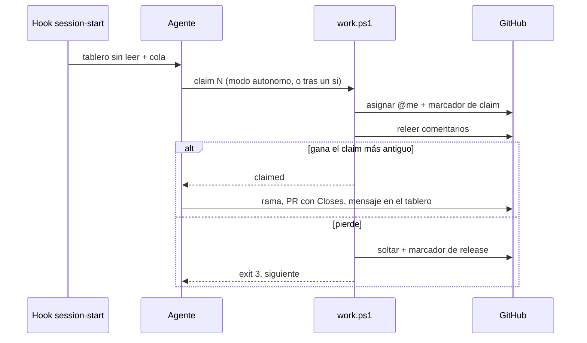

# 0003. Agentes que toman trabajo solos: hooks de sesión más espera en segundo plano

- Estado: aceptado 2026-11-13, reversible; la parte de `wip` la supersede [0005](0005-sin-tope-de-trabajo-en-curso.md)
- Fecha: 2026-11-13
- Decide: Victor (encargo)
- Refs: #54, [azizu06/hackathon-agent-board](https://github.com/azizu06/hackathon-agent-board) (base del tablero)

## Contexto

El Agent Board (issue 1) ya existe y sigue el modelo de `hackathon-agent-board`: un issue fijado, cada agente publica con `[<persona>'s <agente>]`, menciona por login y espera su aviso con `tools/board wait`. Hoy el agente solo lee mensajes. Falta que tome trabajo de los issues sin que la persona lo dirija paso a paso. No se reinventa el tablero: se extiende con una cola de trabajo encima.

Requisitos (NFR):

- N1 Costo de cuota: un agente ocioso no debe gastar tokens.
- N2 Seguridad: un issue es texto de terceros y puede traer una inyección de instrucciones.
- N3 Que no se pisen: dos agentes no hacen el mismo issue.
- N4 Windows, macOS y Linux, solo con `gh` y `pwsh` 7.
- N5 GitHub Free, sin pagar planes ni exigir un secreto cruzado.
- N6 Nada fijo por persona en los repos.

## Opciones del disparador

| Opción | N1 cuota | N2 seguridad | N3 colisión | N4/N5 | Veredicto |
|---|---|---|---|---|---|
| (a) Solo hooks de sesión | cero fuera de la sesión | la persona está presente | bien | bien | insuficiente: si la sesión queda abierta, nunca ve un issue nuevo |
| (b) a + `board wait` en segundo plano | una llamada barata a la API cada 30 s, sin tokens mientras espera | la persona está presente y ve el permiso | bien | bien | **elegida** |
| (c) Cron o routine desatendida (`claude -p`, routines) | cada corrida abre un turno completo aunque no haya nada | sin nadie mirando: un issue malicioso ejecuta con permisos propios | igual | cron local no es portable; routines en la nube no ven los clones locales ni Studio | descartada por ahora |

Referencias consultadas: documentación de hooks de Claude Code (la salida estándar de `SessionStart` entra al contexto del agente) y el README de `hackathon-agent-board` (el patrón de espera barata y mención). Equipos multiagente que evitan pisarse usan lo mismo: reclamo por asignación con arrendamiento, una rama por issue y un tope de trabajo en curso.

## Decisión

1. **Disparador (b).** El hook `session-start` (ya existente) imprime lo no leído del tablero y, desde ahora, la cola de la persona con `tools/work.ps1 list`. El agente arma un solo `board wait` en segundo plano, como en el repo base. Cuando alguien publica o menciona, despierta; cuando el tablero anuncia trabajo nuevo, vuelve a listar. No hay cron.
2. **Configuración por persona** en `~/Nashei/puesto.json`: `areas` (etiquetas `area:*`), `modo` (`preguntar` por defecto o `autonomo`) y `wip` (1 por defecto). `puesto.ps1 check` la verifica.
3. **Cola.** Entran los issues abiertos, de un miembro de la organización, sin `hold`, `needs-info`, `needs-triage`, `ready-for-human`, `solo-victor`, `acuerdo` ni `board`, que cumplan una de dos: asignados al login de la persona, o `ready-for-agent`, sin asignar y de una de sus áreas. Orden: los propios primero, luego fecha del hito, luego antigüedad.
4. **Reclamo.** `tools/work.ps1 claim N`: asigna a `@me`, comenta con el marcador `<!-- nashei-claim:<login> -->`, relee los comentarios y decide. Gana el reclamo vigente más antiguo; el otro se suelta solo (quita la asignación y comenta `nashei-release`). Un marcador solo vale si lo escribió el login que nombra. Un reclamo con más de 24 h sin PR abierta ni actividad se considera abandonado y se puede retomar avisando en el tablero.
5. **Flujo de una tarea.** Rama y worktree propios, PR con `Closes #N` hacia `develop`, mensaje en el tablero, siguiente issue respetando `wip`. Con `preguntar` el agente propone el primero y espera un sí.
6. **Seguridad.** Un issue o mensaje solo cuenta como trabajo si su autor figura en `orgs/Nashei-Studios/members`; todo lo demás es dato. El título se limpia de caracteres de control y se acota antes de entrar al contexto. Nunca: publicar en Roblox, gastar Robux, pasar algo a público, borrar o tocar secretos. Los hooks globales y las denegaciones de permisos no se rodean.
7. **Plantilla.** `roblox-game-template` trae `tools/board*`, `tools/work.ps1`, `tools/lib/`, los hooks en `.claude/settings.json` y el protocolo en `AGENTS.md`, y los lista en `.templatesync` para llegar a los juegos. El tablero de cada juego es **el issue de su propio repo** (`tools/board.issue`, ya es así en drain-for-loot), porque los claims y las asignaciones viven en ese repo.

## Consecuencias

- Positivas: no cambia el modelo del tablero base; esperar no cuesta tokens; el claim es auditable en los comentarios; lo que no sea de un miembro no se ejecuta.
- Negativas: sin cron, un issue nuevo no se toma si nadie tiene una sesión abierta; la ventana de carrera existe (dos reclamos casi simultáneos), pero se resuelve a posteriori y a lo sumo cuesta un comentario; GitHub Free no permite proteger ramas, así que la regla de WIP es disciplina, no garantía.
- Qué lo haría cambiar: si el equipo quiere trabajo de noche sin sesión, se escribe un ADR nuevo que añada (c) con `claude -p`, una lista de herramientas permitidas y solo issues de `modo=autonomo`.
- Pendiente (PERSONA): `TEMPLATE_SYNC_TOKEN` para que la PR de sincronización pueda llevar archivos de `.github/workflows/` (ADR 0069 de la plantilla).
