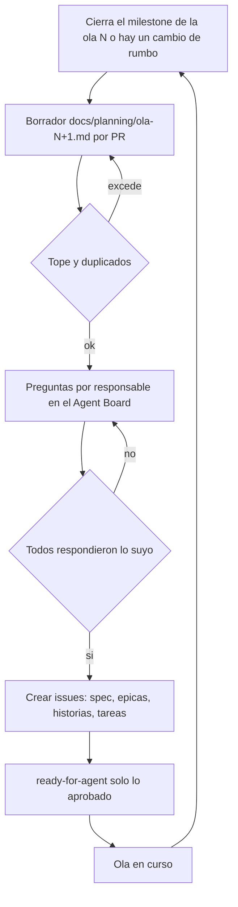

# 0004. Planificación por olas con compuerta de preguntas por responsable

- Estado: aceptado 2026-11-13, reversible
- Fecha: 2026-11-13
- Decide: Victor (encargo)
- Refs: #64, [ADR 0001](0001-una-sola-fuente-para-el-grill.md), [ADR 0003](0003-agentes-que-toman-trabajo-solos.md)

## Contexto

Un juego puede llegar a miles de issues a lo largo de su vida. La fase 3 de `grill-de-juego` generaba spec, épicas, historias y tareas de una vez (30 a 60 historias) y las creaba sin preguntarle a nadie por área. Eso falla de tres maneras: el detalle de lo lejano se vuelve viejo antes de usarse, el agente decide cosas de arte o de sistemas que le tocan a una persona, y cada persona mira solo su parte sin ver monetización, retención, FTUE, rendimiento y crecimiento del juego completo.

Requisitos (NFR):

- N1 Calidad del backlog: lo que se programa está claro y no caduca.
- N2 Carga de preguntas: cada persona responde poco y solo lo suyo.
- N3 No pisarse: dos agentes o dos personas no deciden lo mismo, ni se reescribe lo ya aprobado.
- N4 Minutos de CI: ningún disparo extra por cada issue.
- N5 Tokens: el agente no relee todo el backlog en cada turno.
- N6 Nada fijo por persona en las skills.

## Opciones

| Opción | N1 calidad | N2 carga de preguntas | N3 no pisarse | N4 CI | N5 tokens | Veredicto |
|---|---|---|---|---|---|---|
| A. Todo detallado al grill (comportamiento anterior) | baja: tareas de la ola 5 escritas hoy caducan | una sola ronda enorme | el agente decide por todos | un PR de docs | un turno gigante | descartada |
| B. Olas (rolling wave) sobre un mapa de historias, con compuerta por lote | alta: detalle solo de la ola viva | rondas chicas, 3 a 7 preguntas por persona | aprobación por responsable y por issue | un PR de docs por ola | se lee la ola, no el backlog | **elegida** |
| C. Solo épicas, y preguntar al reclamar cada tarea | media | miles de interrupciones sueltas, sin vista global | cada agente pregunta lo suyo y nadie ve el conjunto | cero | cero | descartada |

Fuentes consultadas. Rolling wave: lo cercano se detalla y lo lejano queda grueso hasta saber más ([Wikipedia](https://en.wikipedia.org/wiki/Rolling-wave_planning)). Story mapping: la columna vertebral de actividades del jugador y cortes horizontales hacia versiones, empezando por un esqueleto andante de punta a punta ([Jeff Patton](https://jpattonassociates.com/the-new-backlog/)). Jerarquía: GitHub admite hasta 100 sub-issues por padre y 8 niveles ([documentación de GitHub](https://docs.github.com/en/issues/tracking-your-work-with-issues/using-issues/adding-sub-issues)). La unión de olas con el mapa es una síntesis propia, no una receta publicada.

## Decisión

1. **Jerarquía:** spec, épica (un frente del juego), historia (valor para el jugador, criterios Dado/Cuando/Entonces), tarea (una sola persona o agente, M o menos). Se enlazan con sub-issues nativos. La profundidad útil son tres niveles, muy por debajo de los 8 de GitHub; el tope de 15 hijos por padre queda muy por debajo de los 100.
2. **Olas.** Una ola es un milestone `Ola N` (con `due_on`). La ola en curso se detalla hasta la tarea. Las siguientes quedan como épicas e historias sin tareas. Al cerrar el milestone de la ola N se refina la N+1 con lo que se midió. Las olas no son iteraciones: una ola dura varias iteraciones semanales.
3. **Campos del Project:** Etapa, Área, Prioridad, Tamaño, Iteración y Responsable. En los Project ya plantados Área es el campo `Carril` y Responsable es el asignado nativo; la definición está en `planificacion.campos` de `config/ecosistema.json`. Renombrar `Carril` a `Área` en la plantilla de Project es un cambio de `github-integrado` y queda como pendiente.
4. **Personas y roles en el config** (`personas`): login, rol, áreas y foco. Nande figura `por-definir`: no recibe preguntas de área ni se le asume rol hasta que lo diga. Un área sin responsable no se asigna a nadie por defecto: la pregunta va a todo el equipo y no se crean sus issues hasta que alguien la tome.
5. **Compuerta antes de cada lote** (skill `planificar-ola`): borrador en `docs/planning/ola-N.md` por PR; por responsable, 3 a 7 preguntas cerradas en el Agent Board, con opciones, recomendación y qué se pierde, y al menos una de impacto global (monetización, retención, FTUE, rendimiento o crecimiento). Solo con respuestas se crean los issues; solo lo aprobado pasa a `ready-for-agent`. Un issue que cruza áreas se pregunta a los dos responsables y necesita los dos sí.
6. **Topes por lote:** 40 issues en total, 25 tareas detalladas como máximo y 15 sub-issues por padre (`planificacion` del config, verificados con `ecosistema.mjs lote`). Razones: 7 preguntas por persona agrupan unos 6 issues cada una (7 × 6 ≈ 40); 25 tareas es lo que tres personas con `wip` 1 consumen en una ola de una a dos semanas; 15 hijos mantiene cada épica legible. Con 40 por lote, 5.000 issues son unas 125 olas: el tope no frena, obliga a refinar.
7. **Re-planificación:** una sesión de beta testing, una reunión o un cambio de rumbo producen una propuesta de ajuste (sección Ajustes de `ola-N.md`) con preguntas. Un issue aprobado solo cambia con un sí del responsable; el agente nunca lo reescribe solo.
8. **Duplicados:** antes de crear, búsqueda por palabras clave en abiertos y cerrados, y contra el propio borrador.

## Consecuencias

- Positivas: el backlog lejano no caduca; cada persona responde poco y solo de lo suyo; la visión global es una pregunta obligatoria, no una buena intención; cero minutos de CI por issue (solo el PR de docs de la ola); el agente lee una ola, no miles de issues.
- Negativas: si alguien no responde, su parte del lote espera (no responder no es aprobar); un refinamiento por ola cuesta una ronda de preguntas aunque nada haya cambiado; hay que mantener el config al día cuando Nande defina su rol; Área sigue llamándose `Carril` en los Project actuales.
- Qué lo haría cambiar: si las rondas pasan de 30 minutos por persona de forma sostenida, bajar el tope por lote; si el equipo crece a más de seis personas, pasar de un borrador por ola a un borrador por frente.
- Pendiente (PERSONA): confirmar las opciones del campo Etapa en la primera ola; Nande define su rol y se actualiza `personas.nande`.
