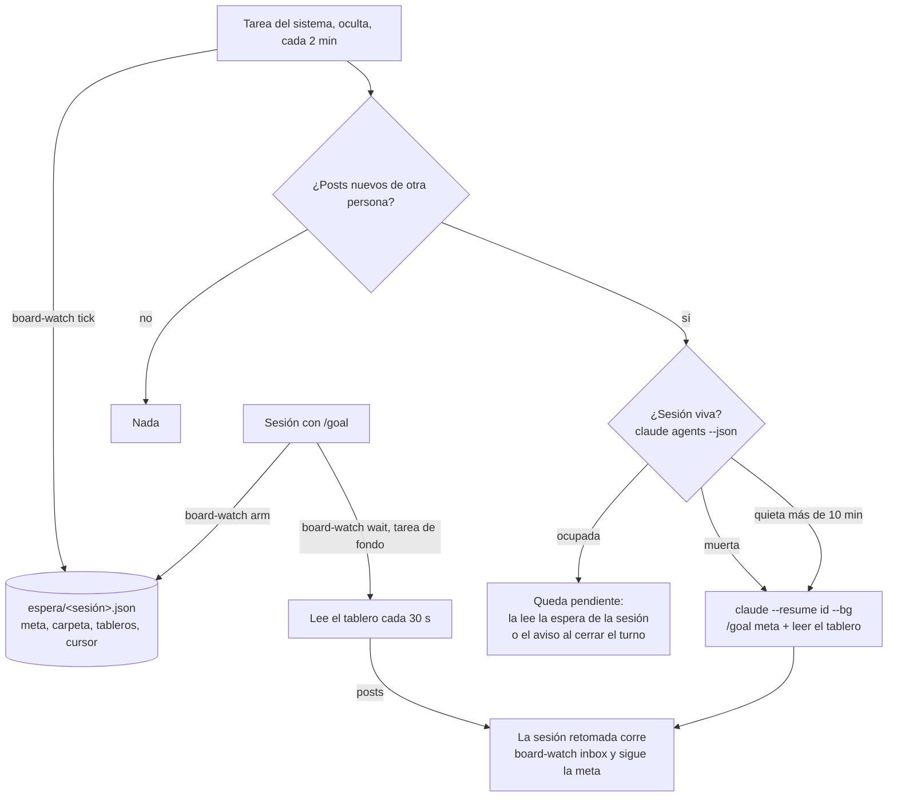

# 0007: La espera del tablero vive fuera de la sesión

- **Estado:** aceptado (ley de Victor del 14-11-2026; el mecanismo se explicó al equipo en studio#1)
- **Fecha:** 2026-11-14
- **Relacionados:** studio#161, [0003](0003-agentes-que-toman-trabajo-solos.md), [0006](0006-regla-de-ramas-en-los-hooks-de-git.md), `docs/como-trabajamos.md`

## Contexto

Una sesión con `/goal` deja corriendo `tools/board.ps1 wait` como tarea de fondo. Esa tarea avisa cuando alguien del equipo responde en el tablero (studio#1) o en el hilo de un juego. El 14-11 el sistema la mató por falta de memoria y las tres decisiones `needs-team` quedaron sin aviso. La espera, al vivir dentro de la sesión, muere con ella: falta de memoria, corte de la sesión, límite de 5 h, compactación o la noche.

Victor lo fijó como ley: con una meta activa, el aviso de que alguien respondió no puede morir.

Medido antes de decidir (Claude Code 2.1.325, Windows 11):

| Hecho | Cómo se midió |
|---|---|
| `claude agents --json` lista las sesiones vivas con `sessionId`, `pid` y `status` (`busy` o `idle`), sin turno de modelo | corrida directa |
| `claude --resume <id> --bg "<mensaje>"` retoma una sesión terminada en segundo plano, con su mismo id y su historia | sesión de prueba con Haiku: las dos respuestas quedaron en la misma transcripción |
| Si esa sesión ya está viva, el mismo comando abre una copia con la historia y lo dice | segunda corrida sobre la sesión anterior |
| Un mensaje inicial `/goal <texto>` deja la meta activa en la sesión retomada | la transcripción muestra `Goal set` y el hook de Stop |
| `--bg` se niega en una carpeta sin confianza (`Workspace not trusted`) | corrida en una carpeta temporal y en el clon de studio |

## Opciones evaluadas

| Opción | Sobrevive a la muerte de la sesión | Costo | Sirve a todo el equipo | Qué se pierde |
|---|---|---|---|---|
| A. Tarea del programador del sistema que consulta la API de GitHub y retoma la sesión | sí | 0 tokens por consulta; 1 llamada por tablero cada 2 min | sí (Programador de tareas, launchd, systemd) | hay que instalarla una vez por equipo; no despierta un computador suspendido |
| B. Cron de JARVIS con `selfWake` | sí | un turno de modelo por pasada si el cron pide criterio; sin turno, es la opción A con otro programador | no: JARVIS solo existe en el equipo de Victor | Leon queda fuera |
| C. Workflow de `issue_comment` que notifica | el aviso sale de GitHub, pero no llega a un proceso local sin un runner propio o un canal de mensajes | al menos 1 minuto de Actions por comentario del tablero, que recibe decenas al día | sí | minutos del plan Free; igual hace falta algo local que retome la sesión |
| D. `Monitor`, `ScheduleWakeup` o cron de la sesión | no: mueren con la sesión, y los cron de sesión no disparan con un turno abierto (medido el 8-11) | 0 | sí | es el problema que se quiere resolver |

Los límites de la API alcanzan de sobra: 5.000 peticiones por hora con sesión iniciada ([límites de la API REST](https://docs.github.com/en/rest/using-the-rest-api/rate-limits-for-the-rest-api)) contra 30 por hora y por tablero de esta espera. Los minutos de Actions de un repo privado se descuentan del plan ([facturación de Actions](https://docs.github.com/en/billing/concepts/product-billing/github-actions)).

## Decisión

Opción A, con la espera de la sesión como primera línea.

- **Registro.** `tools/board-watch.ps1 arm` guarda la sesión, la meta, la carpeta y los tableros en `~/Nashei/estado/espera/<sesión>.json`. El cursor de esta espera es propio y no toca el de `tools/board`.
- **Pasada (`tick`).** La corre el programador del sistema cada 2 minutos, sin ventana. Lee los comentarios nuevos con `gh api`. Si hay posts de otra persona, mira si la sesión vive. Una sesión ocupada no se toca. Una sesión muerta, o quieta más de 10 minutos con posts sin leer, se retoma con `claude --resume <id> --bg`.
- **Qué recibe la sesión retomada.** `/goal <meta> (al retomar, corre una vez: <board-watch.ps1 inbox>)`. El texto de los posts nunca entra en el mensaje: se lee con `inbox`, con tope y entre marcadores, igual que el resto del tablero (#108). La meta viaja tal como la escribió la persona, más un único paso que se hace una vez. En la primera prueba real el mensaje pedía además "dejar la espera corriendo": eso pasó a ser parte de la condición de cierre, chocó con la meta y la sesión quedó dando vueltas. Por eso el recordatorio de relanzar la espera sale en la salida de `inbox` y no en la meta.
- **Sesión viva y ocupada.** La lee su propia espera (`board-watch.ps1 wait`). Si esa espera murió, el hook de cierre de turno frena el cierre una vez y pide correr `inbox`.
- **Freno.** Un reintento cada 30 minutos y 6 como máximo por tanda de posts. Una espera caduca a las 72 horas si nadie la renueva.
- **Instalación.** `board-watch.ps1 install` registra la tarea: Programador de tareas con `wscript.exe` y `run-hidden.vbs` en Windows, `launchd` en macOS, `systemd --user` o `crontab` en Linux. `puesto.ps1 check` muestra si está.

## Prueba de punta a punta (14-11-2026, Windows 11)

1. Sesión de fondo con Haiku, espera armada sobre un issue de prueba (studio#166).
2. `claude stop` sobre la sesión: `claude agents --json` dejó de listarla.
3. Comentario de prueba en el issue.
4. La tarea `Nashei Board Watch` corrió oculta (6 ventanas visibles antes y después) y terminó con 0. Su registro: `action: wake`, `exit: 0`, "woke session 99bde4bb with its saved options".
5. La transcripción de la sesión retomada muestra `Goal set`, la llamada a `board-watch.ps1 inbox` y el texto del comentario entre marcadores.

La primera corrida falló y dejó dos arreglos: `ConvertFrom-Json` convierte las fechas ISO en `DateTime`, y la consulta a GitHub salía con la fecha en formato local (la pasada quedaba colgada); y el mensaje de retomada, descrito arriba.

Las pruebas automáticas (`tools/tests/board-watch.test.ps1`) simulan GitHub y Claude Code, matan el proceso de la espera y comprueban que la pasada retoma la sesión. En macOS y Linux se prueba la forma de lo que `install` registra; la instalación real solo se corrió en Windows.

## Consecuencias

- Positivo: la espera ya no depende de la sesión. Una pasada no gasta tokens y la sesión solo se retoma cuando hay algo que leer.
- Positivo: la misma herramienta sirve en los tres sistemas y para el agente de cada persona.
- Negativo: la sesión retomada corre en segundo plano con el modo de permisos que tenga la persona en su configuración. Se ve y se toma con `claude agents` y `claude attach`.
- Negativo: una sesión viva pero quieta se retoma como copia. Si la persona vuelve a la ventana original, hay dos conversaciones con la misma historia; la copia es la que siguió.
- Negativo: un computador suspendido o apagado no corre la tarea. La tarea no lo despierta, a propósito: despertarlo cada 2 minutos gasta batería.
- Negativo: sin cuota, la sesión retomada falla hasta el reinicio. Los 6 reintentos cada 30 minutos cubren 3 horas; el relevo por cuota sigue siendo de JARVIS.
- Negativo: la carpeta de la sesión tiene que ser de confianza para Claude Code, o `--bg` se niega. `tick` lo deja escrito en su registro.

## Qué haría cambiar esta decisión

- Que Claude Code ofrezca enviar un mensaje a una sesión viva desde fuera: la copia dejaría de hacer falta.
- Que GitHub entregue eventos a un proceso local sin runner ni minutos.
- Que la tarea cada 2 minutos se note en el equipo de alguien: el intervalo es un parámetro de `install`.
