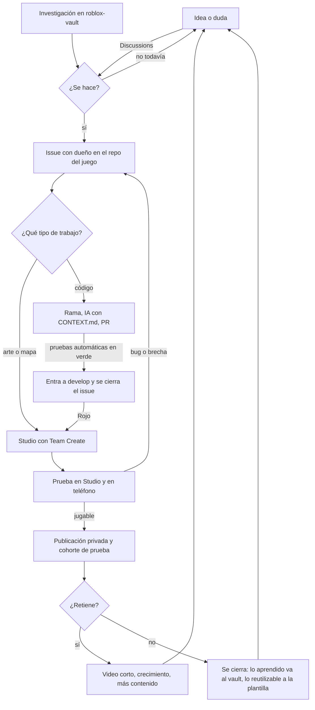

# Cómo funciona el sistema completo

Una vuelta entera, desde que alguien tiene una idea hasta que se decide si el juego sigue.

## Las piezas y quién las mueve

| Pieza | Qué hace | Quién |
|---|---|---|
| Discussions | Ideas, gustos, preguntas | Todos |
| Issues | Una tarea, un dueño, un criterio de listo | Quien la toma |
| Agent Board | Avisos: avance, bloqueo, traspaso. La mención con `@` es lo que notifica | Personas y agentes |
| Project de la organización | Tablero con todo, por estado | Se llena solo con los issues |
| `roblox-vault` | Referentes medidos, decisiones, qué se aprendió de cada juego | Se lee antes de decidir; lo actualiza el sistema de investigación |
| `roblox-game-template` | De aquí nace cada juego. Trae guardado, tienda, UI, pruebas y el flujo de equipo | Victor y sus agentes; todos proponen |
| Studio con Team Create | Arte y mapa, en vivo entre los tres | Nande y Leon, con Victor |
| Rojo | Lleva el código de Git a Studio. Qué se ve en vivo y qué va por ramas: [en-vivo-y-ramas.md](en-vivo-y-ramas.md) | Una persona a la vez: Victor en la place del grupo |
| CI | Revisa formato, tipos y pruebas en cada PR; al verde, mergea | Automático |
| Notion | La misma información, para leer | Automático (espejo) |
| Drive | Kits, video, audio | Quien sube deja la nota en el vault |

## Lo que hace el sistema solo

- Mide a diario el mercado de Roblox y deja el snapshot en el vault.
- Al empezar un frente de un juego (música, UI, economía, mundo) compara lo que hacen los referentes con lo que tiene el juego y abre los issues de las brechas.
- Revisa cada PR con pruebas y la mergea si pasa.
- Copia los issues a Notion (cuando el token esté conectado).

## Lo que solo hace una persona

- Publicar el juego y hacerlo público.
- Gastar Robux o pagar anuncios.
- Invitar gente y dar permisos.
- Decidir si un juego se cierra.

## Un día normal

1. Abres el Agent Board y lees lo nuevo. Si te mencionan, respondes.
2. Miras el Project: qué tienes tomado y qué está libre.
3. Trabajas en lo tuyo. Si llevas trabado más del tiempo acordado, escribes `[bloqueo]`.
4. Al terminar, `[avance]` con el número del issue y qué sigue.
5. Una vez por semana, 10 minutos entre los tres: qué se atrasó y qué entra.
