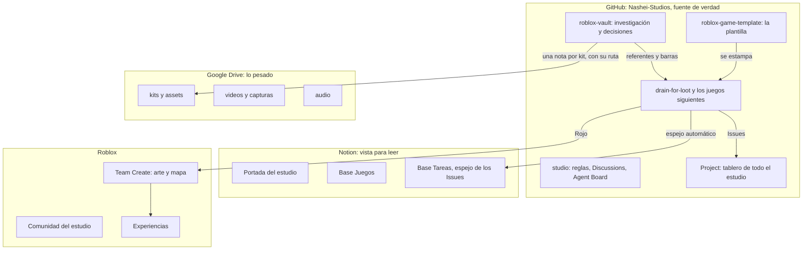

# Mapa del ecosistema

Qué vive dónde. La regla: **GitHub es la fuente de verdad, Notion la muestra, Drive guarda lo pesado.** Nada importante vive solo en el computador de una persona.

## Qué va en cada lugar

| Cosa | Dónde | Por qué |
|---|---|---|
| Código de un juego | Repo del juego | Historial, revisión por PR, pruebas automáticas |
| Tareas | Issues del repo del juego | Una tarea, un dueño, se cierra con la PR |
| Ideas, dudas, gustos | Discussions (`studio` para todo el estudio, el repo del juego para ese juego) | No todo es una tarea |
| Avisos entre personas y agentes | Agent Board (issue fijado) | Un solo buzón; la mención dispara la notificación |
| Estado de todo | Project de la organización | Un solo tablero |
| Investigación, referentes, decisiones | `roblox-vault` | Se lee antes de opinar sobre un juego |
| Sistemas reutilizables | `roblox-game-template` | Lo que un juego resuelve vuelve a la plantilla |
| Arte y mapa | Studio con Team Create, modelos como Package | No se versiona bien en Git |
| Kits, modelos, texturas, audio, video (archivos grandes) | Google Drive del estudio | Git no sirve para gigas; el vault guarda la nota y la ruta |
| Vista cómoda para leer | Notion | Para quien no vive en GitHub |

## Lo pesado: Drive

Todo lo que pesa vive en la carpeta de Drive del estudio, como un zip por paquete más un `manifest.json` con el hash de cada uno. Cada persona tiene su copia local y la herramienta `tools/kits.ps1` la deja igual a la del Drive. Guía completa: [drive.md](drive.md).

| Carpeta del Drive | Qué tiene (2026-11-11) |
|---|---|
| `10-kits` | 36 paquetes: modelos, UI, íconos, audio, vaults de referencia. Cada uno con su nota en `roblox-vault/kits/` |
| `20-investigacion` | 4 paquetes de material de investigación (videos y subtítulos de referentes) |
| `50-arte` | Fuentes `.blend` del repo `art` |
| `LibreriaRbx` | La biblioteca original del equipo, en carpeta; su copia empaquetada es `10-kits/libreria-rbx.zip` |
| `30-video`, `40-audio`, `60-legacy`, `70-redes`, `90-archivo` | Vacías, con su lugar reservado |

Estado: **funciona**. Subir y bajar verifican el hash. Lo que no garantiza: Drive guarda solo la última versión de cada paquete, y la cuota es la de quien sube.
## Automatizaciones

| Qué | Cómo | Estado |
|---|---|---|
| Merge al verde, cierre de issues, borrado de ramas | Workflows de la plantilla (`ci.yml`, automerge) | Funciona en los repos estampados |
| Release con changelog | `release.yml` de la plantilla | Funciona |
| Issues y PR hacia Notion | `notion-mirror.yml` en cada repo (al instante) y `notion-sync.yml` en `studio` (repaso cada 30 minutos de toda la organización) | Funciona en `studio`, `drain-for-loot` y `project-template`. El repaso central solo ve repos públicos hasta que exista el secreto `GH_READ_TOKEN` |
| Aviso de mensajes nuevos al abrir Claude Code y en cada pedido | Hooks de `.claude/settings.json` que llaman a `tools/board-hooks/board-hook.ps1` | Funciona solo al clonar: `studio`, `drain-for-loot`, `roblox-game-template`, `project-template` y `art` |
| Radar de mercado diario | Colector del vault (corre en el computador de Victor) | Funciona |

## Skills y herramientas de IA compartidas

Las skills de Roblox que usa Victor (análisis por frentes, UI, monetización, publicación, Studio por MCP) viven hoy en su configuración personal. Las comunes están en el repo `claude-toolkit` (28 skills); se instalan copiando la carpeta de la skill a `.claude/skills/`. Falta convertirlo en un marketplace de un comando (issue #9).

## El mismo sistema en todos los repos

| Pieza | Cómo queda igual en todos | Estado |
|---|---|---|
| Ramas | `develop` por defecto con squash; `main` solo recibe releases | Plantado en `drain-for-loot`, `roblox-game-template` y `plus-one-mining` |
| CI, automerge y release | Workflows de la plantilla; cada juego los hereda al estamparse | Funciona; Actions ya puede crear PR en toda la organización |
| Project | Uno global y uno por repo, con el mismo ciclo (Backlog, Listo, En curso, En revisión, Verificación, Hecho), campos (Prioridad, Carril, Tamaño, Puntos, Iteración, Inicio, Objetivo) y diez vistas | Plantado en los cuatro con `plant-project.mjs` |
| Equipos | `todos` (escritura en todos los repos), `dev`, `arte` | Creados |
| Tablero de agentes | Issue fijado más `tools/board` y sus hooks | En `studio` y `drain-for-loot` |
| Etiquetas | `owner:*`, `agent`, `handoff`, `art`, `hold`, `board`, `acuerdo` | En `drain-for-loot`; falta copiarlas al resto |

### Protección de `main`: qué se puede y qué no

GitHub no permite reglas de protección de ramas ni rulesets en repos **privados** de una organización gratis. Se probó el 2026-11-11: la API responde que hay que pagar o hacer público el repo. En el único repo público (`.github`) la regla sí quedó activa.

Lo que protege `main` en los repos privados:

- Nadie trabaja en `main`: la rama por defecto es `develop` y `main` solo la toca el workflow de release.
- Todo entra por PR con CI; el merge lo hace el automerge, no una persona.
- CODEOWNERS pide la revisión del dueño de cada carpeta.

Lo que **no** se puede garantizar: que alguien con permiso de escritura no empuje directo a `main`. Opciones: dejarlo así (recomendado mientras son tres), o hacer públicos los repos que no tengan nada privado, donde la regla sí aplica. Los tres miembros son hoy Owner de la organización; con ese rol cualquier regla se puede saltar.

### Pasos que solo existen en la interfaz

En cada Project, una vez: columna del tablero por Status (y por Carril en "Por carril"), fechas del roadmap con Inicio y Objetivo, límite de trabajo en "En curso", y los workflows integrados (ítem agregado a Backlog, PR enlazada a En revisión, cerrado a Hecho, auto-archivo, auto-agregar issues del repo).

## Ids y nombres: una sola fuente

Los ids de las bases de Notion, las carpetas de Drive, los repos y el grupo de Roblox viven en [`config/ecosistema.json`](../config/ecosistema.json) y nada más los escribe. `node scripts/ecosistema.mjs validate` lo comprueba contra su schema y `node scripts/ecosistema.mjs discover` los busca de nuevo por nombre y avisa si alguno cambió. Cómo se usa en una reunión: [reuniones.md](reuniones.md).
