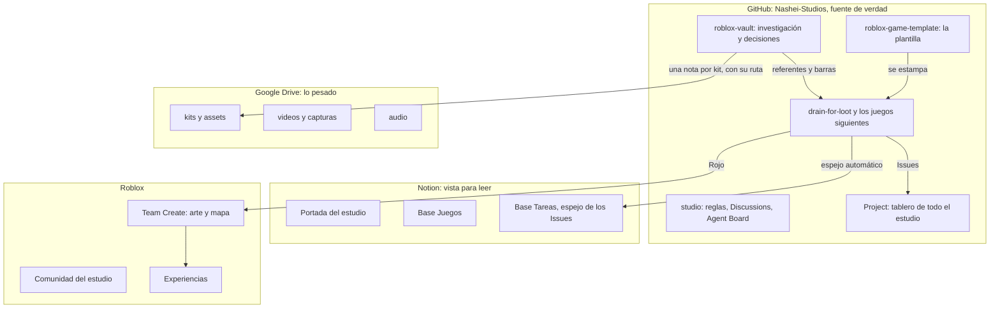

# Mapa del ecosistema

Qué vive dónde. La regla: **GitHub es la fuente de verdad, Notion la muestra, Drive guarda lo pesado.** Nada importante vive solo en el computador de una persona.

## Qué va en cada lugar

| Cosa | Dónde | Por qué |
|---|---|---|
| Código de un juego | Repo del juego | Historial, revisión por PR, pruebas automáticas |
| Tareas | Issues del repo del juego | Una tarea, un dueño, se cierra con la PR |
| Ideas, dudas, gustos | Discussions (`studio` para todo el estudio, el repo del juego para ese juego) | No todo es una tarea |
| Avisos entre personas y agentes | Agent Board (issue fijado) | Un solo buzón; la mención dispara la notificación |
| Estado de todo | Project de la organización | Un solo tablero |
| Investigación, referentes, decisiones | `roblox-vault` | Se lee antes de opinar sobre un juego |
| Sistemas reutilizables | `roblox-game-template` | Lo que un juego resuelve vuelve a la plantilla |
| Arte y mapa | Studio con Team Create, modelos como Package | No se versiona bien en Git |
| Kits, modelos, texturas, audio, video (archivos grandes) | Google Drive del estudio | Git no sirve para gigas; el vault guarda la nota y la ruta |
| Vista cómoda para leer | Notion | Para quien no vive en GitHub |

## Lo pesado: Drive

Hoy la biblioteca de kits está en el computador de Victor (`D:\Victor\Roblox\kits`, con su `INDEX.json`). Para que el equipo la tenga:

1. Carpeta compartida `Nashei Studios` en Google Drive con `kits/`, `video/`, `audio/` y `capturas/`.
2. La estructura de `kits/` replica el `INDEX.json`: una carpeta por kit, mismo nombre que la nota en `roblox-vault/kits/`.
3. Cada nota de kit en el vault lleva la ruta de Drive, la licencia y el hash del archivo.
4. Se sincroniza con `rclone` (libre) desde el computador que tiene la biblioteca. Nadie sube archivos sueltos sin su nota.

Estado: **pendiente**. Falta que Victor cree la carpeta compartida y autorice `rclone` una vez. Issue en este repo.

## Automatizaciones

| Qué | Cómo | Estado |
|---|---|---|
| Merge al verde, cierre de issues, borrado de ramas | Workflows de la plantilla (`ci.yml`, automerge) | Funciona en los repos estampados |
| Release con changelog | `release.yml` de la plantilla | Funciona |
| Issues hacia Notion | `notion-mirror.yml` de la plantilla | Apagado hasta tener el token y la base (ver [notion.md](notion.md)) |
| Aviso de mensajes nuevos al abrir Claude Code | Hooks de `tools/board-hooks/` | Lo activa cada persona en su copia |
| Radar de mercado diario | Colector del vault (corre en el computador de Victor) | Funciona |

## Skills y herramientas de IA compartidas

Las skills de Roblox que usa Victor (análisis por frentes, UI, monetización, publicación, Studio por MCP) viven hoy en su configuración personal. Para que los tres tengan las mismas, el plan es publicarlas como un marketplace de plugins de Claude Code en un repo de esta organización, que cada persona instala con un comando. Estado: **pendiente**, issue en este repo.
