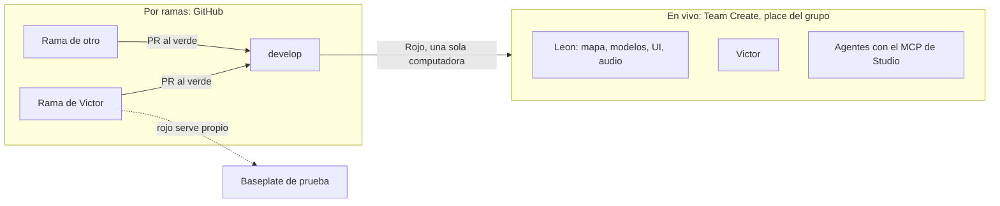

# Qué se ve en vivo y qué va por ramas

**En una frase:** lo que se construye en Studio (mapa, modelos, UI hecha a mano, luces) lo vemos todos al mismo tiempo. El código no: vive en GitHub, cada uno lo escribe en su rama y entra a Studio con Rojo, desde una sola computadora.

## Lo que vemos al mismo tiempo

Abrir la place del grupo desde Studio (Archivo, Abrir desde Roblox, pestaña del grupo) es entrar a la misma sesión de Team Create. El panel "Colaboradores en vivo" muestra quién está conectado.

| Qué | ¿Lo ve el otro en vivo? | Detalle |
|---|---|---|
| Terreno, partes, modelos, Packages | Sí, apenas lo cambias | Es lo normal para mapa y arte |
| UI armada a mano (ScreenGui, Frames) | Sí | |
| Luces, `Atmosphere`, cielo, efectos | Sí | Lo que lee el código (como la densidad de la `Atmosphere`) se avisa antes en el tablero |
| Configuración de experiencia (permisos, acceso a API) | Sí, después de apretar Guardar | |
| Scripts | Los ves, pero **no se editan en Studio** | Rojo los pisa en la siguiente sincronización y el cambio nunca llega a GitHub |

Team Create guarda la place solo cada pocos minutos. Los jugadores no ven nada hasta que alguien publica, y publicar lo decide Victor.

## Lo que no se ve en vivo: el código

- Cada uno programa en **su rama** (`feat/<tarea>`), en su computadora. El otro no ve nada hasta que la PR pasa el CI y entra a `develop`. Las PR son chicas y se mergean el mismo día, así nadie se queda atrás.
- **Una sola computadora conecta Rojo a la place del grupo: la de Victor.** Con dos Rojo conectados a la misma place, uno pisa al otro. Mientras el juego es privado, lo que se lleva es `develop`. Cuando sea público, la versión publicada sale de `main` por release.
- Para probar tu rama: un Baseplate propio con tu `rojo serve`. Nunca la place del grupo.
- Para programar juntos en vivo: **VS Code Live Share**. Uno comparte su VS Code, los dos editan los mismos archivos en la rama de quien comparte, y ese hace el commit.

## Para Leon, en concreto

1. Mapa, modelos, UI y audio van en la place del grupo, con Team Create. Lo que haces lo vemos al instante, y tú ves lo nuestro.
2. Antes de tocar una zona que otro usa o que el código lee, avisas en el tablero con su issue. Ya lo haces: sigue igual ([flujo-arte-y-avisos.md](flujo-arte-y-avisos.md)).
3. No conectes Rojo a la place del grupo y no edites scripts en Studio.
4. Lo que se construye con un script (por ejemplo la bahía de drain-for-loot#61) entra al repo por PR. Así cualquiera puede rehacerlo igual.
5. El trabajo nuevo va a la place del grupo. Tu place personal no se toca ni se borra: queda como archivo.

## Para los agentes

- Un agente que maneja la place del grupo con el MCP de Studio cuenta como una persona más en Team Create: avisa la zona en el tablero antes de tocarla.
- En los repos de juego, `rojo serve` y el MCP de Studio solo corren con el candado `.studio.lock` del worktree (`docs/multi-agent.md` de la plantilla).

## Acceso de Studio a los servicios API

Está activado en la experiencia del grupo desde el 13-11-2026. Las pruebas en Studio leen y escriben los **datos reales** de la experiencia (DataStores). Hoy el código del juego no separa los datos de Studio de los de producción, así que todo lo que se gane o se gaste en una prueba queda guardado. Mientras el juego es privado no hay riesgo. Antes de abrirlo al público se separan esos datos o se apaga el acceso.
