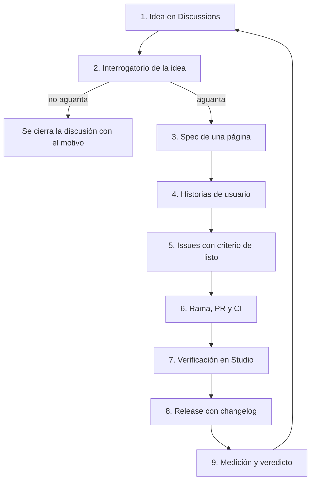

# Flujo de trabajo: de la idea al changelog

Vale para todos los repos de la organización. Cada paso deja algo escrito en GitHub; nada se decide solo en una llamada.

## Partir un juego: el grill

Antes de eso, cuando todavía no se sabe qué juego hacer, va el [grill inicial](../plantillas/grill-inicial.md): el agente trae la foto de mercado, los legacy y las ideas del vault; el grupo compara candidatos con una matriz, elige uno y fija la dirección de cada frente (arte, UI, loop, música, crecimiento). De ahí sale una decisión en el vault y el candidato pasa al grill de juego.

Un juego nuevo no parte escribiendo issues. Parte con un solo documento, el grill de juego (`docs/game/grill.md` de `roblox-game-template`, [ADR 0001](adr/0001-una-sola-fuente-para-el-grill.md)): un agente lo deja prellenado con la investigación, el grupo lo responde en una reunión y de sus respuestas el agente genera el spec, las épicas, las historias, los issues, el Project y la fila de Notion (skill `grill-de-juego` de `claude-toolkit`). Los pasos de abajo son el mismo camino para una idea suelta dentro de un juego que ya existe.

Cómo se prepara, conduce y procesa cada reunión (grabación, acta, decisiones, abiertos): [reuniones.md](reuniones.md).

### Tres tamaños de grill

| Grill | Cuándo | Quién | Sale |
|---|---|---|---|
| [Inicial](../plantillas/grill-inicial.md) | No se sabe qué juego hacer | El grupo, 90 a 120 min | Decisión y candidato |
| De juego (`docs/game/grill.md` del juego) | Juego elegido, antes de construir | El grupo, 60 a 90 min | Spec, épicas, historias, issues, Project |
| [De sesión](../plantillas/grill-de-sesion.md) | Cada vez que alguien se sienta a trabajar | Persona y agente, 5 a 10 min | Plan en el issue; el issue pasa a En curso |

## 1. Idea

Categoría **Ideas** de Discussions. Formato libre, una idea por discusión. Etiqueta `tipo:idea`.

## 2. Interrogatorio de la idea

Antes de gastar una hora de trabajo, la idea se interroga con todo el equipo en la misma discusión. Lo conduce el agente de quien la propuso, con una pregunta por comentario, hasta que no queden respuestas vagas. Preguntas mínimas:

| # | Pregunta | Se responde con |
|---|---|---|
| 1 | ¿Qué hace el jugador en los primeros 10 segundos? | Una frase |
| 2 | ¿Por qué volvería mañana? | Un motivo concreto |
| 3 | ¿Qué se ve en los primeros 3 segundos de un video? | Una imagen descrita |
| 4 | ¿Quién ya lo hace y cómo le va? | Referentes medidos del vault, con cifra y fecha |
| 5 | ¿Qué tenemos ya en la plantilla y qué habría que construir? | Lista |
| 6 | ¿Cabe en 7 a 10 días con tres personas? | Sí, o qué se recorta |
| 7 | ¿Qué dato nos haría abandonarla? | Un umbral |

Se cierra con un comentario de resumen: decisión (sigue, se recorta o se descarta), quién decidió y qué se pierde. Si sigue, la discusión se convierte en issue con "Create issue from discussion".

## 3. Spec de una página

Issue con la plantilla **Spec**: problema, a quién le sirve, qué entra, qué queda fuera, cómo se mide. Etiqueta `tipo:spec`. Es el issue padre.

## 4. Historias de usuario

Sub-issues del spec, plantilla **Historia de usuario**: "Como jugador que..., quiero..., para...". Cada una con criterios de aceptación comprobables (Dado, Cuando, Entonces) y su tamaño. Etiqueta `tipo:historia`.

## 5. Issues

Cada historia se parte en tareas si pasa de tamaño M. Toda tarea tiene dueño, área, prioridad y criterio de listo. Estados: viven en el Project, no en etiquetas.

Nadie mueve tarjetas a mano:

| Estado | Lo pone |
|---|---|
| Backlog | El flujo nativo del Project al agregar el ítem |
| Listo | Quien planifica (el issue tiene dueño o `ready-for-agent`); `work.ps1 release` lo devuelve aquí |
| En curso | `work.ps1 claim` del agente que lo toma |
| En revisión | El flujo nativo del Project al enlazarse la PR |
| Hecho | El flujo nativo del Project al mergear la PR o cerrar el issue |

Los nombres de campo y de estado salen de `github.project_estados` en `config/ecosistema.json`. Un issue sin dueño ni `ready-for-agent` no aparece en la cola de ningún agente.

## 6. Rama, PR y CI

Una rama por issue, PR a `develop` con `Closes #N`. El CI revisa formato, tipos, pruebas y cobertura. Al verde, el automerge la une, cierra el issue y borra la rama. Los commits siguen Conventional Commits, porque de ahí sale el changelog.

### Quién escribe las pruebas

Las pruebas se escriben para romper el código, no para verlo pasar. Si la misma IA escribe el código y sus pruebas, las dos comparten los mismos puntos ciegos. Por eso cada tarea de código pasa por tres roles distintos:

| Rol | Qué hace | Qué no hace |
|---|---|---|
| Orquestador | Parte el issue, reparte y revisa las PR | No implementa |
| Agente que implementa | Escribe el código y sus pruebas unitarias | No escribe las pruebas de aceptación de su propio código |
| Agente de pruebas | Lee solo la historia y sus criterios, y escribe pruebas que buscan que falle: propiedades con entradas aleatorias y entradas mal formadas contra todo lo que recibe datos del jugador | No arregla nada; reporta lo que rompió |

La plantilla ya trae las herramientas (`tests/property/`, `tests/fuzz/`, cobertura mínima de 75 %), así que cada juego las hereda.

### Arreglo urgente en producción (hotfix)

Si algo se rompe en un juego publicado: rama `hotfix/<tema>` desde `main`, PR a `main` con el arreglo mínimo y su prueba, release de parche, y la misma PR se lleva a `develop` el mismo día. Es el único caso en que una rama que no es `develop` entra a `main`.

## 7. Verificación

Lo que cambia cómo se juega se abre como borrador y se prueba en Studio (y en emulador de teléfono) antes de marcarla lista. En el Project pasa por "Verificación" antes de "Hecho".

## 8. Release y changelog

`release.yml` calcula la versión desde los commits, escribe `CHANGELOG.md`, abre la PR de `develop` a `main`, la une, etiqueta la versión y crea el Release en GitHub. Corre a pedido o los lunes si hay cambios.

## 9. Medición y veredicto

Con jugadores reales: retención y tiempo de sesión contra el umbral del equipo. El veredicto (seguir o cerrar) y lo aprendido se escriben en `roblox-vault`.

## Etiquetas

Las mismas en todos los repos.

| Grupo | Etiquetas |
|---|---|
| Tipo | `tipo:idea`, `tipo:spec`, `tipo:historia`, `tipo:tarea`, `tipo:bug`, `tipo:investigación`, `tipo:deuda`, `tipo:docs` |
| Área | `area:código`, `area:ui`, `area:arte`, `area:economía`, `area:audio`, `area:crecimiento`, `area:infra` |
| Dueño | `owner:victor`, `owner:nande`, `owner:leon`, `agent` |
| Triaje | `needs-triage`, `needs-info`, `ready-for-agent`, `ready-for-human` |
| Flujo | `handoff`, `hold`, `keep`, `board`, `acuerdo`, `from-research` |

Prioridad, tamaño e iteración no son etiquetas: son campos del Project.

## Qué hacen los agentes

- Conducen el interrogatorio y escriben el resumen.
- Redactan el spec y las historias desde la discusión, para que una persona los apruebe.
- Toman los issues con `ready-for-agent`, abren la PR y responden en el Agent Board.
- Mantienen el Project al día y avisan lo que se atrasa.

Un agente no decide si una idea sigue, no publica y no gasta: eso es de las personas.
