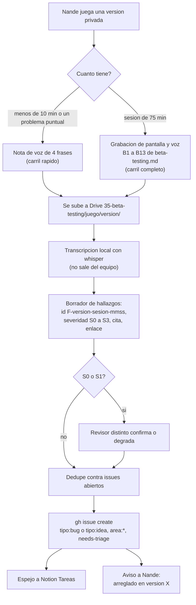
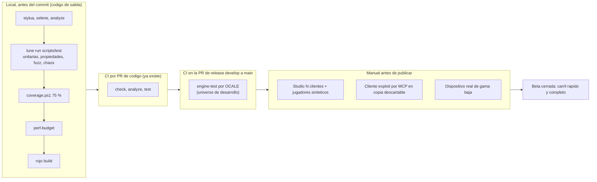

# Arquitectura de pruebas: primero las pruebas, pruebas que rompen, carga y beta testers

Investigación del issue [studio#111](https://github.com/Nashei-Studios/studio/issues/111), parte de la épica #109. Fecha: 2026-11-13. Esto es investigación: no decide nada. Las decisiones van a un ADR o a la persona dueña del área.

## Resumen de una pantalla

1. **El estudio ya está más lejos de lo que parece.** `drain-for-loot` y `roblox-game-template` tienen un gate local con `stylua`, `selene`, `analyze`, `lune run scripts/test`, cobertura de línea al 75 % con el CLI de Luau, `perf-budget` y `docs-check`. Además tienen una capa que rompe: un generador de propiedades propio (`tests/property/Prop.luau`) y un fuzz de cada validador de remotes (`tests/fuzz/RemoteFuzz.test.luau`, ADR 0062). Todo corre en un solo comando y en un solo job de CI.
2. **Lo que falta no es una herramienta nueva, es disciplina y tres huecos.** Disciplina: "pruebas primero" hoy es una frase en el ADR 0005 y en los reels, no un paso del flujo. Huecos: (a) nada prueba el motor real (DataStore, MarketplaceService, ProcessReceipt de verdad); (b) las pruebas que rompen cubren entradas hostiles pero no cortes en mitad de una operación, concurrencia ni conservación de ítems; (c) la carga está descrita en `docs/performance.md` pero todas sus filas dicen "not measured".
3. **Pruebas primero, en concreto.** El criterio de aceptación del issue pasa a ser una prueba escrita antes del código y vista en rojo. Es la línea de Robert C. Martin que Victor guardó en los reels 40 y 58: el código se aprueba porque sobrevive a las pruebas, no porque alguien lo leyó. Cuesta cero minutos de CI extra.
4. **Herramientas de prueba.** Mantener Lune más el CLI de `luau` para lo puro (ya funciona, 0 dependencias). Para el motor, la API de ejecución de Luau de Open Cloud (estable, límites medidos abajo) se puede usar, pero no corre física ni scripts automáticos, así que sirve para adaptadores y no para simular una partida. TestEZ está archivado; Jest-Lua tiene su última versión en diciembre de 2024. Ninguna de las dos gana hoy sobre lo que hay.
5. **Pruebas que rompen.** El catálogo de la sección 5 cruza cada ataque del issue con la capa donde se automatiza. Lo nuevo de mayor valor: inyección de cortes ("crash points") en guardado y compra, y propiedades de conservación de ítems.
6. **Carga.** Roblox no ofrece clientes headless ni bots oficiales (solo peticiones en el DevForum). Lo que hay es Studio con hasta 8 clientes, un conductor de jugadores sintéticos que llame a los mismos handlers, y testers reales. Los límites de DataStore y MemoryStore se pueden calcular con fórmulas oficiales y probar con adaptadores falsos que devuelvan los códigos de error.
7. **Beta testers.** Hay dos procedimientos sin conectar: la guía larga de `docs/game/beta-testing.md` (video, Drive, whisper, hallazgos con minuto) y la línea de `plan-vigente.md` ("Nande deja notas de voz cortas; van a Notion"). Propuesta: dos carriles (nota corta y sesión completa) que terminan en el mismo issue, con una plantilla de cuatro frases para la nota.
8. **CI con minutos limitados.** Nada nuevo corre por PR. Las pruebas del motor corren solo en la PR de release `develop` a `main` (una vez por release) y también se pueden correr en local con la misma llave.

Seis tareas salen de aquí (sección 10).

---

## 1. Qué tiene hoy el estudio

Todo esto se leyó en los repos el 2026-11-13. Las rutas son de `D:\Victor\Repositorios\roblox\games\drain-for-loot` salvo que se diga otra cosa.

| Capa | Qué hay | Dónde | Estado |
|---|---|---|---|
| Estática | `stylua --check .`, `selene .`, `luau-lsp analyze` (solver estable bloqueante, solver nuevo informativo) | `.github/workflows/ci.yml`, `scripts/analyze.ps1` | Activo |
| Unitarias | Suites en Lune, arnés propio, lista explícita de suites | `tests/harness.luau`, `scripts/suites.luau`, `scripts/test.luau` | Activo |
| Cobertura | `luau --coverage` más `coverage_report.luau`, umbral 75 % del total, falla si un archivo no excluido falta en el lcov | `scripts/coverage.ps1`, ADR 0017 | Activo |
| Propiedades y fuzz | `Prop.check` con semilla reproducible, reducción del caso (shrinking), mínimo 200 casos; fuzz de cada validador y handler de remote con `nil`, `NaN`, infinitos, strings de 1 MB, tablas cíclicas y metatablas hostiles | `tests/property/`, `tests/fuzz/RemoteFuzz.test.luau` (345 líneas), ADR 0062 | Activo. Su primer hallazgo fue un bug real: `Config.validate` aceptaba un producto de `1e300` monedas que `ProductGrants` rechazaba |
| Recibos y datos | Guardado confirmado antes de `PurchaseGranted`, libro de recibos acotado, migraciones, repositorio en memoria con contrato | ADR 0016, `tests/features/monetization/`, `tests/features/playerdata/` | Activo, con límites que el propio ADR declara (el libro descarta los recibos más viejos) |
| Presupuesto de red | Ancho de banda en el peor caso por remote contra `PerfBudget` | `scripts/perf-budget.luau`, ADR 0019 | Activo |
| Documentos | `docs-check` verifica que los documentos de la etapa están llenos y con evidencia | `scripts/docs-check.luau`, ADR 0068 | Activo |
| Carga | Método paso a paso con N = 2, 6, 12, 16, 20 clientes y criterios de paso sacados de los presupuestos | `docs/performance.md`, ADR 0070 | **Escrito, no medido**: todas las filas dicen "not measured" |
| Plan de QA | Plantilla de matriz sistema a prueba | `docs/game/qa-plan.md` | **Vacío** (`TBD` en todas las respuestas y en la matriz) |
| Beta | Procedimiento de 13 pasos (B1 a B13), severidades S0 a S3, ficha de sesión | `docs/game/beta-testing.md` | Escrito; respuestas `TBD`; sin ronda hecha |
| Motor real | Nada. El ADR 0005 dice "engine tests are added when Victor creates the Open Cloud key" | ADR 0005 | **Hueco** |
| CI | Un disparo por PR, sin CI en borradores ni en cambios solo de docs, `timeout-minutes` en cada job, `concurrency` con cancelación | `ci.yml`, ADR 0029 | Activo. Tiempo de reloj de las últimas 15 corridas: 40 a 62 s en las exitosas (no son minutos facturados; cada job se factura como mínimo un minuto, según el propio comentario del workflow) |

Contexto previo del vault (`Nashei-Studios/roblox-vault`) que esta investigación no rehace:

- Decisión D-06 (Lune más API de ejecución de Luau) y su base, en `research/` de las notas R0 `toolchain` y `decisions-proposed` (copia local en `D:\Victor\Brain\30-recursos\roblox\r0\`).
- [`research/2026-11-05-testeo-studio-y-player.md`](https://github.com/Nashei-Studios/roblox-vault/blob/develop/research/2026-11-05-testeo-studio-y-player.md): modos de prueba de Studio, simulador de dispositivos, quién puede entrar a una experiencia privada, compras en Studio.
- La nota de beta testing móvil que cita `beta-testing.md` (`research/2026-11-12-beta-testing-movil.md`) no está en la rama que se consultó (la API devolvió 404 el 2026-11-13). No la cito como leída.

Dos hallazgos sobre cosas ya escritas:

- `beta-testing.md` dice que el procesamiento lo hace la skill `beta-testing` del `claude-toolkit`. Esa skill **no está** en `Nashei-Studios/claude-toolkit/skills` (listado el 2026-11-13). El flujo de la guía no se puede ejecutar completo hoy.
- La guía nombra al tester "Nando" y el plan vigente y el issue dicen "Nande". Es la misma persona según el contexto, pero el nombre en la guía debe unificarse (por acordar con Nande).

## 2. Lo que ya se vio en el banco de reels

Búsqueda en `D:\Victor\Brain` con `rg` sobre `test|prueba|tdd|romp|uncle bob|robert martin|boris`. Lo relevante está en `30-recursos/reels/`.

| Reel | Qué dice | Qué aprovechamos |
|---|---|---|
| 040, "Uncle Bob: no leer el código de tus AI agents" (autor del reel: William Ugalde x Dojo Coding) | Rodear al agente de restricciones: pruebas unitarias obligatorias, cobertura mínima, mutation testing y pruebas Gherkin; si pasa el gauntlet, entra. Excepción: código crítico lleva revisión humana | La receta completa. Aquí el código crítico es dinero, recibos y datos del jugador |
| 058, "Uncle Bob no lee código de AI, pero no por confianza ciega" (Fazt; tuit de Robert C. Martin del 23 de julio de 2026 según el reel) | El código no se aprueba porque se leyó, sino porque sobrevivió a TDD, pruebas de aceptación, mutación y métricas. "Cobertura completa antes de que el código exista" | La base de "primero las pruebas". También su advertencia: requiere infraestructura de pruebas madura desde el día 1 |
| 056, "Verification skills con pstack" (Thomas Kim) | Instrucciones por componente que enseñan al agente a validar la app y a dejar capturas como prueba | La idea de una "skill de verificación" por juego que diga cómo probar cada sistema por el MCP de Studio. El reel es de una fuente y habla de una app web, no de Roblox |
| 020, "Strix" (pentesting con IA antes de publicar) | Agentes que atacan la app en vivo y entregan prueba de concepto | Inspiración para el cliente "exploit" de la sección 5.3. No se instala nada: el reel no es de Roblox y no se auditó |
| 092, "Agentic engineering, 4 pilares" | El rol del humano pasa a diseñar contexto y reglas | Contexto, no método de prueba |

Los reels 040 y 058 son resúmenes de un tuit viral, es decir, fuente secundaria. Para quedar con la fuente directa se leyeron las dos páginas de Robert C. Martin sobre el ciclo (enlaces en la sección Fuentes). Las tres leyes, tal como las formula él: no escribir código de producción salvo para hacer pasar una prueba unitaria que falla; no escribir de una prueba más de lo suficiente para que falle (un error de compilación cuenta como fallo); no escribir más código de producción del suficiente para pasar la única prueba que falla.

## 3. Pruebas primero: cómo se vuelve un paso del flujo

### 3.1 Qué significa para un equipo de 3 personas y agentes

TDD estricto en cada línea es caro y en un juego mucho del código es adaptador de motor que no se puede probar sin motor. Lo que sí se puede exigir, con costo bajo, es esto:

| Nivel | Regla | Dónde queda escrito |
|---|---|---|
| Issue | El campo "Hecho cuando" se escribe como una lista de comportamientos comprobables, y el "Cómo comprobarlo" nombra la prueba | Plantilla de issue (ya tiene Meta, No rompas, Hecho cuando, Cómo comprobarlo) |
| Antes del código | Se escribe la prueba del comportamiento y se corre en rojo. El comando y la salida del rojo van en la descripción de la PR | Plantilla de PR, sección nueva "Prueba que falló primero" |
| Código | Lo mínimo para pasar; la lógica va en módulo puro con dependencias inyectadas (ya es regla del CLAUDE.md del juego), así que cada feature de lógica se puede probar en Lune | CLAUDE.md del juego |
| Después | Un error encontrado deja una prueba determinista de regresión junto a la propiedad (ya es regla del ADR 0062) | `tests/README.md` |
| Agentes | Un agente que implementa no puede ser el único que escribe las pruebas del dinero: las pruebas que rompen (sección 5) las escribe o revisa otra sesión, que es lo que pide `qa-plan.md` ("quien prueba no es quien escribió el código") | `qa-plan.md` |

### 3.2 Alternativas para llevarlo al flujo

| Opción | Costo | Qué se pierde | Veredicto |
|---|---|---|---|
| A. Sección en la plantilla de PR más una línea en el CLAUDE.md | Minutos de edición; 0 de CI | Nadie verifica que de verdad se vio el rojo: es confianza | Punto de partida |
| B. Hook o job que exija que el diff tenga un archivo `tests/` | Un paso de segundos en el job `check` | Un archivo de prueba trivial lo pasa; castiga cambios de solo documentación o de adaptadores | Solo si A falla dos veces |
| C. Mutación como verificación (reels 040 y 058) | Herramienta propia: no se encontró una madura para Luau | Tiempo de construir | Spike acotado, sección 4.3 |
| D. Nada formal, confiar en la cobertura del 75 % | 0 | La cobertura mide líneas ejecutadas, no cuánto detectan las pruebas | Ya existe; es la red, no el método |

Recomendación: A ahora, C como spike, B si hace falta. Qué la haría cambiar: que aparezcan PR de lógica de dinero sin prueba previa pese a A.

### 3.3 Mutación: lo que se pudo comprobar

Búsqueda en GitHub (2026-11-13) de "luau mutation testing" y "luau test framework lune": sin resultados con uso real (un repositorio personal sin estrellas). El ADR 0062 ya registra "no mature Luau tool" y dice que la mutación de las propias pruebas "no se mide". Es coherente. Una mutación dirigida a mano es abordable: un script de Lune que cambie un operador (`<` por `<=`, `+` por `-`, borrar un `if`) en los módulos de dinero y confirme que `lune run scripts/test` falla. Sin herramienta, "mutation score" de la barra de entrega se cumple solo en esos módulos. No medido: cuántos mutantes sobreviven hoy.

## 4. Pruebas unitarias y de integración en Luau

### 4.1 Herramientas, con datos del 2026-11-13

| Herramienta | Estado medido | Qué prueba | Ventaja | Qué se pierde |
|---|---|---|---|---|
| **Lune + arnés propio** (hoy) | Lune v0.11.1 (2026-10-21), 980 estrellas, MPL-2.0 | Lógica pura, sin DataModel | Rápido (segundos), sin Studio ni llaves, ya integrado con cobertura | No ejecuta nada que toque el motor; Lune no mide cobertura (se usa el CLI de `luau`, ADR 0017) |
| **CLI `luau` con `--coverage`** (hoy) | Fijado a 0.745.0 en `rokit.toml` | Las mismas suites, con lcov | Cobertura de línea real sin dependencia nueva | Solo líneas, no ramas |
| **Jest-Lua** (`jsdotlua/jest-lua`) | v3.10.0 del 2024-12-23, 58 estrellas, MIT | Corre dentro de Roblox (Studio o ejecución en la nube) | API conocida, mocks, snapshots | Última versión hace casi un año; no corre en Lune |
| **jest-roblox** (`Roblox/jest-roblox`) | Último push 2026-11-10, sin releases, 50 estrellas, MIT; su README dice que corre dentro de Roblox y vía la API de ejecución de Luau para CI | Igual que el anterior | Mantenido por Roblox, vivo | Sin versiones etiquetadas: habría que fijar un commit |
| **TestEZ** (`Roblox/testez`) | Archivado, último push 2024-03-05, v0.4.2 de 2022 | Dentro de Roblox | Era el estándar | Archivado: descartado |
| **API de ejecución de Luau (OCALE)** | Estable (campo `x-visibility: STABLE` en la especificación oficial) | Un script con acceso completo al DataModel de una versión del place, incluido `require` de ModuleScripts | Sin Studio en el runner; es lo que Roblox recomienda para pruebas en CI | Ver 4.2 |
| **`run-in-roblox`** | `Roblox/run-in-roblox` responde 404 (2026-11-13); necesitaba Studio en el runner | | | No usar |
| **Lute** (`luau-lang/lute`) | v1.0.0 (2026-04-16), 366 estrellas, MIT; runtime general de Luau con biblioteca `std` | Luau fuera de Roblox | Respaldado por el equipo de Luau | No medido si trae ejecutor de pruebas o cobertura (el ADR 0017 registra que su API de cobertura estaba pendiente). No hay motivo para cambiar de Lune |

### 4.2 Lo que la API de ejecución de Luau sí y no permite

Fuente: la especificación oficial de Open Cloud y la página de la función (enlaces abajo), leídas hoy.

| Aspecto | Dato |
|---|---|
| Tiempo por tarea | 5 minutos por defecto; `timeout` configurable y no se puede cambiar después. Pasarse da `DEADLINE_EXCEEDED` |
| Tareas incompletas a la vez | 10 por place; crear más da HTTP 429 |
| Crear tarea | 5 por minuto por dueño de la llave; consultar tarea 200 por minuto; listar logs 45 por minuto |
| Tamaños | Script 4 MB; valores de retorno 4 MB tras JSON; logs retenidos 450 KB; la tarea se conserva 24 horas |
| Alcance | "Acceso completo al DataModel y a la API de Luau del motor". La física no corre y los scripts de servidor y de cliente no arrancan solos. Los cambios al DataModel no persisten salvo `SavePlaceAsync` |
| Servicios de nube | Las APIs que leen o escriben datos en la nube, como DataStore, funcionan y la página pide cuidado con ellas |
| Autorización | Llave de Open Cloud con el scope `universe.place.luau-execution-session:write` |
| Versiones | Se puede crear la tarea contra una `version_id` concreta del place |
| Referencia | `Roblox/place-ci-cd-demo` (Rojo más esta API), último push 2024-09-17, 45 estrellas |

Consecuencias para el estudio:

1. **No sirve para simular una partida.** Sin física ni scripts automáticos, no se prueba "un jugador entra, recoge, deposita". Se prueba una función o un módulo, como `ProfileStoreRepository` contra el DataStore real, el cálculo de precios con `MarketplaceService` o el contrato de `ProfileRepository` (`tests/features/playerdata/ProfileRepository.contract.luau`) contra la implementación de verdad.
2. **Cada tarea arranca un servidor nuevo.** Encadenar pasos exige un solo script por tarea.
3. **Necesita un place subido.** Para probar una versión hay que publicar esa versión a un place. Hacerlo contra el place del grupo está fuera de límites (nada se publica sin Victor). Hace falta una experiencia de desarrollo aparte, privada y descartable. Esa decisión es de Victor.
4. **Un hilo del DevForum la llama "impracticable para la mayoría de los casos de prueba"** por el límite de tareas cortas ([enlace](https://devforum.roblox.com/t/open-cloud-script-execution-is-unworkable-for-most-testing-use-cases/3357898)); una sola fuente y de la época de la beta. El límite subió después de 2 a 10 tareas concurrentes. Para un juego de nuestro tamaño, 5 creaciones por minuto alcanzan: una suite de motor sería una a tres tareas.
5. **Una llave que escribe en DataStore real es riesgo.** El mismo `DataStore` que usa el juego es el que tocaría la prueba. Por eso la experiencia de desarrollo debe ser otra universe y las llaves van a secretos de GitHub, nunca al repo.

### 4.3 Decisión propuesta (para un ADR, no tomada aquí)

| Opción | Costo en minutos de CI | Costo para 3 personas | Qué se pierde |
|---|---|---|---|
| A. Seguir solo con Lune | 0 | 0 | El motor sigue sin pruebas; el riesgo vive en ProcessReceipt y en el guardado real |
| B. Lune más OCALE con un script propio, solo en la PR de release | Una corrida por release; las tareas duran segundos | Crear universe de desarrollo, llave, un script `engine-test` (una tarde, no medido) | Mantener un place de pruebas sincronizado con Rojo |
| C. Lune más jest-roblox dentro de OCALE | Igual que B, más la dependencia sin versiones | B más aprender Jest | Un framework más que mantener; hoy no aporta sobre `harness.luau` |
| D. Playtest manual por el MCP de Studio en cada cambio de adaptador | 0 | Tiempo de Victor, tokens | No es reproducible por otra persona |

Propuesta: A para todo lo puro (sigue siendo la mayoría), B para los adaptadores de motor, con el mismo script corrible en local (la regla "nada al CI que no se pueda reproducir en local"). C solo si el arnés propio se queda corto; qué lo cambiaría: que jest-roblox publique una versión etiquetada. D queda como verificación de humo antes de publicar, que ya está en las guías.

## 5. Pruebas que rompen el juego

Principio: quien escribe el código y sus pruebas comparte los mismos puntos ciegos (ADR 0062). Estas pruebas parten de un atacante que controla todo su cliente. La documentación oficial lista lo que puede hacer: disparar remotes con cualquier argumento y frecuencia, tomar la propiedad de red de su personaje, mover o teletransportar su personaje, y disparar `Touched` o `ProximityPrompt` desde cualquier distancia ([Security and cheat mitigation tactics](https://create.roblox.com/docs/scripting/security/security-tactics)).

### 5.1 Catálogo: ataque, capa y estado

| Ataque | Qué se afirma | Capa donde se automatiza | Estado hoy |
|---|---|---|---|
| Tipos, tamaños, `NaN`, infinitos, UTF-8 inválido, tablas cíclicas en remotes | Nada lanza error; la respuesta es un `Result` bien formado; un valor rechazado no llega a la dependencia | Lune (`tests/fuzz`) | **Hecho** (ADR 0062). Límite: Zap valida el esquema antes que nuestros validadores y eso no se ejercita en Lune |
| Frecuencia de remotes (spam) | Nunca se aceptan más de N llamadas por ventana; el estado no crece sin tope | Lune con reloj falso: propiedad sobre `RateLimiter` con ráfagas de 1.000 llamadas | `tests/net/RateLimiter.test.luau` existe; no se leyó si cubre ráfagas generadas. Verificar |
| Teletransporte y velocidad | Un depósito, compra o cobro que exige estar en un lugar se rechaza si el jugador no pudo llegar (distancia contra tiempo desde el último evento) | Lune sobre una función pura `canReach(from, to, dt, maxSpeed)`; las heurísticas de ritmo de ganancia ([Server-side detection](https://create.roblox.com/docs/scripting/security/server-side-detection)) también son puras | No se encontró un validador de movimiento ni de distancia en `src/shared` ni `src/server` fuera de `legacy` (búsqueda con `rg`, 2026-11-13). Propuesta, sección 5.2 |
| Duplicar ítems o monedas | Conservación: lo que sale de un lado entra al otro; doble disparo del mismo remote en el mismo instante no produce doble efecto | Lune con corrutinas que ceden en puntos controlados (el ADR 0062 lo lista como no cubierto: "`confirmSaved` is a plain function") | **Hueco** |
| Comprar sin Robux | Ningún handler otorga un producto por un argumento del cliente; solo `ProcessReceipt` otorga; un `PurchaseId` repetido se otorga una vez | Lune (propiedades de recibos, hechas) más una compra real con el producto más barato en la experiencia de desarrollo | Propiedades **hechas**. La compra real no: Studio no cobra y no es confiable (nota del vault 2026-11-05, secciones 1.3) |
| Corte en mitad de una compra o de un guardado | Tras reiniciar desde el estado persistido: no hay pérdida ni doble otorgamiento, el recibo sigue pendiente si el guardado no se confirmó | Lune con inyección de cortes (5.2) | Los casos de ADR 0016 están probados uno a uno; falta la enumeración sistemática de puntos de corte |
| Servidor lleno | El visitante 21 recibe un rechazo claro, el estado del lobby no se corrompe con entradas y salidas en cualquier orden, un fallo de teletransporte no pierde al jugador | Lune (propiedad sobre secuencias aleatorias de entrar, salir y encolar) más Studio con N clientes | `tests/features/lobby/` existe; propiedad de secuencias no se leyó. Verificar |
| Datos corruptos | Cualquier tabla como perfil produce un perfil válido o un error tipado, nunca una excepción ni un valor negativo | Lune: `Prop.anything()` hacia el cargador y las migraciones; un corpus de perfiles de versiones viejas en `tests/fixtures` | Migraciones probadas con ejemplos; la propiedad "cualquier entrada" no se encontró. Verificar |
| Límites de DataStore y MemoryStore | Con `GetAsync` que devuelve error 301 a 306, o con una cola llena, el juego reintenta con espera creciente, no pierde datos y no se bloquea | Lune con adaptador falso que devuelve esos códigos | No se encontró. Propuesta |
| Un remote señuelo (honeypot) | Disparar un remote que ningún cliente legítimo usa deja un registro | Prueba unitaria del detector; la señal se activa en producción | No existe; es una técnica de la documentación oficial |

### 5.2 Dos técnicas nuevas, concretas

**Inyección de cortes.** Una operación de dinero es una secuencia de pasos: validar, aplicar, escribir en el libro, guardar, confirmar. La prueba enumera cada punto de corte k, ejecuta hasta k, "mata" el servidor (descarta el estado en memoria, conserva lo persistido en el repositorio falso), arranca de nuevo y comprueba los invariantes: saldo nunca negativo, un recibo otorgado como máximo una vez, un recibo sin guardado confirmado sigue sin otorgar. Es determinista (sin azar), cabe en segundos y es exactamente el escenario "desconexión en mitad de una compra". Se apoya en `InMemoryProfileRepository` y en el `runtime` con reloj falso que ya usa `ProfileStoreRepository.test.luau`.

**Conservación y concurrencia.** Cada transferencia (recoger, depositar, vender, comprar) se prueba con la propiedad "la suma total del sistema se conserva" sobre secuencias aleatorias de operaciones, incluyendo la misma operación dos veces seguidas y dos jugadores sobre el mismo objeto. La concurrencia se modela con corrutinas que ceden en los puntos donde el motor cede (cualquier llamada de red o espera). No encuentra condiciones de carrera del motor real; encuentra las que existen por la forma de nuestra lógica, que son las explotables.

**Heurísticas de movimiento.** La documentación recomienda no expulsar por una sola señal y usar un puntaje de sospecha, y neutralizar el efecto antes que castigar. Como función pura se prueba con trayectorias generadas: ninguna trayectoria legítima (velocidad máxima del personaje, salto, vehículos) debe marcarse, y todo salto mayor al máximo posible sí. Esa prueba es la que impide el falso positivo que bloquearía a un jugador bueno.

### 5.3 El "cliente exploit" para Studio (propuesta, a confirmar)

Para lo que no se puede probar en Lune: un script que corra en el cliente de un playtest dentro de una copia descartable del place y dispare los remotes del juego con argumentos hostiles, mientras el servidor registra lo que pasa. El vault anota que `execute_luau` del MCP de Studio puede medir cosas desde el cliente (nota 2026-11-05, 1.2, marcado `[INFERRED]`). No se comprobó aquí que alcance el DataModel del cliente durante un playtest. Un spike de media hora lo confirma; hasta entonces es propuesta. Aplican las reglas del estudio: solo en una copia local, nunca en la place del grupo.

### 5.4 Cómo se automatiza sin pagar minutos

| Qué | Dónde corre | Cuándo | Costo |
|---|---|---|---|
| Fuzz y propiedades (300 casos por propiedad) | `lune run scripts/test`, dentro del job `test` actual | Cada PR de código | Alrededor de 1 segundo según el ADR 0062 |
| Cortes y conservación | Igual, nuevas suites en `tests/chaos/` registradas en `scripts/suites.luau` | Cada PR de código | Segundos (no medido) |
| Modo profundo (por ejemplo 20.000 casos) | Local, con una variable de entorno que suba `cases`; sin job de CI | Antes de una release o tras cambiar dinero, recibos o datos | 0 minutos de CI |
| Una semilla que falla | Se vuelve una prueba determinista de regresión en el mismo cambio | Siempre | 0 |
| Cliente exploit por MCP | Local, con el MCP de Studio, en copia descartable | Antes de publicar una versión | Tokens y tiempo de Victor |

Regla propuesta: el modo profundo sube la profundidad, nunca baja el mínimo del gate. Un fallo del modo profundo se arregla y deja su semilla como prueba.

## 6. Carga

### 6.1 Qué existe y qué no

Búsqueda en el DevForum y la web (2026-11-13). No hay herramienta oficial de bots ni de clientes headless para Roblox:

- Hilo con la recomendación habitual: servidor local con unos 8 jugadores simulados, medir y extrapolar ([enlace](https://devforum.roblox.com/t/stress-test-with-only-a-few-people/311764)). Cada ventana de cliente consume la máquina del desarrollador.
- Petición de "BotService" para crear jugadores falsos ([enlace](https://devforum.roblox.com/t/botservice-create-and-control-fake-players/3311311)): es una petición, no una función.
- Herramientas externas de bots (como el BotClient de Metaplay) sirven para servidores propios, no para Roblox.
- Los modos de Studio permiten un servidor y de 1 a 8 clientes (nota del vault 2026-11-05, 1.1; la documentación de modos está en [testing-modes](https://create.roblox.com/docs/studio/testing-modes)). La documentación oficial insiste en que los emuladores no reproducen memoria, fluidez, calor ni red celular, y pide al menos un dispositivo de gama baja real ([Test on hardware](https://create.roblox.com/docs/performance-optimization/test-on-hardware)). Dato de esa página: alrededor del 65 % de los jugadores de un juego típico están en Android y cerca del 60 % de ellos tienen 2 a 4 GB de RAM.
- **Cómo miden los juegos grandes:** no se encontró una fuente primaria. Lo que está documentado es lo que ofrece la plataforma: el Performance Dashboard y los paneles de observabilidad de DataStore y MemoryStore. Se marca "una sola fuente" cualquier afirmación sobre estudios concretos, y aquí no se hace ninguna.

### 6.2 Alternativas para generar carga

| Opción | Qué mide bien | Qué no | Costo | Veredicto |
|---|---|---|---|---|
| A. Studio con N clientes (método de `docs/performance.md`) | Servidor real con jugadores reales en ventanas; Heartbeat, memoria y red del servidor | Con 16 GB y un Ryzen 5 4600H quizá no llegue a 20 clientes; el propio documento dice que se registre el máximo alcanzado y no se extrapole | 0; tarda | Ya está definida; falta correrla |
| B. Conductor de jugadores sintéticos en el servidor: un módulo que crea N "jugadores" falsos (tablas con la misma forma que usa nuestra capa de dominio) y llama a los handlers reales a una frecuencia dada | CPU y memoria del servidor frente a la lógica propia, con 20 o 100 jugadores sin ventanas | No ejercita replicación, física ni el costo de los remotes reales; no es el cliente real | Un módulo y un script de playtest | Complementa a A. Se puede correr también en Lune, pero ahí el tiempo de CPU no es el de la máquina virtual de Roblox: sirve para forma, no para milisegundos |
| C. Testers reales en un servidor privado (5 a 10 personas) | Comportamiento humano, celular real | Escala | Tiempo de personas | Es el carril de beta; no se pide que sustituya a A y B |
| D. Prueba en el juego publicado con CCU bajo, mirando el Performance Dashboard | Datos reales | Llega tarde: ya está publicado | 0 | Solo para validar lo medido antes |

Propuesta: A y B juntas. B responde la pregunta de #87 (¿20 en el lobby?) a muy bajo costo, A confirma con ventanas reales hasta donde llegue la máquina, y D verifica después.

### 6.3 Límites de DataStore y MemoryStore que la carga debe respetar

Fuentes: [límites de DataStore](https://create.roblox.com/docs/cloud-services/data-stores/error-codes-and-limits) y [MemoryStore](https://create.roblox.com/docs/cloud-services/memory-stores), leídas hoy.

| Servicio | Límite | Qué probar |
|---|---|---|
| DataStore, por clave | 25 MB por minuto de lectura y 4 MB por minuto de escritura, contado en la ventana de 60 s y redondeado al KB | Un perfil grande guardado muy seguido choca aquí |
| DataStore, colas | Cada cola de peticiones admite 30; al llenarse las peticiones se descartan con errores 301 a 306 | Que el adaptador trate esos códigos con espera creciente y sin perder datos |
| DataStore, almacenamiento | 500 MB más 1 MB por usuario de por vida | No es un problema con pocos usuarios; sí un aviso al crecer |
| DataStore, presupuesto por minuto | Escala con los usuarios concurrentes; el servidor del juego y Open Cloud comparten presupuesto | Que las lecturas de analítica propia en CI (`own-analytics`) no quiten presupuesto al juego |
| MemoryStore, memoria | 64 KB más 1,2 KB por usuario, por juego | Cálculo con la fórmula para un lobby de 20: unos 88 KB |
| MemoryStore, peticiones | 1.000 más 120 por usuario concurrente, por minuto, en unidades de petición | Cálculo para 20 usuarios: 3.400 por minuto |
| MemoryStore, por estructura | Hasta 100 MB y 1 millón de ítems; el valor tiene un tope de tamaño (la página lista 32 KB junto a ese código de error); un mapa ordenado o una cola vive en una sola partición | Que `MemoryStoreFeed` no concentre todo el tráfico en una cola |
| MemoryStore, partición | Alrededor de 30.000 unidades por minuto por partición; en mapas hash, unos 5.000 de escritura y 15.000 de lectura por clave | Repartir en claves; la página avisa que son estimaciones que pueden cambiar |

Las cifras de MemoryStore para el lobby son un cálculo con la fórmula oficial, no una medición. Los límites exactos del presupuesto de DataStore por tipo de petición están en la tabla oficial y no se copian aquí para no desactualizarlos.

## 7. Programa de beta testers

### 7.1 Qué hay y qué falta

`docs/game/beta-testing.md` define muy bien la sesión larga: B1 a B13, severidades S0 a S3 con identificador `F-<versión>-<sesión>-<mmss>`, columnas de `hallazgos.csv`, retención del video, consentimiento y privacidad. Lo que le falta:

| Falta | Detalle |
|---|---|
| Un carril liviano | Una sesión completa son 75 minutos más procesamiento. El plan vigente pide algo mucho más corto de Nande: "notas de voz cortas; van a Notion" |
| La skill que procesa | `beta-testing` no existe en `claude-toolkit` (ver sección 1) |
| Un destino en Notion | La guía dice que falta una base "Sesiones de testeo" ([GAP], pendiente de Victor). El espejo actual copia Tareas desde GitHub y no lee notas |
| Canales por versión | Qué build ve cada persona, y cómo pasa de una a otra |
| Cierre del lazo | Avisar al tester que lo suyo se arregló y en qué versión |
| Medidas del programa | Cuántos hallazgos por hora, cuántos nuevos frente a duplicados, cuánto tarda S0 en arreglarse |

### 7.2 Canales y versiones

La documentación oficial de Roblox sobre pruebas beta ([Beta test games](https://create.roblox.com/docs/education/developer/beta-testing-experiences)) distingue cuatro métodos: acceso cerrado, acceso abierto de pago, prueba de tiempo limitado y beta abierta. Recomienda empezar por la cerrada, que es "la más segura y aun así da datos suficientes". Pide, para abrir un programa, un juego jugable de punta a punta, buen rendimiento en las plataformas objetivo y recursos para atender la comunidad. La nota del vault sobre quién puede entrar a una experiencia privada (hasta 10 early testers amigos, playtesters con acceso de edición o de prueba, y miembros del grupo) aplica sin cambios.

| Canal | Quién entra | Build | Qué se espera |
|---|---|---|---|
| 0. Desarrollo | Quien programa | Copia local (`places/<rama>.rbxl`), sin Connect a la compartida | Gate local en verde |
| 1. Equipo | Victor, Leon, Nande (Team Test o privada del grupo 405835365) | Tag `-rc` de `develop` | Prueba de humo y la matriz de `qa-plan.md` |
| 2. Beta cerrada | Testers invitados al grupo o como early testers | Tag SemVer de la versión (`0.2.0`), el `PlaceVersion` anotado en `00-version.md` | Ronda completa de la guía, o notas cortas |
| 3. Beta abierta de tiempo limitado | Público, ventana corta | La major candidata | Solo con decisión de Victor; el estudio ya fijó "público solo al cerrar la major" |
| 4. Público | Todos | `main` | Analítica propia y alertas |

Alternativa a evaluar para el canal 1 y 2: una segunda experiencia (universe) de pruebas frente a una sola experiencia con versiones.

| Opción | Ventaja | Qué se pierde |
|---|---|---|
| Una experiencia, versiones por tag | Un solo lugar | Los DataStores se comparten: un perfil de prueba puede mezclarse con uno real; las compras de prueba y las llaves de ejecución de Luau apuntan a datos reales |
| Dos experiencias (`-dev` y la real) | DataStores y MemoryStore aislados (MemoryStore ya se aísla entre Studio y producción; DataStore no, según la nota del vault), llaves distintas, compras de prueba sin riesgo; necesaria para OCALE | Dos lugares que mantener y subir |

Propuesta: dos experiencias. Qué la haría cambiar: que el costo de mantener la segunda supere lo que previene. Decide Victor.

### 7.3 De la nota al issue

**Plantilla de la nota de voz (carril rápido), cuatro frases:** "Versión X. Hice esto. Esperaba esto. Pasó esto." Más, si hay, "en este celular". Ocho a veinte segundos. La versión se dice porque el juego debe mostrarla en pantalla (es un punto abierto del criterio de listo de la guía).

**Qué cambia respecto de lo escrito:**

1. El carril rápido reutiliza todo el procesamiento de la guía (identificador, severidad, dedupe, citas cortas, privacidad). No se inventa un formato nuevo.
2. Las notas no van "a Notion" como destino final. Notion es la vista; la fuente de verdad es el issue en GitHub (regla del estudio, `docs/notion.md`: "no se editan tareas ahí"). Lo que sí puede vivir en Notion es la ficha de sesión, cuando exista la base "Sesiones de testeo".
3. Cada hallazgo S0 a S2 produce un issue; los S3 y las ideas van como `tipo:idea`. Se usan solo etiquetas existentes en `studio` (`tipo:bug`, `tipo:idea`, `area:*`, `needs-triage`). Una etiqueta de fuente (por ejemplo `fuente:beta`) facilitaría medir, pero no existe: queda como propuesta.
4. Acuerdos de servicio, por acordar con Nande y Victor: cuánto se tarda en confirmar un S0 (propuesta de partida: el mismo día) y en responder al tester.

### 7.4 Cómo se mide el programa

Medidas sugeridas, sin umbral hasta tener la primera ronda: hallazgos por hora de juego, proporción de duplicados, tiempo desde la nota hasta el issue, tiempo desde el S0 hasta el arreglo, y las respuestas 1 a 5 del cuestionario de la guía por versión. Ningún objetivo se fija con un número plausible: la primera ronda lo mide.

## 8. Cómo encaja todo con el gate local y el CI

Reglas, todas ya vigentes en el estudio:

- El gate se juzga por código de salida, nunca por la última línea. Hoy son comandos sueltos; falta un `scripts/gate.ps1` que los corra en orden y devuelva un solo código (tarea 1).
- Todo lo nuevo de lógica entra a `lune run scripts/test` y por tanto al job `test`, sin job nuevo (cada job se factura como mínimo un minuto).
- Lo que necesita llave o Studio no corre por PR. OCALE corre en la PR de release (una vez por release) y también en local con las mismas variables de entorno.
- El modo profundo del fuzz es local.
- Ningún secreto en el repo: la llave de ejecución va a secretos de GitHub y a una variable de usuario local.

## 9. Riesgos y lo que no se pudo medir

| Tema | Estado |
|---|---|
| Cuántos mutantes sobreviven hoy | No medido |
| Cobertura real del fuzz sobre los remotes generados por Zap | No medido; el ADR 0062 ya dice que no se ejercita |
| Si `execute_luau` del MCP llega al cliente en un playtest | No comprobado (nota del vault `[INFERRED]`) |
| Carga del lobby de 20 | No medida; la tabla de `performance.md` sigue vacía |
| Cuántos clientes aguanta la máquina de referencia | No medido |
| MB por minuto de la grabación en el celular de Nande | No medido (`[GAP]` de la guía) |
| Si la API de ejecución de Luau puede requerir módulos que dependen de `ProfileStore` vendorizado sin cambios | No probado |
| Minutos de CI facturados | No medidos; solo tiempo de reloj de 15 corridas |
| Cómo miden carga los juegos grandes | Sin fuente primaria encontrada |

## 10. Propuestas en orden de valor y esfuerzo

| # | Propuesta | Valor | Esfuerzo | Dueño | Tarea |
|---|---|---|---|---|---|
| 1 | Pruebas primero como paso del flujo: plantilla de PR con "Prueba que falló primero", línea en CLAUDE.md, `scripts/gate.ps1` único | Alto | Bajo | Victor | Sí |
| 2 | Capa "rompe-todo": inyección de cortes en compra y guardado, conservación y concurrencia, ráfagas al `RateLimiter`, perfiles corruptos, errores 301 a 306; modo profundo local | Alto | Medio | Victor | Sí |
| 3 | Programa de beta: carril rápido, plantilla de nota, flujo a issue, ronda 0 | Alto | Bajo a medio | Nande | Sí |
| 4 | Jugadores sintéticos y prueba de carga del lobby de 20 (cierra la tabla de `performance.md`) | Medio a alto | Medio | Victor | Sí |
| 5 | Pruebas de motor por OCALE: universe de desarrollo, llave, `engine-test`, ADR | Medio | Medio; requiere a Victor (llave y publicar a un place de prueba) | Victor | Sí |
| 6 | Spike de mutación dirigida sobre los módulos de dinero | Medio | Bajo | Victor | Sí |
| 7 | Cliente exploit por MCP | Medio | Bajo (spike) | Victor | No (queda dentro de la tarea 2 como paso opcional) |
| 8 | Remotes señuelo y puntaje de sospecha en producción | Medio | Medio | Victor | No (depende de la tarea 2; se abre cuando exista el validador de movimiento) |

Cómo escala: en la etapa de ahora, 1 y 2 más la ronda 0 de la 3; la siguiente, 4 y 5 cuando haya universe de desarrollo; después, 6 y 8 cuando el juego tenga jugadores reales y dinero en juego.

## Fuentes

Documentación oficial de Roblox (todas devolvieron HTTP 200 el 2026-11-13):

- Ejecución de Luau por Open Cloud: <https://create.roblox.com/docs/cloud/reference/features/luau-execution>
- Seguridad y mitigación de trampas: <https://create.roblox.com/docs/scripting/security/security-tactics>
- Detección del lado del servidor: <https://create.roblox.com/docs/scripting/security/server-side-detection>
- Frontera cliente-servidor: <https://create.roblox.com/docs/scripting/security/client-server-boundary>
- Límites de DataStore: <https://create.roblox.com/docs/cloud-services/data-stores/error-codes-and-limits>
- MemoryStore: <https://create.roblox.com/docs/cloud-services/memory-stores>
- Modos de prueba de Studio: <https://create.roblox.com/docs/studio/testing-modes>
- Simulador de red: <https://create.roblox.com/docs/studio/network-simulator>
- Probar en hardware: <https://create.roblox.com/docs/performance-optimization/test-on-hardware>
- Pruebas beta: <https://create.roblox.com/docs/education/developer/beta-testing-experiences>
- Especificación OpenAPI de Open Cloud (`cloud.docs.json`, leída del repositorio `Roblox/creator-docs`): <https://github.com/Roblox/creator-docs/blob/main/content/en-us/reference/cloud/cloud.docs.json>

Repositorios (estado leído con `gh api` el 2026-11-13):

- Jest-Lua: <https://github.com/jsdotlua/jest-lua>
- jest-roblox: <https://github.com/Roblox/jest-roblox>
- TestEZ (archivado): <https://github.com/Roblox/testez>
- Lune: <https://github.com/lune-org/lune>
- Lute: <https://github.com/luau-lang/lute>
- place-ci-cd-demo: <https://github.com/Roblox/place-ci-cd-demo>

Robert C. Martin sobre el ciclo de TDD:

- <https://blog.cleancoder.com/uncle-bob/2014/12/17/TheCyclesOfTDD.html>
- <http://butunclebob.com/ArticleS.UncleBob.TheThreeRulesOfTdd>

DevForum (una sola fuente cada uno, sin confirmar con documentación):

- Ejecución de Luau para pruebas, crítica: <https://devforum.roblox.com/t/open-cloud-script-execution-is-unworkable-for-most-testing-use-cases/3357898>
- Prueba de estrés con pocos jugadores: <https://devforum.roblox.com/t/stress-test-with-only-a-few-people/311764>
- Petición de BotService: <https://devforum.roblox.com/t/botservice-create-and-control-fake-players/3311311>

Del estudio:

- `drain-for-loot`: `docs/adr/0005`, `0016`, `0017`, `0019`, `0029`, `0062`, `0070`; `docs/performance.md`; `docs/game/beta-testing.md`; `docs/game/qa-plan.md`; `tests/README.md`; `.github/workflows/ci.yml`.
- `studio`: `docs/plan-vigente.md`, `docs/notion.md`, `docs/drive.md`.
- Vault: <https://github.com/Nashei-Studios/roblox-vault/blob/develop/research/2026-11-05-testeo-studio-y-player.md>
- Banco de reels (`D:\Victor\Brain\30-recursos\reels\`): 020, 040, 056, 058, 092.
