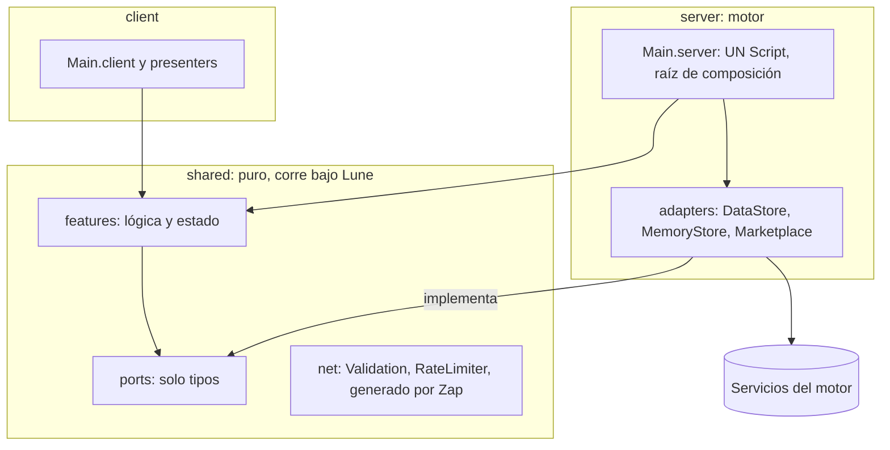

# Arquitectura de un juego de Roblox que escala: stack, capas, datos y red

- Issue: [#110](https://github.com/Nashei-Studios/studio/issues/110), parte de la épica [#109](https://github.com/Nashei-Studios/studio/issues/109).
- Fecha de la investigación: 2026-11-13. Los repos se midieron con `gh api` ese día; la documentación oficial se leyó en `Roblox/creator-docs` (rama `main`), porque `create.roblox.com` responde 502 a curl.
- Alcance: investigación. No decide nada. Cada cambio que propone pide un ADR o la decisión de su dueño.

## Resumen

1. **No hay una fuente primaria pública sobre cómo están armados por dentro los juegos grandes de simuladores.** Busqué charlas de RDC, entrevistas y código abierto. Lo que existe son herramientas que sus estudios publican (Uplift Games publica Wally, un fork de Rojo y un fork de TestEZ) y opiniones de DevForum. Una de ellas afirma que "muchos, si no la mayoría, de los juegos top siguen usando Knit"; es la palabra de un solo autor y no se pudo comprobar. Lo que sí está documentado, y es lo que escala un simulador, es la parte de datos: una llave por jugador, datos en memoria con autoguardado, bloqueo de sesión y recibos idempotentes.
2. **El template y Drain for Loot ya están por encima de lo que usa la comunidad.** Tienen puertos y adaptadores, ProfileStore detrás de una interfaz, migraciones puras con fixtures, remotes generados con Zap, presupuesto de red verificado en CI, pruebas de propiedades y fuzz. No cambiaría la arquitectura de base.
3. **Cambiaría seis cosas pequeñas, todas de datos y de estructura, no de framework:**
   - Usar el borrado automático por derecho al olvido de Roblox (plantillas `{UserId}`), que reemplaza el "trabajador externo" planeado en #61.
   - Partir `Main.server.luau` (1355 líneas en Drain for Loot): ADR 0009 ya dejó ese disparador escrito.
   - Escribir un inventario de stores y llaves como contrato de datos, con su presupuesto de requests por servidor.
   - Dejar un procedimiento de respaldo y restauración (versiones de 30 días y snapshots de Open Cloud). Hoy no hay ninguno.
   - Resolver el gestor de paquetes con un caso real: ADR 0028 eligió Wally, pero no existe `wally.toml` y la versión estable de Wally es de 2023.
   - Fijar con medición, antes de adoptar ECS o estado reactivo, cuándo conviene cada uno.
4. **Lo que no cambiaría:** Luau estricto sin roblox-ts, sin framework tipo Knit, ProfileStore vendorizado, Zap, el recibo confirmado antes de entregar, y Lune como corredor de pruebas.

## 1. Lo que se sabe de los juegos grandes

| Dato | Fuente | Confianza |
|---|---|---|
| Knit está archivado desde 2024-07-31 | `gh api repos/Sleitnick/Knit` | Comprobado |
| "Muchos, si no la mayoría, de los juegos top siguen usando Knit" | Un autor en DevForum, [Life after Knit](https://devforum.roblox.com/t/life-after-knit-should-i-use-it-is-it-outdated-how-to-move-on/3605691) | Una sola fuente, sin evidencia |
| El consejo más repetido en DevForum es ModuleScripts planos con un cargador pequeño; se mencionan `Loader` y `Comm` de RbxUtil y Axis | Hilos [Is the Knit Framework still reliable?](https://devforum.roblox.com/t/is-the-knit-framework-still-reliable/3386821) y el anterior | Opinión de foro, no guía oficial |
| Uplift (Adopt Me) publica Wally, mantiene un fork de Rojo con syncback y un fork de TestEZ | [uplift.games/open-source-software](https://www.uplift.games/open-source-software) | Una sola fuente; no dice cómo es el código del juego |
| Roblox anunció en RDC24 esquemas estándar y APIs de más alto nivel para data stores, con bloqueo de sesión y reintentos automáticos | [RDC24: What We Announced](https://devforum.roblox.com/t/rdc24-what-we-announced/3148833) | Anuncio de plan; no verifiqué que esté publicado |
| No se encontró ninguna charla ni entrevista sobre la arquitectura interna de BIG Games (Pet Simulator) ni de Uplift | Búsquedas web del 2026-11-13 | No encontrado |

Qué se repite en simuladores, incrementales y tycoons según código abierto y foros (todo de fuentes comunitarias, no oficiales):

- La moneda la muta un solo módulo (un "ledger") en el servidor. El cliente solo predice lo que muestra. Ejemplo: [OrkGabb/roblox-economy-validation](https://github.com/OrkGabb/roblox-economy-validation).
- El progreso offline tiene tope y umbral. Un proyecto paga el 50 % con tope de 3 horas y un mínimo de 60 s de ausencia; otro, 50 % con tope de 8 horas y no paga nada si la marca de tiempo falta o va hacia atrás. Dos fallas conocidas: re-acreditar tiempo ya cobrado y pagar de golpe el tiempo de carga del perfil.
- Los repos "simulador" encontrados son plantillas pequeñas: `RetakerMZ/roblox-simulator` tiene 0 estrellas y no declara licencia. No sirven como referencia de escala; solo confirman la forma `server / client / shared` con servicios por sistema.

Conclusión: para un juego grande de sistemas básicos, la escala la decide la capa de datos y de red, no el framework. Es lo que la documentación oficial cubre mejor, y lo que Drain for Loot ya trata con más cuidado.

## 2. El stack, decisión por decisión

NFR del estudio usados en todas las tablas: **R** rendimiento en celulares de gama baja, **$** costo cero, **E** equipo de 3, **T** Luau con tipado estricto, **M** mantenimiento.

### 2.1 Herramientas de proyecto

| Pieza | Estado medido (2026-11-13) | Lo que se pierde al elegirla |
|---|---|---|
| Rojo 7.7.1 | Release 2026-10-02, MPL-2.0, 1871 estrellas | Parcial: el arte y la UI quedan en Studio (ADR 0002, correcto con Team Create) |
| Rokit | Último push 2026-09-27, MIT | Una herramienta más que instalar |
| Lune 0.11.1 | Release 2026-10-21, MPL-2.0 | Lune no carga servicios del motor: obliga a puertos (ya lo hacen) |
| Luau estricto, sin roblox-ts | Template ADR 0001 | Sin refactorización de TypeScript ni npm. Flamework solo existe para roblox-ts |

Sin alternativa que cambie algo: no se propone cambio.

### 2.2 Gestor de paquetes

| Opción | Estado medido | R | $ | E | T | M | Se pierde |
|---|---|---|---|---|---|---|---|
| Wally | Estable 0.3.2 (2023-06-05); alpha `0.4.0-alpha.1` (2026-10-12). Registro más grande | n/a | Sí | Bien conocido | Tipos de paquete con herramienta aparte | Estable viejo, línea nueva en alpha | Riesgo de quedar en una línea sin soporte |
| pesde | `v0.7.4+registry.0.2.3` (2026-09-09), push 2026-11-13, MIT, 132 estrellas | n/a | Sí | Menos usado | Paquetes con tipos propios | Activo | Registro más chico; no confirmé que `sleitnick/trove` esté |
| Vendorizar todo | Es lo que hoy se hace con ProfileStore | n/a | Sí | Simple | Sí | Actualización manual por pieza | Crece con cada librería |

Hoy el estudio vendoriza todo y ADR 0028 aprobó Wally "sin instalar nada". No hay `wally.toml` en el template ni en Drain for Loot. Mientras el único paquete externo sea ProfileStore, vendorizar es correcto. El cambio se justifica solo cuando entre la primera dependencia de registro (por ejemplo `trove`). Propuesta: un spike corto con una dependencia real en ambos gestores y un ADR que confirme o reemplace el 0028.

### 2.3 Framework

| Opción | Estado | R | $ | E | T | M | Se pierde |
|---|---|---|---|---|---|---|---|
| Sin framework: módulos planos, constructor DI, un Script por lado (lo actual) | ADR 0009 | Sin capa extra | Sí | Cada feature se entiende sola | Alta: `Deps` tipado | Sin dependencia | Código de cableado propio |
| Knit | Archivado 2024-07-31, 631 estrellas | Singleton | Sí | Conocido | Autocompletado débil (queja repetida en DevForum) | Muerto | Todo soporte |
| Flamework | Push 2025-09-04, MIT, 160 estrellas; solo roblox-ts | Compila a Luau | Sí | Exige TypeScript | Alta (TS) | Activo a ritmo bajo | Obliga a salir de Luau |
| Cargador pequeño (`Loader` de RbxUtil, Axis) | Citados en DevForum, no medí Axis | Sin capa extra | Sí | Fácil | Media | Una pieza chica | Ciclo de vida ya lo tienen los `Main.*` |

Decisión actual correcta. Un framework no aporta nada que un `Main` con puertos no dé, y el estudio ya paga el costo del cableado.

### 2.4 ECS

| Opción | Estado | Se pierde |
|---|---|---|
| Tablas y módulos planos (lo actual) | Cero dependencia | Si hay miles de entidades simuladas por servidor, el costo de iterar crece |
| Jecs | v0.11.0 (2026-03-10), push 2026-10-22, MIT, 485 estrellas. El autor afirma "800 000 entidades a 60 FPS" (afirmación del README, no medida aquí) | Otro modelo mental; el equipo es de 3; `require` no se puede usar en la fase paralela de Luau |
| Matter | 120 estrellas, último push 2024-12-31, depuración por sistema | Mantenimiento casi parado |

Jecs gana a Matter en actividad. Pero un simulador de "+1 por segundo" no itera miles de entidades por frame. Un hilo de DevForum cuenta un caso (NPC con más de 2000 entidades) donde Jecs fue mucho más rápido que Matter; es una sola anécdota. Otro comentario sostiene que en Roblox todo son tablas y la ganancia es menor que en un motor con ECS nativo. No se adopta sin una medición propia: ver propuesta 6.

### 2.5 Estado replicado y reactivo

| Opción | Estado | Se pierde |
|---|---|---|
| Remotes de Zap + atributos + adaptadores publicadores (lo actual) | `ReplicatedBoardPublisher`, `AttributeObjectivePublisher` | Reescribe cada "publicador" a mano |
| Replica (MadStudioRoblox) | Push 2025-08-07, Apache-2.0, 77 estrellas; sucesor oficial de ReplicaService | Otro paquete y otro modelo de replicación selectiva |
| ReplicaService | Sin soporte, README apunta a Replica | Descartado |
| Charm | v0.11.1 (2026-10-01), MIT, señales reactivas; Luau y TypeScript | La UI de Leon decide el modelo; no imponerlo |
| Reflex | Release v4.3.1 de 2023-11-28, push 2025-12-21 | Rodux-like, flujo de reductores |

La UI es de Leon (ADR 0071). Elegir un contenedor de estado de cliente es decisión suya y del sistema de UI, no de este documento. En servidor, la replicación selectiva (chunks, casas) solo hace falta en juegos con mundo grande por jugador. Ninguno de los dos juegos lo tiene.

### 2.6 Red

| Opción | Estado | Se pierde |
|---|---|---|
| Zap 0.6.29 (lo actual) | Release 2026-06-23; reescritura en curso; 0.6.x mantenido por una persona aparte | Rama sin futuro claro; cuerpo generado en `--!nocheck` |
| Blink 0.18.9 | Release 2026-09-19, push 2026-11-12, 192 estrellas; un solo autor principal | Parámetros posicionales, 58 avisos de selene (medido en el spike del ADR 0015) |
| ByteNet | Push 2025-08-01, sin releases en GitHub, 185 estrellas | Sin movimiento en 15 meses |
| RemoteEvents a mano con `Validation` | Fallback del ADR 0015 | Sin esquema tipado ni compresión |
| Packet | No encontré el repositorio con `gh search` | No evaluado |

Zap y Blink empataron en el spike del ADR 0015 (ancho de banda "no medido", requiere Studio). Hoy Blink tiene más actividad; Zap, más historial en el estudio. Un solo punto de riesgo: la rama 0.6.x de Zap la mantiene una persona. Se deja Zap y se anota qué haría migrar: Zap sin release por más de 12 meses, o un bug de generador abierto sin respuesta. La migración a Blink es barata porque el esquema es de texto y la capa generada está aislada (`scripts/generate-remotes.ps1`).

### 2.7 Datos

| Opción | Estado | R | $ | E | Se pierde |
|---|---|---|---|---|---|
| ProfileStore vendorizado detrás de `ProfileRepository` (lo actual) | Push 2025-07-31, Apache-2.0. Un solo ModuleScript. Su README dice que no sirve para leaderboards ni estado global | Buffer en memoria, autoguardado | Sí | Poco código propio | Control del algoritmo de bloqueo; `Save()` es asíncrono |
| DataStore directo con envoltorio propio | La doc oficial trae un ejemplo de bloqueo de sesión, cola y reintentos | Igual | Sí | Mucho código a mantener | Es reescribir ProfileStore |
| DataStore2 | La doc oficial lo llama legado y desaconsejado para juegos nuevos | n/a | Sí | n/a | Descartado |
| Base externa por `HttpService` | 500 requests por minuto en total por servidor (Open Cloud va aparte, 2500 por minuto) | Latencia de red, por jugador | No: hay servidor y base | Operarla | Rompe $; sin sesión atómica con el servidor de juego |
| MemoryStore | Cuota `64 KB + 1,2 KB × usuarios` por juego, TTL máximo 45 días, valor de sorted map máximo 32 KB | Muy rápido | Sí | Simple | No es persistente |
| OrderedDataStore | Solo números, sin versiones de respaldo | OK | Sí | Simple | No se puede restaurar una versión |

Elegir la base externa solo se justifica cuando haga falta consultar los datos fuera de Roblox (analítica de negocio, panel de moderación). Eso se puede hacer sin cambiar la fuente de verdad: exportar por Open Cloud. No hay NFR hoy que lo pida.

## 3. Capas en Luau: dónde se rompe Clean Architecture

El template aplica `adapters -> ports <- features` y funciona. Los puntos donde la teoría no calza, con lo que cada uno cuesta:

| Punto de quiebre | Qué pasa | Qué hace el estudio | Qué falta |
|---|---|---|---|
| Ciclos de `require` | Dos módulos que se requieren entre sí dan el error `Requested module was required recursively` ([doc oficial](https://github.com/Roblox/creator-docs/blob/main/content/en-us/scripting/module.md)) | Los puertos son solo tipos, así que no hay ciclo | Nada |
| Interfaces | Luau es estructural: dos tablas con la misma forma son el mismo tipo. Un puerto es un `export type` y no hace falta clase abstracta ([luau.org/types](https://luau.org/types)) | Tipos de puertos y fakes por estructura | Nada |
| Tipos del motor en el dominio | `Vector3`, `Instance` no existen bajo Lune | Alias estructurales locales; ADR 0009 admite la duplicación | Un test que las compare entre sí, como ya existe para el esquema de datos |
| Llamadas que ceden | `DataStore`, `MemoryStore` y `IsFriendsWith` ceden. Un "dominio puro" no puede asumir ejecución síncrona | `leaving` flag y `Cancel` (ADR 0032), iteración sobre copias (ADR 0031) | Regla escrita: ningún puerto cede dentro de un recorrido de tabla viva |
| `shared` visible al cliente | Los contratos del servidor (solo tipos) quedan en `ReplicatedStorage` | ADR 0009 lo lista como negativo | Revisar que ningún puerto lleve nombres de llaves o ids sensibles |
| Raíz de composición que crece | `Main.server.luau` tiene 1355 líneas en Drain for Loot | ADR 0009 dice "si el `Main` crece, partirlo en módulos por feature y dejar un solo Script" | Esa partición aún no se hizo |
| Costo de indirección | Una llamada por puerto en una ruta caliente cuesta CPU | Presupuesto de rendimiento (ADR 0019) | Medir una ruta caliente real (tick de ingresos) con el Script Profiler |
| Luau en paralelo | `require` no se puede llamar en la fase desincronizada ([multithreading](https://github.com/Roblox/creator-docs/blob/main/content/en-us/scripting/multithreading.md)) | No se usa Parallel Luau | Si algún día se usa, requerir todo antes de `desynchronize()` |

Qué hacen "los equipos serios": no encontré fuentes. Lo que sí hay son críticas de DevForum a los frameworks de arquitectura por capas. En el hilo de [RblxArch](https://devforum.roblox.com/t/framework-rblxarch-%E2%80%94-clean-architecture-for-roblox-studio/4477673) (ocho capas con Repository, Service, Controller, Cubit, View, Context, NetBridge y ServiceLocator) los comentarios objetan el costo de middleware y que se pierda el autocompletado en los `require`. Opinión de foro, una sola fuente. La forma del estudio (puertos como tipos, sin localizador de servicios) evita ambas objeciones.

## 4. Datos en profundidad

### 4.1 Lo que dice la documentación oficial

- **Una llave por jugador**, mientras quepa en 4 MiB (4 194 304 caracteres por valor), con patrón estático tipo `User_{UserId}`; pocos data stores ([best-practices](https://github.com/Roblox/creator-docs/blob/main/content/en-us/cloud-services/data-stores/best-practices.md)).
- **Datos en memoria del servidor**, guardado periódico, al salir y en puntos críticos como una compra. El ejemplo oficial guarda cada 180 s.
- **Presupuesto por servidor:** lecturas y escrituras estándar a `60 + jugadores × 40` por minuto ([límites](https://github.com/Roblox/creator-docs/blob/main/content/en-us/cloud-services/data-stores/error-codes-and-limits.md)). Cada cola admite 30 pedidos pendientes. Open Cloud comparte el presupuesto de la experiencia.
- **Bloqueo de sesión:** se escribe un `LockId` en los metadatos dentro del mismo `UpdateAsync` que lee ([player-data-purchasing](https://github.com/Roblox/creator-docs/blob/main/content/en-us/cloud-services/data-stores/player-data-purchasing.md)). ProfileStore ya lo hace.
- **Recibos:** guardar el `PurchaseId` en los datos, entregar, confirmar el guardado y recién ahí devolver `PurchaseGranted`; si el id está registrado pero no guardado, devolver `NotProcessedYet`.

### 4.2 Contraste con el estudio

| Tema | Template y Drain for Loot | Veredicto |
|---|---|---|
| Esquema versionado y migraciones | ADR 0014: cadena pura `vN -> vN+1`, error tipado `future_version`, fixtures congelados por versión | Mejor que lo común. No cambiar |
| Bloqueo de sesión | ProfileStore; `Cancel` al salir; nunca `Steal` en carga normal; nombre de store distinto en Studio (ADR 0032) | Correcto |
| Recibos | ADR 0016: confirmar con `LastSavedData`, lista acotada de 50 ids, tope de 30 s | Igual al patrón oficial. Correcto |
| Leaderboards | `OrderedDataStore` por tablero (`Board_<boardKey>`, llave = id del jugador) más caché de MemoryStore | Correcto para persistentes. Faltan los límites por tipo documentados en un solo lugar |
| Registro de invitaciones | MemoryStore con `UpdateAsync` atómico y TTL de 24 h (ADR 0031) | Correcto |
| Respaldo | No hay procedimiento ni mención (búsqueda de "backup", "snapshot", "ListVersions" en `docs/`) | Falta |
| Derecho al olvido | `#61` planeaba un "trabajador externo" y ADR 0028 dice "no verificado" | Desactualizado: ver 4.4 |

### 4.3 Respaldos y restauración

- Las versiones se crean con la **primera escritura de cada hora UTC**; las siguientes de esa hora sobrescriben. Una versión sobrescrita caduca a los 30 días; la última no caduca ([versioning](https://github.com/Roblox/creator-docs/blob/main/content/en-us/cloud-services/data-stores/versioning-listing-and-caching.md)).
- Se restaura con `ListVersionsAsync` y `GetVersionAsync` (ejemplo oficial por hora del reporte).
- El API de **snapshot** de Open Cloud permite un snapshot de todos los data stores una vez al día. La doc pide tomar uno antes de publicar cualquier cambio que toque la lógica de datos.
- `OrderedDataStore` no guarda versiones: un tablero dañado no se restaura. Se reconstruye desde los perfiles, y eso exige que el tablero sea derivable (el diseño del ADR 0022 con caché lo permite).
- Con ProfileStore, el valor guardado envuelve los datos; una restauración por versión debe respetar ese envoltorio. No lo probé: **no medido**.

### 4.4 Borrado por derecho al olvido

La doc oficial describe un borrado automático. Se declaran plantillas con el token `{UserId}` (hasta 100 por juego), por el Data Stores Manager o por la Configs API (`user_data_templates`). Cuando Roblox procesa un pedido, borra lo que coincide ([right-to-be-forgotten](https://github.com/Roblox/creator-docs/blob/main/content/en-us/cloud-services/data-stores/right-to-be-forgotten.md)). Requisitos: store estándar u ordenado, y el id del usuario en el nombre del store, la llave o el scope con patrón estático. El borrado de un store completo solo vale para estándar. Si el esquema no calza, hay un webhook de borrado para un flujo propio.

Cómo calza con Drain for Loot (inferido del código, no probado):

- Los perfiles van en el store `PlayerData` y la llave parece ser el id del jugador como texto (`tonumber(key)` en `Main.server.luau`, línea 198). Cumple el patrón. Hay que fijar el prefijo de forma explícita; hoy el patrón no está escrito como contrato.
- Los tableros usan `Board_<boardKey>` con el id como llave. Si `boardKey` incluye el ciclo (por ejemplo diario), el nombre del store cambia y cada nombre necesita su propia plantilla. Con el límite de 100 plantillas hay que contar cuántos nombres distintos genera el juego en un año. **No medido.**
- El borrado de datos que quedan fuera de los stores (analítica propia, registros de la sonda de entrada) no lo cubre este mecanismo.

### 4.5 Presupuesto de datos que falta

Un cuadro de stores y llaves ("inventario") con: tipo, patrón de llave, tamaño máximo estimado, quién escribe, frecuencia y plantilla de borrado. Alimenta tres cosas a la vez: el RTBF, los límites de requests por servidor y los respaldos. Hoy esa información está repartida en ADR y código.

## 5. Planificación y documentación de la arquitectura

| Práctica | Qué hace el estudio | Qué falta |
|---|---|---|
| Decisiones | ADR en formato MADR, numerados e inmutables (70 en Drain for Loot) | Hay dos ADR 0035 y dos 0039 en Drain for Loot (colisión de numeración, vi `0035-quests...` y `0035-ui-system...`, `0039-automated-ui-audit` y `0039-global-gitflow-automation`). Un chequeo de duplicados en el gate de docs |
| Diagramas | Mermaid dentro de los ADR y de `architecture.md` | Sin diagrama de datos (stores, llaves, quién escribe) |
| Presupuestos | `PerfBudget` con fuente por número y fallo en CI (ADR 0019) | Sin presupuesto de requests de DataStore ni de MemoryStore |
| Documentos de juego | `docs/game/` con etapas y `docs-check` | Sin contrato de datos |
| Pruebas de arquitectura | Pruebas de propiedades y fuzz (ADR 0062), cobertura 75 % | Sin prueba que falle si una `feature` requiere un adaptador |

La regla "una feature nunca requiere un adaptador ni un servicio del motor" hoy se vigila por revisión y porque Lune no carga el motor. Esa segunda barrera ya es un chequeo automático: un `require` a un servicio del motor falla las pruebas. Una comprobación estática de imports (sin Lune) cubriría los módulos que solo corren en el servidor.

## 6. Qué tiene hoy el estudio, qué falta, qué cambiar y qué no

| Área | Hoy | Cambiar | No cambiar | Por qué |
|---|---|---|---|---|
| Lenguaje | Luau estricto | No | Luau estricto | Sin compilación; nada de lo evaluado lo supera |
| Framework | Ninguno, DI por constructor | No | Sin framework | Knit está archivado; Flamework exige TypeScript |
| Paquetes | Todo vendorizado, Wally aprobado sin uso | Spike con una dependencia real: Wally 0.4 alpha o pesde | Vendorizar ProfileStore | El gestor solo vale cuando entre un paquete de registro |
| Red | Zap, `Validation`, `RateLimiter`, presupuesto en CI | Documentar el criterio de salida de Zap | Zap | Empate medido con Blink; migrar es barato |
| Datos de jugador | ProfileStore, migraciones, recibo confirmado | Inventario de stores y llaves | Todo lo demás | Cumple y supera la guía oficial |
| Borrado RTBF | Planeado como trabajador externo (#61) | Plantillas `{UserId}` por Configs API | El puerto de borrado por si hay datos fuera de stores | Mecanismo oficial nuevo, cero código propio |
| Respaldos | Ninguno documentado | Snapshot antes de publicar y runbook de restauración | Perfiles en ProfileStore | Cierra la única brecha de integridad |
| Raíz de composición | `Main.server` de 1355 líneas | Partir por feature, un solo Script | Un solo Script por lado | Disparador ya escrito en ADR 0009 |
| ECS | No hay | Nada hasta medir | Tablas planas | Un incremental no itera miles de entidades |
| Estado de cliente | Presenters y puente de UI de Leon | Nada: es de Leon | GameUiBridge | ADR 0071 |
| Leaderboards | OrderedDataStore y caché | Tabla de límites en el contrato | Diseño actual | Correcto |

## 7. Propuestas, por valor y esfuerzo

| # | Propuesta | Valor | Esfuerzo | Qué ADR |
|---|---|---|---|---|
| 1 | Borrado automático por derecho al olvido con plantillas `{UserId}` | Alto: cumplimiento sin código | Bajo | Nuevo; reemplaza la parte de borrado del 0028 |
| 2 | Respaldo: snapshot antes de publicar y runbook de restauración | Alto: hoy un error de migración no se puede deshacer | Bajo a medio | Nuevo |
| 3 | Inventario de stores y llaves más presupuesto de requests por servidor en CI | Alto: lo usan 1 y 2 | Medio | Nuevo, sobre el 0019 |
| 4 | Partir `Main.server` por feature | Medio: mantenimiento de un equipo de 3 | Medio | Nuevo; cumple el disparador del 0009 |
| 5 | Spike del gestor de paquetes (Wally 0.4 alpha frente a pesde) con `trove` o `signal` | Medio | Bajo | Confirma o reemplaza el 0028 |
| 6 | Disparadores medidos para ECS, Parallel Luau y estado reactivo | Medio, evita adoptar sin evidencia | Medio | Solo si el resultado cambia una decisión |

## 8. Lo que no se pudo hacer

- Charlas de RDC y entrevistas sobre la arquitectura interna de juegos grandes: no encontré ninguna fuente primaria.
- Ancho de banda real de Zap y Blink: requiere Studio; **no medido**.
- Que la restauración por versión funcione con el envoltorio de ProfileStore: **no medido**.
- Cuántos nombres de store distintos generan los tableros por ciclo: **no medido**.
- No leí el código de ningún juego comercial. Nada descargado se ejecutó.

## Fuentes

Documentación oficial (`Roblox/creator-docs`, rama `main`):

- [Best practices for data stores](https://github.com/Roblox/creator-docs/blob/main/content/en-us/cloud-services/data-stores/best-practices.md)
- [Data store versioning, listing and caching](https://github.com/Roblox/creator-docs/blob/main/content/en-us/cloud-services/data-stores/versioning-listing-and-caching.md)
- [Data store error codes and limits](https://github.com/Roblox/creator-docs/blob/main/content/en-us/cloud-services/data-stores/error-codes-and-limits.md)
- [Player data and purchasing](https://github.com/Roblox/creator-docs/blob/main/content/en-us/cloud-services/data-stores/player-data-purchasing.md)
- [Right to be forgotten](https://github.com/Roblox/creator-docs/blob/main/content/en-us/cloud-services/data-stores/right-to-be-forgotten.md)
- [Choose between cloud services](https://github.com/Roblox/creator-docs/blob/main/content/en-us/cloud-services/data-stores-vs-memory-stores.md)
- [Memory stores](https://github.com/Roblox/creator-docs/blob/main/content/en-us/cloud-services/memory-stores/index.md) y [sorted map](https://github.com/Roblox/creator-docs/blob/main/content/en-us/cloud-services/memory-stores/sorted-map.md)
- [HttpService](https://github.com/Roblox/creator-docs/blob/main/content/en-us/cloud-services/http-service.md)
- [Module scripts](https://github.com/Roblox/creator-docs/blob/main/content/en-us/scripting/module.md) y [Parallel Luau](https://github.com/Roblox/creator-docs/blob/main/content/en-us/scripting/multithreading.md)
- [Server authority](https://github.com/Roblox/creator-docs/blob/main/content/en-us/projects/server-authority/index.md): modelo para juegos competitivos con predicción y rollback; no aplica a simuladores ni incrementales.
- [Luau types](https://luau.org/types)

Repositorios (medidos con `gh api`, 2026-11-13):

- [Sleitnick/Knit](https://github.com/Sleitnick/Knit), [rbxts-flamework/core](https://github.com/rbxts-flamework/core), [Ukendio/jecs](https://github.com/Ukendio/jecs), [matter-ecs/matter](https://github.com/matter-ecs/matter)
- [littensy/charm](https://github.com/littensy/charm), [littensy/reflex](https://github.com/littensy/reflex), [MadStudioRoblox/Replica](https://github.com/MadStudioRoblox/Replica), [MadStudioRoblox/ReplicaService](https://github.com/MadStudioRoblox/ReplicaService)
- [red-blox/zap](https://github.com/red-blox/zap), [1Axen/blink](https://github.com/1Axen/blink), [ffrostfall/ByteNet](https://github.com/ffrostfall/ByteNet)
- [MadStudioRoblox/ProfileStore](https://github.com/MadStudioRoblox/ProfileStore)
- [rojo-rbx/rojo](https://github.com/rojo-rbx/rojo), [rojo-rbx/rokit](https://github.com/rojo-rbx/rokit), [lune-org/lune](https://github.com/lune-org/lune), [UpliftGames/wally](https://github.com/UpliftGames/wally), [pesde-pkg/pesde](https://github.com/pesde-pkg/pesde)
- [OrkGabb/roblox-economy-validation](https://github.com/OrkGabb/roblox-economy-validation), [RetakerMZ/roblox-simulator](https://github.com/RetakerMZ/roblox-simulator)

DevForum y otros (leídos con WebFetch o resultado de búsqueda, todos opinión):

- [Is the Knit Framework still reliable?](https://devforum.roblox.com/t/is-the-knit-framework-still-reliable/3386821)
- [Life after Knit](https://devforum.roblox.com/t/life-after-knit-should-i-use-it-is-it-outdated-how-to-move-on/3605691)
- [RblxArch](https://devforum.roblox.com/t/framework-rblxarch-%E2%80%94-clean-architecture-for-roblox-studio/4477673)
- [Jecs: scene graphs con ECS](https://devforum.roblox.com/t/jecs-optimizing-declarative-scene-graphs-with-ecs/3263203)
- [RDC24: What We Announced](https://devforum.roblox.com/t/rdc24-what-we-announced/3148833)
- [Uplift Games, software abierto](https://www.uplift.games/open-source-software)

Del propio estudio (rutas locales en `D:\Victor\Repositorios\roblox`):

- `roblox-game-template/docs/architecture.md` y ADR 0001, 0003, 0009, 0010, 0012, 0014, 0015, 0016, 0019, 0022, 0028.
- `games/drain-for-loot/docs/adr/` (0016, 0028, 0031, 0032, 0056, 0070), `docs/ecosystem-map.md`, `docs/performance.md`, `src/server/Main.server.luau`.
