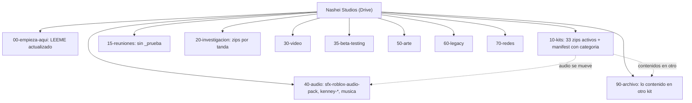

# Kits y ecosistema contra el Drive del estudio

Issue: [#113](https://github.com/Nashei-Studios/studio/issues/113), parte de la épica #109. Fecha de la medición: 2026-11-13.

Nada de lo que sigue se decide aquí. El Drive es de Leon: todo lo que toca su orden es una propuesta que él acepta o cambia. No se borró, movió ni subió nada al Drive salvo la copia de este documento en `20-investigacion`.

## Resumen

- El Drive tiene 11 carpetas numeradas y 4,4 GiB en ellas (la cuenta marca 6,9 GiB usados de 15, contando lo que está fuera de estas carpetas). Hay 36 kits en `10-kits` (2,86 GiB), 4 paquetes en `20-investigacion` (1,32 GiB), 3 en `60-legacy` y 2 en `50-arte`. Nada está vacío ni roto en tamaño: los 45 zips coinciden en bytes con su `manifest.json`. La integridad del contenido de cada zip no se midió (habría que bajar 4 GiB).
- Los 36 kits de Drive coinciden uno a uno con los 36 zips y con las notas de `roblox-vault/kits/`, salvo un nombre: el zip `icons` tiene su nota con otro slug (`icons-tabler-phosphor`) y su fila de manifiesto sin licencia ni `ships`.
- El problema real no es el espacio, es la licencia. En `manifest.json`, 20 de 36 kits dicen `ships: yes` con licencia desconocida o sin declarar. `docs/drive.md` dice lo contrario ("sin licencia conocida, `ships` es `no`") y la decisión 0019 del vault dice que todo kit del dueño entra completo con `ships: yes`. Las dos reglas chocan y nadie las ha reconciliado. Hay cuatro casos peores que "desconocida" (sección 3).
- Los duplicados existen pero pesan poco: archivar los cinco kits contenidos en otro liberaría unos 37 MB, y unos 200 MB si se suma `roblox-ui-references`. Lo pesado son cinco archivos (`lihfolk-vault`, `2026-11-06-research-ui`, `lift-rock-models`, `fwjelaa-vault`, `sfx-roblox-audio-pack`: 3,6 GiB de 4,4).
- Faltan README: 8 de las 11 carpetas no tienen `LEEME.md`, y el de `00-empieza-aqui` está desactualizado (nombra un `INDEX.json` que no existe, no lista `15-reuniones` ni `35-beta-testing`, y habla de una carpeta `LibreriaRbx` que ya no está en la raíz).
- Kits nuevos con licencia libre comprobada: 9 candidatos verificados (sección 5). Los de más valor para el juego actual son los paquetes CC0 de Kenney que aún no están en el Drive (UI, sonidos de interfaz, iconos, partículas, naturaleza para el tema de lago o mar) y el renderizador de iconos SVG en tiempo de ejecución. De Discord, TikTok, Instagram y Facebook no salió ningún kit comprobable en esta pasada (sección 5.4).
- Se proponen 6 tareas: 3 para Leon (orden del Drive, con `needs-triage`) y 3 para Victor.

## 1. Inventario del Drive

Medido con `rclone lsjson -R`, `rclone size` y los `manifest.json` y `*.files.json` de cada carpeta.

| Carpeta | Objetos | Tamaño | Qué tiene | README |
|---|---|---|---|---|
| `00-empieza-aqui` | 1 | 1,2 KiB | `LEEME.md` | es el README |
| `10-kits` | 73 | 2,858 GiB | 36 zips, 36 `.files.json`, `manifest.json` | no |
| `15-reuniones` | 12 | 21,3 MiB | `LEEME.md`, una reunión, `_prueba/` | si |
| `20-investigacion` | 5 | 1,318 GiB | 4 zips y manifiesto | no |
| `30-video` | 0 | 0 | solo subcarpetas vacías: `crudo`, `editado`, `referentes` | no |
| `35-beta-testing` | 10 | 204 MiB | `LEEME.md`, `drain-for-loot/0.0.0-legacy`, `referentes/` | si |
| `40-audio` | 0 | 0 | vacía | no |
| `50-arte` | 5 | 280 KiB | 2 zips, manifiesto, subcarpetas `capturas`, `modelos`, `texturas` vacías | no |
| `60-legacy` | 7 | 1,1 MiB | 3 zips (`bowl-brawl`, `drain-the-sea`, `grassgame`), manifiesto | no |
| `70-redes` | 0 | 0 | solo `guiones` y `publicado`, vacías | no |
| `90-archivo` | 0 | 0 | vacía | no |

### Peso real de `10-kits`

| Kit | Tamaño | Archivos |
|---|---|---|
| lihfolk-vault-v2.5.0 | 1,26 GiB | 10.466 |
| lift-rock-models | 672 MiB | 79 |
| fwjelaa-vault-0.1.0 | 310 MiB | 7.114 |
| sfx-roblox-audio-pack | 189 MiB | 805 |
| roblox-ui-references | 155 MiB | 1.284 |
| icons | 82 MiB | 25.538 |
| adam-does-roblox-vault | 31 MiB | 1.005 |
| roblox-ai-free-pack-full | 77 MiB | 831 |
| Los otros 28 | 121 MiB entre todos | |

`20-investigacion` también pesa por un solo zip: `2026-11-06-research-ui.zip` tiene 1,21 GiB, el 92 % de la carpeta.

### Duplicados medidos por MD5

Se compararon los `*.files.json` (ruta, bytes y MD5 de cada archivo) de los 36 kits, contando archivos de más de 2 KB. "Contenido en" significa que esos archivos tienen el mismo MD5 en el otro kit.

| Kit | Contenido en | Cuánto | Tamaño del kit |
|---|---|---|---|
| ui-icon-pack | fwjelaa-vault-0.1.0 y casi todo en icons-pack | 1.574 de 1.574 (100 %); 1.573 también en icons-pack | 21,5 MiB |
| picture-to-roblox-model | fwjelaa-vault-0.1.0 | 17 de 17 | 1,4 MiB |
| roblox-maps | fwjelaa-vault-0.1.0 | 93 de 97 | 4,5 MiB |
| roblox-ui-references | fwjelaa-vault-0.1.0 | 1.109 de 1.185 (94 %) | 155 MiB |
| studs-icon-pack | libreria-rbx | 869 de 869 | 6,2 MiB |
| roblox-art-pipeline | roblox-ai-free-pack-full | 22 de 29 (76 %) | 1,4 MiB |
| roblox-animations | fwjelaa-vault-0.1.0 | 101 de 251 (40 %) | 7,1 MiB |
| icons-pack | fwjelaa-vault-0.1.0 | 1.573 de 2.457 (64 %) | 26 MiB |

Parecidos por nombre, sin MD5 igual (una sola fuente: nombres de archivo): `food-kit-glb` (148 glb) comparte 67 nombres con `kenney-food-kit` (CC0) y 21 con `ultimate-food-pack-glb`. Probablemente son del mismo origen reexportado; falta confirmarlo abriendo los README de cada uno.

Cuatro "paquetes de studs" son un solo archivo `.rbxm` o `.rbxl` cada uno (`stud-ui-pack`, `small-stud-asset-pack`, `crucial-stud-ui-pack`, `pds-particles-models-kit`): no se puede saber sin abrirlos en Studio si se pisan con `rblx-essentials-studded-ui`. No se abrieron, por la regla de no abrir material de terceros.

### Archivos vacíos o rotos

- Los únicos archivos de 0 bytes son `.gitkeep` y `.keep` (18 en total: 15 en `icons`, 2 en `picture-to-roblox-model`, 1 en `roblox-ai-free-pack-full`). No son un defecto.
- 0 diferencias entre bytes del manifiesto y bytes en Drive en `10-kits`, `20-investigacion`, `50-arte` y `60-legacy`.
- Una fila sin datos de licencia ni `ships`: `icons` (`ships: null`, `license: null`).
- Hash: el manifiesto guarda SHA-256 del zip y Drive solo expone MD5, así que no se pudo recomprobar el hash sin bajar el zip. El manifiesto de Drive y la plantilla (`assets/kits.manifest.luau`) guardan hashes distintos para el mismo kit porque uno es del zip y el otro de la carpeta: no son comparables.

### Nombres y convención

La convención de `docs/drive.md` es minúsculas y guiones. Fuera de ella:

- `icons` frente a `icons-pack`, `ui-icon-pack` y `studs-icon-pack`: cuatro nombres casi iguales para cuatro cosas distintas (Phosphor y Tabler, 4.132 iconos, 3.110 iconos, iconos de Gvesster). Quien busca "iconos" no sabe cuál abrir.
- `icons` no coincide con su nota del vault (`icons-tabler-phosphor`).
- `15-reuniones/2026-11-12_grill_juego-2` mezcla `_` y `-`; `15-reuniones/_prueba/` es una carpeta de prueba que empieza con guion bajo (las carpetas así no se suben con `kits.ps1`, pero esta ya está en Drive).
- Los kits no llevan fecha en el nombre y los de `20-investigacion` sí. Es coherente con lo que son, solo conviene dejarlo escrito.

## 2. Contraste con el vault y la plantilla

| Fuente | Lo que dice | Diferencia con el Drive |
|---|---|---|
| `roblox-vault`, rama `origin/develop`, `kits/README.md` | 36 filas más `icons-tabler-phosphor`; la nota de cada kit lleva licencia y `ships` | `icons` (Drive) vs `icons-tabler-phosphor` (vault): un solo kit con dos nombres |
| `roblox-vault`, decisión 0019 | Todo kit de Victor entra completo con `ships: yes` | choca con `docs/drive.md` (sin licencia, `ships: no`) |
| `roblox-vault`, `research/free-first-ui-and-assets-2026-11.md` | Ya lee las licencias de Kenney UI Pack, Interface Sounds y otras fuentes | Ninguno de esos paquetes CC0 está en `10-kits` |
| `roblox-vault`, `research/2026-11-12-brechas-del-ecosistema.md` | Lista 37 carpetas en `D:/Victor/Roblox/kits` y marca que casi todos tienen licencia desconocida | Drive tiene 36: `adam-does-roblox-vault`, `libreria-rbx` y `icons` entre ellas |
| `roblox-game-template`, `assets/kits.manifest.luau` | 33 slugs, generado el 2026-11-05 | No incluye `adam-does-roblox-vault`, `libreria-rbx` ni `icons` (los dos primeros son `ships: no`, correcto) |
| `roblox-game-template`, `docs/ecosystem-map.md` | Tabla de piezas externas con licencia, push y pegamento | Cubre sistemas de código, no kits de arte, audio ni VFX |
| `roblox-vault`, `link-ledger-2026-11` | 87 enlaces de Victor | 12 marcados como "missing" del banco; fuera del alcance de este documento |

Nota de método: el checkout local de `roblox-vault` no tiene la carpeta `kits/` en la rama que tiene abierta. Se leyó desde `origin/develop` con `git show`.

Lo que ya cubre el ecosistema de código y no se repite aquí: ProfileStore, Zap, RbxUtil, Vide, Fusion, Iris, Cmdr y otros (`docs/ecosystem-map.md`); UI en la nota del vault citada arriba; el plugin oficial de Blender a Roblox y Poly Pizza en `research/2026-11-06-v0-2-l-pipeline-de-arte.md`.

## 3. Licencias: lo que hay que decidir

Dos reglas que hoy chocan:

| Opción | Cómo queda | Qué se pierde |
|---|---|---|
| A. Mantener 0019 (`ships: yes` para todo lo del dueño) y cambiar `docs/drive.md` | Una regla, sin trabajo de auditoría | `ships: yes` deja de significar "puede ir al juego". El campo no informa y el manifiesto de la plantilla promete lo que no sabemos |
| B. Mantener `docs/drive.md` (sin licencia, `ships: no`) y reabrir 0019 | `ships` vuelve a ser una señal real; 20 kits pasan a `no` hasta que alguien lea su licencia | Los kits que hoy usan los juegos (los marcados `yes`) quedan "sin permiso" hasta la auditoría |
| C. Un tercer valor, `prototype`, para "sirve para probar, no para lanzar" | Cabe el choque de reglas; coincide con lo que dice la nota `brechas-del-ecosistema` ("sirven para prototipo y deben pasar auditoría antes del lanzamiento") | Requiere cambiar `kits.ps1`, el validador de la plantilla y el manifiesto |

Recomendación: C, porque ya es lo que el equipo dice en voz alta y ninguna de las dos reglas lo expresa. Cambiaría `kits.ps1`, `KitManifest.validate` y el manifiesto; lo decide Victor con un ADR (la decisión 0019 es suya).

Casos que son peores que "licencia desconocida", todos con `ships: yes` hoy:

| Kit | Qué dice su propia nota | Riesgo |
|---|---|---|
| lift-rock-models (672 MiB) | Personajes de la serie "Lift Rock for Anime" del autor, sin licencia | Propiedad intelectual de otra serie. Es el archivo más pesado después de LihFolk |
| roblox-ui-references (155 MiB) | "Las imágenes pertenecen a sus creadores" | Capturas de terceros: referencia, no activo |
| libreria-rbx y studs-icon-pack | `libreria-rbx` contiene los 869 archivos de `studs-icon-pack`; los términos de Gvesster prohíben "redistribuir como pack" | La biblioteca del equipo (que ya es `ships: no`) redistribuye un pack con licencia restringida. Solo es un problema si se comparte fuera de los tres |
| lihfolk-vault-v2.5.0 (1,26 GiB) | CC BY 4.0 más "términos propios del pack de activos" | Pide crédito; los términos propios no se leyeron en este trabajo |
| sfx-roblox-audio-pack | Sin licencia declarada, 805 archivos | Audio sin origen; riesgo de reclamo en un juego monetizado |
| crucial-stud-ui-pack | Licencia desconocida, trae un panel de administración "gated" por creador | Código a auditar antes de usarlo, además de la licencia |

Los kits RBLX Essentials dicen "uso comercial en juegos propios, sin reventa ni redistribución suelta": compartirlos entre los tres miembros del estudio dentro del Drive es uso interno, pero cada persona que lo comparta fuera rompería los términos. Una sola fuente: comentario del autor en itch.io citado por la nota del vault.

## 4. Propuesta de orden del Drive (solo plan)

Nada de esto se ejecutó. Mover o borrar algo de Leon requiere su sí. Lo que se mueva va a `90-archivo` o a la papelera del Drive, nunca se borra para siempre.

### 4.1 Alternativas para `10-kits`

| Opción | Cómo funciona | Rendimiento y costo | Mantenimiento | Qué se pierde |
|---|---|---|---|---|
| A. Plano más campo `categoria` en el manifiesto | Los 36 zips siguen en una carpeta; cada fila del manifiesto gana `categoria` (ui, iconos, audio, modelos3d, animacion, vfx, herramientas, conocimiento, referencia) | Cero cambios en `kits.ps1`; costo cero | Un campo que mantener; `kits.ps1 status` puede agrupar | Quien abre Drive en el navegador sigue viendo 36 zips sin agrupar |
| B. Subcarpetas por categoría | `10-kits/ui/`, `10-kits/audio/`, etc. con un manifiesto cada una | `kits.ps1 -Folder 10-kits/ui` puede servir pero no se probó (una sola fuente: el parámetro `-Folder` acepta una ruta); 8 manifiestos | Más carpetas que ordenar; un kit puede caer en dos | Se rompen las rutas de `kits.ps1 pull` ya usadas por los tres |
| C. Prefijo en el nombre (`ui-`, `audio-`) | Se renombra el zip | Renombrar zips cambia el slug y rompe `kits.manifest.luau`, las notas del vault y `kit-use.ps1` | Mucho arrastre | Un cambio que toca 3 repos por un orden cosmético |

Recomendación: A. Cuesta lo mínimo, no rompe a nadie y deja a Drive en una carpeta por kit. Cambiaría si los kits pasaran de unos 60.

### 4.2 Estructura propuesta

### 4.3 Acciones, en orden de valor y esfuerzo

| # | Acción | Dueño | Esfuerzo | Efecto |
|---|---|---|---|---|
| 1 | Escribir `LEEME.md` en las 8 carpetas sin uno (`10-kits`, `20-investigacion`, `30-video`, `40-audio`, `50-arte`, `60-legacy`, `70-redes`, `90-archivo`): qué va, qué no, convención de nombre, dónde está su nota | Leon propone, Victor redacta si se lo pide | Bajo | Cierra la brecha de documentación de `docs/drive.md` y `delivery-bar` (3) |
| 2 | Corregir `00-empieza-aqui/LEEME.md`: `INDEX.json` por `manifest.json`, agregar `15-reuniones` y `35-beta-testing`, quitar `LibreriaRbx` de la tabla, mencionar `kits.ps1` | Leon | Bajo | Un nuevo integrante no se pierde |
| 3 | Mover `15-reuniones/_prueba` a la papelera (es de una prueba de `puesto.ps1`) | Leon (su sí) | Bajo | Una carpeta menos de ruido |
| 4 | Renombrar `icons` a `icons-tabler-phosphor` (igual que su nota) y completar su licencia (MIT, según la nota) y `ships` | Leon con Victor (toca `kits.ps1 push`) | Bajo | Un solo nombre en vault, Drive y manifiesto |
| 5 | Agregar `categoria` a las 36 filas del manifiesto | Victor | Medio | Navegable por tema sin tocar rutas |
| 6 | Mover a `40-audio` los kits de audio (`sfx-roblox-audio-pack`, `kenney-impact-sounds`) y el zip `2026-11-08-music` de `20-investigacion`; actualizar su nota del vault | Leon decide, Victor ajusta rutas | Medio | La carpeta deja de estar vacía; `docs/drive.md` ya promete que el audio vive allí |
| 7 | Archivar (mover a `90-archivo`, con su manifiesto) los kits contenidos en otro: `ui-icon-pack`, `picture-to-roblox-model`, `roblox-maps`, `studs-icon-pack`, `roblox-art-pipeline`. Opcional: `roblox-ui-references` (155 MiB, 94 % duplicado) | Leon (su sí) | Medio | Unos 37 MB menos con los cinco, 200 MB con `roblox-ui-references` (de 15 GiB). No justifica el riesgo por sí solo; sí aclara qué es fuente y qué es copia |
| 8 | Decidir la regla de `ships` (sección 3) y aplicarla al manifiesto | Victor (ADR) | Medio | Que `ships: yes` vuelva a significar algo |
| 9 | Fijar la política para `lift-rock-models`: `ships: no`, o salir del Drive | Victor y Leon | Bajo | Quita 672 MiB de propiedad intelectual ajena de la ruta "puede ir al juego" |

Con la acción 7 hecha, `fwjelaa-vault-0.1.0` queda como único dueño de los 1.574 iconos y de los mapas; si algún día se elimina ese kit, hay que traer de vuelta los archivados. Se pierde la simplicidad de "un zip es un kit del autor": un kit pasa a ser "un zip, salvo los que otro ya contiene".

## 5. Kits nuevos y gratuitos de uso comercial

Todos los enlaces se comprobaron con `curl` (código 200) el 2026-11-13. La licencia se leyó en el repositorio con `gh repo view` o en la página del autor. Nada se descargó ni se abrió en Studio o Blender.

### 5.1 Recomendados para el juego actual (lago o mar, `drain-for-loot`)

| Kit | Licencia y estado | Qué aporta | Duplica algo nuestro | Veredicto |
|---|---|---|---|---|
| [Kenney Nature Kit](https://kenney.nl/assets/nature-kit) | CC0 (página de Kenney); 330 archivos; fecha de actualización no leída | Modelos 3D de árboles, rocas, plantas para ribera | No hay naturaleza CC0 en `10-kits`. `lihfolk-vault` trae modelos pero con CC BY y términos propios | Agregar. Encaja con el tema de lago; low poly |
| [Kenney Particle Pack](https://kenney.nl/assets/particle-pack) | CC0; 80 archivos | Texturas 2D de partículas (humo, chispa, agua) para `ParticleEmitter` | `pds-particles-models-kit` es un `.rbxm` sin licencia | Agregar. Cubre `features/hitfx` con licencia limpia |
| [Kenney Interface Sounds](https://kenney.nl/assets/interface-sounds) | CC0; 100 archivos | Sonidos de botones, clics, avisos | Tenemos `kenney-impact-sounds` (golpes) pero ningún sonido de UI con licencia | Agregar. Cierra una brecha del módulo de sonido |
| [Kenney UI Audio](https://kenney.nl/assets/ui-audio) | CC0; 50 archivos | Más sonidos de UI | Solapa con el anterior | Opcional, después de oír el primero |
| [Kenney Game Icons](https://kenney.nl/assets/game-icons) | CC0; 105 archivos | Iconos planos de juego | Tenemos más de 25.000 iconos pero casi todos con licencia desconocida | Agregar solo si Leon quiere un set con licencia segura |
| [Kenney UI Pack](https://kenney.nl/assets/ui-pack) | CC0; 430 archivos | Paneles y botones PNG para 9-slice | Solapa en uso con `rblx-essentials-studded-ui`, pero ese tiene términos de autor | Leon decide: la UI es suya |
| [Kenney Input Prompts](https://kenney.nl/assets/input-prompts) | CC0; 1.500 archivos | Iconos de teclas y mandos | `icons-pack` trae solo teclas CC0 de RhosGFX | Opcional, para el soporte de mando |

Una sola fuente para la licencia CC0 de cada paquete: su página. La nota `free-first-ui-and-assets-2026-11` del vault confirma que la página de soporte de Kenney permite uso comercial sin crédito.

### 5.2 Herramientas y sistemas

| Kit | Licencia y estado | Qué aporta | Duplica algo nuestro | Veredicto |
|---|---|---|---|---|
| [peanut-ui/svg-icon-renderer](https://github.com/peanut-ui/svg-icon-renderer) | MIT; último push 2026-10-21; 4 estrellas; [post en DevForum](https://devforum.roblox.com/t/4947402) | Renderiza iconos SVG a `EditableImage` en tiempo de ejecución, sin subir PNG ni asset id; incluye Material Symbols | Reemplaza el flujo "subir un PNG por tamaño". No duplica nada | Probar. Riesgos: un solo autor, y el costo de `EditableImage` en celulares de gama baja no está medido. Es UI: lo decide Leon |
| [Roblox/otter](https://github.com/Roblox/otter) | MIT; push 2026-09-02; 23 estrellas; espejo de solo lectura de Roblox | Animación declarativa (resortes) para Luau | Ningún módulo de la plantilla; `features/autofeel` y `hitfx` no la usan | Candidato para la animación de UI. Hay que ver si tiene versión publicada (no la tiene en GitHub: `latestRelease` es nulo) |
| [kotdes/pantheon](https://github.com/kotdes/pantheon) | MIT; push 2026-11-01; v0.1.0; 5 estrellas; [post](https://devforum.roblox.com/t/4941242) | Componentes de UI con accesibilidad, sobre Fusion 0.3 | `docs/ecosystem-map.md` descartó Fusion | Solo referencia. Su autor avisa que usa funciones beta de Studio y no la recomienda en producción |
| [ImAvafe/tilly](https://github.com/ImAvafe/tilly) | MIT; push 2026-10-27; 11 estrellas; [post](https://devforum.roblox.com/t/4946536) | Estilo de UI por etiquetas, como Tailwind, sobre `StyleSheet` | Ninguno | Solo referencia: el autor la declara inestable |
| [deyyzy-glitch/penpot-roblox-bridge](https://github.com/deyyzy-glitch/penpot-roblox-bridge) | MIT; push 2026-11-03; v3.0.0; 1 estrella; [post](https://devforum.roblox.com/t/4972663) | Importa diseños de Penpot a instancias de UI de Studio; el autor dice que se hizo con IA | La nota `v0-2-m-herramientas-ui` del vault ya menciona Penpot | Solo si Leon diseña la UI en Penpot. No se leyó el código. El ayudante de Windows es un ejecutable: auditar antes de correrlo |
| [Roblox/roblox-blender-plugin](https://github.com/Roblox/roblox-blender-plugin) | MIT; release v1.0.5 de 2026-04-20; 258 estrellas; oficial | Sube mallas de Blender a Roblox por Open Cloud | Ya aparece en las notas de pipeline del vault; `brechas-del-ecosistema` dice que no hay add-ons instalados | Instalar cuando Leon exporte desde Blender. Sin llaves en este documento |
| [TylerAtStarboard/Roblox-BlenderBridge](https://github.com/TylerAtStarboard/Roblox-BlenderBridge) | MIT; release V1.1 de 2026-10-02; 26 estrellas | Vista previa y subida de malla, textura y armadura desde Blender | Solapa con el plugin oficial | Alternativa al oficial. Elegir uno, no dos |
| [Roblox/roblox-studio-agent-plugin](https://github.com/Roblox/roblox-studio-agent-plugin) | MIT; push 2026-11-10; oficial | Conecta agentes al servidor MCP integrado de Studio | Ya usamos el MCP de Studio. El repo `Roblox/studio-rust-mcp-server` (502 estrellas) está archivado | Informativo: confirmar con `puesto.ps1 check` cuál servidor usa cada persona |

### 5.3 VFX, animación y cámara

| Kit | Licencia y estado | Qué aporta | Duplica algo nuestro | Veredicto |
|---|---|---|---|---|
| [retrospec13/waku-vfx-roblox](https://github.com/retrospec13/waku-vfx-roblox) | MIT; push 2026-11-11; 0 estrellas, un autor | Cuatro efectos editables con fuente, texturas y una guía | `fwjelaa-vfx-method` (solo el método) | Referencia. No se leyó la licencia de las texturas, que puede ser distinta de la del código |
| [adnvli/vfxskill](https://github.com/adnvli/vfxskill) | MIT; push 2026-10-19; 42 estrellas | Skill de Claude para generar VFX | Ya tenemos skills `roblox-animation-vfx` propias | No agregar sin leer el `SKILL.md` y compararlo con lo nuestro |
| [MotionFX](https://create.roblox.com/store/asset/70773802706255/MotionFX) (Creator Store) | El autor escribe en [DevForum](https://devforum.roblox.com/t/4940819) que se puede usar en juegos gratis o de pago, con crédito agradecido y no exigido. No es una licencia formal | Efectos de cámara por capas: temblores, impactos, daño | `clipmoment` hace cámara lenta y captura, no temblor ni overlays; `hitfx` es de partículas | Candidato. Es un modelo de la tienda: auditar sus scripts línea por línea antes de usarlo (nunca `require` por id ni `loadstring`) |

Descartados por no ser gratis o no tener licencia clara: los dos packs de animaciones R6/R15 de BeanyStudios (itch.io, de pago), Eclipse Animator ([post](https://devforum.roblox.com/t/4934601): gratis hasta que pase a pago), Tutorial System FREE (el autor lo llama "libre y de código abierto" pero no nombra licencia), y Porter Buddy ([post](https://devforum.roblox.com/t/4986776), plugin Figma a Roblox sin licencia visible). Cascade (MIT, 43 estrellas) copia el estilo de macOS: ya está en la nota de pipeline de arte del vault y no encaja con el tono del juego.

### 5.4 Lo que no se pudo cubrir

| Fuente | Estado |
|---|---|
| GitHub | Cubierta con `gh search repos` y `gh repo view`. Las búsquedas por estrellas devuelven sobre todo repositorios de cero estrellas; lo de valor se encontró por DevForum |
| DevForum, Community Resources | Cubierta: las dos primeras páginas del ranking mensual de la categoría por la API JSON pública (`/c/resources/community-resources/74`), con 15 temas leídos en detalle |
| Creator Store | No consultada: la API de búsqueda no es pública y `search_asset` del MCP de Studio requiere Studio abierto. Pendiente (tarea para Victor) |
| YouTube | No se corrió esta pasada; el vault tiene `research/2026-11-05-youtube-a-fondo.md` |
| TikTok | Se abrió una búsqueda con la extensión de Chrome en pestaña propia; la página no devolvió texto por DOM (solo video y canvas) y se cerró. Sin resultado |
| Discord, Instagram, Facebook | No se abrieron. Discord exige entrar a servidores con invitación; Instagram y Facebook no aportaron una vía de lectura por DOM comparable en la prueba de TikTok. No se inventa un resultado |

Estos tres canales quedan abiertos como pendiente, no como "no hay nada". Para cerrarlos hace falta una sesión con la extensión de Chrome sobre una lista concreta de cuentas o servidores que nombre el equipo.

## 6. Tareas propuestas

| # | Título | Dueño | Para qué |
|---|---|---|---|
| 1 | Orden de los README del Drive | Leon | Acciones 1 y 2 de 4.3 |
| 2 | Limpieza del Drive: `_prueba`, renombrar `icons`, mover audio | Leon | Acciones 3, 4 y 6 |
| 3 | Archivar kits contenidos en otros | Leon | Acción 7, con su sí |
| 4 | Decidir la regla de `ships` y aplicarla al manifiesto | Victor | Sección 3, ADR |
| 5 | `categoria` en el manifiesto de `10-kits` | Victor | Acción 5 |
| 6 | Sumar al Drive los paquetes CC0 de Kenney elegidos | Victor | 5.1, con registro de licencia en el vault |

## 7. Fuentes

- Drive: `rclone lsjson -R nashei:`, `rclone size`, `manifest.json` y `*.files.json` de cada carpeta; `config/ecosistema.json` y `docs/drive.md` de este repo.
- `roblox-vault`, rama `origin/develop`: `kits/README.md`, `research/free-first-ui-and-assets-2026-11.md`, `research/2026-11-12-brechas-del-ecosistema.md`, `research/link-ledger-2026-11.md`, decisión 0019.
- `roblox-game-template`: `assets/kits.manifest.luau`, `assets/RULES.md`, `docs/ecosystem-map.md`.
- DevForum, Community Resources: [categoría](https://devforum.roblox.com/c/resources/community-resources/74), temas citados en 5.2 y 5.3.
- [Kenney, soporte](https://kenney.nl/support).
