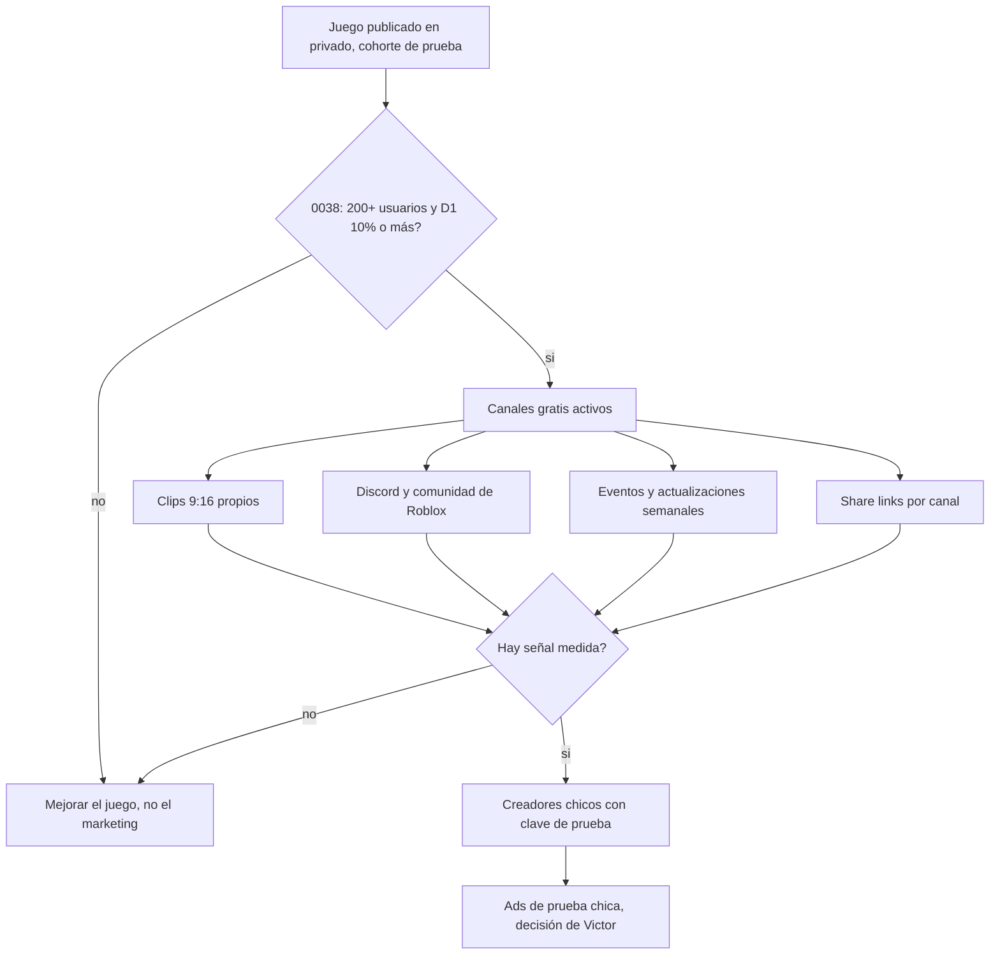

# Más allá de Roblox: comunidad, redes y etapas siguientes

Investigación del issue [#114](https://github.com/Nashei-Studios/studio/issues/114), parte de la épica #109. Fecha: 2026-11-13. Prioridad baja: el estudio hoy construye, esto queda preparado para cuando toque. Nada de lo que sigue es una decisión: las decisiones van a un ADR o a la persona dueña del área (comunidad y crecimiento: Nande; video, miniaturas y presencia visual: Leon).

## Resumen

- El estudio ya tiene medido bastante sobre crecimiento en `roblox-vault`. La regla que manda es la decisión 0038: los primeros ~250 jugadores reales son una cohorte de prueba y no se paga ningún anuncio, creador ni tráfico hasta pasar la puerta de retención. Todo lo de abajo parte de ahí.
- Lo que sí se puede hacer sin gastar: Discord del estudio, comunidad de Roblox con tres enlaces sociales, clips verticales del juego, eventos con fecha y Notify Me, enlaces de compartir con seguimiento por canal, invitaciones y recompensas de referidos dentro del juego, y un calendario de actualizaciones semanales.
- Discord es gratis y suficiente. Un bot de moderación y roles gratis (Carl-bot) cubre lo básico. Los canales por juego solo valen desde ~500 miembros (una sola fuente), así que al inicio basta un servidor chico.
- Shorts y TikTok son marketing, no ingreso. YouTube exige 1.000 suscriptores y 10 millones de vistas de Shorts en 90 días (o 4.000 horas de video largo) para monetizar: está lejos de la escala de un estudio nuevo. Los clips sirven para traer jugadores, y la evidencia del vault dice que 9.700 vistas casi no mueven un juego (un caso).
- Creadores y códigos: no hay tarifas oficiales. Las cifras públicas son de una sola fuente cada una y se negocian. Primero se prueba con creadores chicos y clave de prueba, sin pagar por adelantado, y solo después de pasar la puerta de 0038.
- Otras plataformas: lo más cercano es Fortnite (UEFN), con reparto de ingresos documentado en 2023 (40 % del ingreso neto) pero con otro lenguaje (Verse) y exigencia de ser mayor de 18 o una empresa. Steam cuesta 100 USD por producto. itch.io no cobra por listar y su reparto por defecto es 10 %. Ninguna reutiliza el código Luau del estudio, así que no es una etapa inmediata.
- Merch y cursos: no se encontraron datos propios ni medidos. Quedan como ideas con evidencia insuficiente. El único dato de precio recogido es el de la tienda de productos digitales Gumroad (10 % + 0,50 USD por venta directa), útil solo si algún día hay algo que vender.
- Se proponen 4 tareas (2 para Nande, 2 para Leon), todas con `needs-triage`.

## 1. Lo que el estudio ya tiene

Se cita, no se rehace. Rutas en `Nashei-Studios/roblox-vault`, rama `main`.

| Qué | Dónde | Para qué sirve aquí |
|---|---|---|
| Cohorte de prueba y puerta de retención antes del crecimiento pagado | `decisions/0038-test-cohort-gate-before-growth.md` | Fija el orden: nada pagado antes de 200 usuarios orgánicos y D1 en 10 % o más |
| Anatomía de la página del juego y de la comunidad, límites de eventos, avisos, insignias | `research/game-page-and-community.md` | Lista antes del lanzamiento y lista para mantener la página activa |
| Crecimiento, anuncios, creadores, Discord | `research/2026-11-05-crecimiento-y-descubrimiento.md` (secciones 3.1 a 3.4 y plan por pasos) | CPP de Roblox, tarifas de creadores, política de enlaces a Discord |
| Promoción y video | `research/2026-11-05-promocion-y-video-pipeline.md` | Casos de anuncios, plan por presupuesto (0, 5.000 y 50.000 R$) |
| Tubería de contenido por juego (ícono, 3 miniaturas, video 9:16, 95 min de Victor) | `docs/content-pipeline.md`, `decisions/0013-content-pipeline.md` | Define quién hace qué y que las redes se publican a mano |
| Barras de crecimiento y de live ops | `docs/bars/growth-win-condition.md`, `docs/bars/live-ops.md` | Criterios G1 a G10 y L1 a L10 (cadencia, códigos, calendario, canales desde 500 miembros) |
| Tendencias sociales (TikTok y YouTube, últimos 30 días) | `research/2026-11-05-tendencias-sociales.md` | Formatos de clip que rinden |
| Discord y Reddit | `research/2026-11-05-discord-y-reddit.md` | Sin cifras: solo se leyó FWJ Studios, RBLX Essentials e indies.la |
| Reel 107 (@chrollo_blox) y reel 109 en el Brain | `D:\Victor\Brain\30-recursos\reels\107-*.md`, `109-*.md` | Un creador que creció promocionando juegos en TikTok antes de hacer los suyos; estudios que trabajan remotos por Discord |

Lo que el vault dice que falta: no hay playbook de Discord y de grupos, Ads Manager no está conectado y no hay decisión de presupuesto (`research/2026-11-05-ecosistema-por-etapa.md`, etapa 9).

## 2. Cómo se mueve un estudio chico fuera del juego

El flujo respeta 0038: los canales gratis de la fila D son los permitidos durante la prueba ("clips orgánicos de Victor, el grupo y la promoción cruzada"). Lo pagado (F y G) es posterior.

### 2.1 Discord con roles y avisos

Qué se sabe:

- Activar el modo Community es un ajuste del servidor, gratis, y exige controles de seguridad y un nivel de verificación (Discord, página de ayuda; la página devuelve 403 a clientes automáticos, la lectura vino de una búsqueda: una sola fuente). Da canales de anuncios que otros servidores pueden seguir, Onboarding (el miembro elige roles y canales al entrar) e Insights.
- Un bot gratis como Carl-bot ofrece roles por reacción, registro y moderación automática, con una versión de pago opcional (precio no obtenido).
- Roblox permite hasta tres enlaces sociales en la página del juego, solo los ve quien verificó 16 años o más, y el dueño debe tener 16 años verificados. No se pueden compartir enlaces sociales dentro del juego.
- El vault avisa que publicar invitaciones a Discord en chats o descripciones puede acarrear moderación. Hay que revisar la política vigente antes (vault, `gap-17` y nota de crecimiento, sección 3.3). El texto de las normas de Roblox no se pudo leer desde aquí (403).
- Canales por juego (trading, tips, buscar equipo) solo desde ~500 miembros (una sola fuente: guía rolearn de marzo 2026, sin método). Sin cifras de conversión publicadas: no medido.

Estructura mínima propuesta (no decidida):

| Zona | Canales | Roles |
|---|---|---|
| Entrada | reglas, anuncios (canal de anuncios), onboarding | Miembro |
| Comunidad | general, ideas y feedback | Probador (Nande los asigna) |
| Equipo | privado | Estudio |

### 2.2 TikTok y Shorts con gameplay

- Formatos que rinden en los últimos 30 días, según el vault: gancho de reacción en los primeros segundos y el nombre del juego en el texto del clip. Sirven como hipótesis para clips propios, no como garantía (`research/2026-11-05-tendencias-sociales.md`).
- Monetización de YouTube: 1.000 suscriptores más 4.000 horas de video largo, o 10 millones de vistas de Shorts en 90 días; luego una revisión de unas semanas. Para el estudio es marketing, no ingreso.
- TikTok Creator Rewards: la página oficial nombra seguidores, vistas y duración, pero no da los umbrales. No medido.
- Regla del estudio: las redes se publican a mano, y si hay cuenta por juego la lleva una persona (`docs/content-pipeline.md`, reel 107).
- Evidencia de escala: un caso de TikTok nuevo con 3 videos largos dio 9.700 vistas y un alza leve que cayó (vault, promoción y video, caso 4). Una sola fuente.

### 2.3 Creadores de contenido y códigos

- Tarifas: no hay encuesta de Roblox. En un mercado de creadores (CollabPals) aparecen shoutouts de 1,50 a 20 USD y campañas desde 50 USD; guías generales dicen 50 a 300 USD por video dedicado para 1.000 a 10.000 suscriptores. Cada cifra es de una sola fuente y se negocia.
- Los picos de Grow a Garden y Steal a Brainrot coinciden con creadores grandes (rowatcher.com, una sola fuente; que el video causara el pico es interpretación del autor).
- Roblox anunció un programa de co-marketing a fines de 2025. No se verificó que siga abierto.
- Códigos canjeables: criterio L4 y G9 de las barras (un código por actualización, con vencimiento). Referente medido: +1 Anime Eyes. Un ejemplo real de descripción con "Join Discord Group for Codes" está en `research/2026-11-06-v0-2-g-mercado-pases.md`.
- Herramienta oficial para medir canales: los share links. No tienen límite por juego, se crean uno por canal (por ejemplo, uno por creador) y aceptan `LaunchData` para dar un beneficio a quien llega por ese enlace. Las métricas están en Acquisition del panel.
- Invitaciones y referidos dentro del juego: `SocialService` con invite prompts y el sistema de recompensa de amigos, que entrega recompensa a quien invita y a quien llega.
- Regla pendiente: recompensar un like, favorito o unirse a la comunidad no tiene regla clara en creator-docs. Por eso el módulo del vault queda apagado hasta que Victor confirme las normas (`research/game-page-and-community.md`, hueco [GAP]).

### 2.4 Página del juego y de la comunidad

Ya está resuelto en el vault (`research/game-page-and-community.md`, secciones 4 y 5). Los puntos que importan a Nande y Leon:

- La comunidad lleva el nombre del estudio, no del juego, y es dueña de todos los juegos. Crearla cuesta 100 Robux (una sola fuente: docs de grupos).
- Ícono mínimo de 512x512, hasta 10 miniaturas 16:9, tres enlaces sociales, insignia de bienvenida y dos de hito (5 gratis por día).
- El mismo banner sirve para el evento y para el anuncio de la comunidad.

### 2.5 Live ops con calendario

- Cadencia propuesta por las barras del vault: una actualización por semana durante las primeras 4 semanas, con la fecha de la siguiente escrita (L1, G8). Grow a Garden como referencia, una sola fuente.
- Límites oficiales de eventos: hasta 10 en curso o próximos, un evento puede crearse en privado y pasarse a público cuando esté listo, con título, subtítulo, descripción, miniatura, categoría, fechas y lugar.
- Avisos de actualización: máximo 60 caracteres y uno cada 3 días (una sola fuente: docs leídos por el vault).
- Calendario del estudio: ya existe el tablero y Notion; falta una plantilla de calendario de eventos por juego. Se propone en la tarea 2.

## 3. Herramientas y costo

Solo gratis o casi gratis, contra los NFR del estudio: costo cero, equipo de 3, mantenimiento mínimo.

| Necesidad | Opción A | Opción B | Costo medido | Qué se pierde |
|---|---|---|---|---|
| Comunidad | Discord, modo Community | Solo la comunidad de Roblox | A: gratis (fuente de terceros). B: 100 Robux al crear | A pide moderación y cuidado con invitaciones. B no tiene chat ni canales |
| Roles y moderación | Carl-bot (gratis) | Roles manuales de Discord | Gratis; precio premium no obtenido | Un bot es una dependencia externa. Lo manual no escala |
| Programar publicaciones | Buffer (gratis: 3 canales, 10 publicaciones programadas por canal) | Publicar a mano | A: gratis. B: tiempo de Nande | Con Buffer hay que revisar términos de cada red. A mano se pierde regularidad. La regla del estudio es publicar a mano |
| Edición de video | DaVinci Resolve (versión gratuita) | La tubería existente (ffmpeg y Remotion en `docs/content-pipeline.md`) | A: gratis. B: ya existe | A pesa en una GTX 1650 Ti de 4 GB (no medido). B es por código y la usa Victor |
| Medir canales | Share links de Roblox | Enlaces acortados externos | A: gratis, oficial. | Solo mide la llegada a la página del juego, no el comportamiento posterior |
| Anuncios | Ads Manager (pago, desde 1 crédito) | No hacer anuncios | CPP medio publicado por Roblox: 0,008 USD (autoinformado) | Gasto real. Los casos del vault no recuperaron lo gastado. Prohibido durante la prueba (0038) |

Herramientas no verificadas aquí (no se citan precios): CapCut, Canva, Linktree. Si se proponen, hay que medirlas primero.

## 4. Otras plataformas y productos para después

Contra los NFR: equipo de 3, costo cero, Luau, mantenimiento. Todo es "más adelante", con la condición de tener primero un juego con retención medida.

| Opción | Dato verificado | Encaja con Luau | Qué se pierde / riesgo | Cuándo tendría sentido |
|---|---|---|---|---|
| Fortnite (UEFN) | Epic repartía 40 % del ingreso neto en 2023; creadores deben ser empresa o mayores de 18; las reglas cambiaron (más peso al tiempo jugado y bonos por jugadores nuevos). Cifras cambiantes, algunas con fuente fragmentaria: revisar la oficial | No, usa Verse | Otro lenguaje, otro público, el equipo no tiene Verse | Si un juego gana en Roblox y alguien del equipo quiere aprenderlo |
| Steam | 100 USD por producto, no reembolsables; se recuperan tras 1.000 USD de ingresos ajustados; el reparto no aparece en la página leída | No, es otro motor | Reescribir el juego, soporte de PC, costo inicial | Para un juego propio y distinto, no para portar uno de Roblox |
| itch.io | Reparto por defecto 10 %, configurable de 0 a 100 %; sin tarifa de listado en la página leída; comisión de pago aprox. 0,30 USD + 2,9 % | No (juegos web o descargables) | Poco tráfico propio, hay que llevar al público | Demos, jams y prototipos con costo cero |
| Merch | Sin datos medidos | No aplica | Sin evidencia de demanda ni de margen | Solo con comunidad real; no hay base hoy |
| Cursos o plantillas de pago | Gumroad cobra 10 % + 0,50 USD por venta directa y 30 % por ventas de su mercado, sin cuota mensual. Un caso del vault muestra un curso de pago ligado a un video patrocinado | No aplica | Exige un resultado propio demostrable antes de vender conocimiento | Después de un juego con métricas públicas |

Lectura honesta: ninguna de estas etapas tiene evidencia propia hoy. El orden de valor es itch.io para demos (sin costo), luego mirar UEFN si un juego despega, y dejar Steam, merch y cursos como ideas.

## 5. Qué falta y propuestas en orden

| # | Propuesta | Valor | Esfuerzo | Dueño sugerido | Condición |
|---|---|---|---|---|---|
| 1 | Discord del estudio con Community, onboarding y estructura mínima | Alto | Bajo | Nande | Revisar la política de invitaciones antes de enlazarlo |
| 2 | Convención de share links por canal y plantilla de calendario de live ops | Alto | Bajo | Nande | Necesita un juego en cohorte de prueba |
| 3 | Kit visual del estudio para comunidad y redes (ícono, banner, plantilla de anuncio) | Medio | Medio | Leon | Leon decide estilo |
| 4 | Plantilla de clip vertical con gancho en 3 s | Medio | Medio | Leon | Se apoya en `docs/content-pipeline.md` |
| 5 | Prueba con 3 creadores chicos y clave de prueba | Medio | Bajo | Nande | Solo después de pasar la puerta 0038 |
| 6 | Confirmar normas de recompensa por unirse, like y favorito | Medio | Bajo | Victor | Texto de las normas que Roblox solo sirve a navegador |
| 7 | Ads de prueba chica | Bajo ahora | Costo real | Victor | Prohibido hasta pasar 0038 |

## 6. Tareas nuevas (propuestas, con `needs-triage`)

1. `owner:nande`: montar el Discord del estudio en modo Community (reglas, anuncios, onboarding, roles Probador y Estudio) y dejar escrita la política de invitaciones.
2. `owner:nande`: convención de share links por canal (nombre de campaña y uso de `LaunchData`) y plantilla de calendario de live ops.
3. `owner:leon`: propuesta de kit visual de comunidad y redes (ícono, banner, plantilla de anuncio 16:9). Solo propone, decide Leon.
4. `owner:leon`: propuesta de plantilla de clip vertical 9:16 con gancho en los primeros 3 segundos. Solo propone, decide Leon.

## 7. No medido y límites

- Retorno de Discord, TikTok y Shorts para un juego nuevo: sin cifras públicas fiables. Las pruebas del estudio lo medirán con share links.
- Umbrales de TikTok Creator Rewards: la página no los trae.
- Precio premium de Carl-bot y precio de merch o impresión bajo demanda: no obtenidos.
- Normas de Roblox sobre invitaciones a Discord y sobre recompensar likes o favoritos: la ayuda de Roblox responde 403 a herramientas automáticas. Lo leyó el vault solo a través de creator-docs.
- Cifras de Fortnite: la página oficial responde 403 a curl. Los datos vienen de TechCrunch (2023) y de una búsqueda. Verificar antes de decidir.
- Reddit y X no se leyeron.

## 8. Fuentes

Comprobadas con código 200 (curl, 2026-11-13) salvo donde se indica.

- Creator Docs, promoción: [índice](https://github.com/Roblox/creator-docs/blob/main/content/en-us/production/promotion/index.md), [share links](https://github.com/Roblox/creator-docs/blob/main/content/en-us/production/promotion/share-links.md), [enlaces sociales](https://github.com/Roblox/creator-docs/blob/main/content/en-us/production/promotion/social-media-links.md), [eventos](https://github.com/Roblox/creator-docs/blob/main/content/en-us/production/promotion/experience-events.md), [referidos](https://github.com/Roblox/creator-docs/blob/main/content/en-us/production/promotion/referral-system.md), [invitaciones](https://github.com/Roblox/creator-docs/blob/main/content/en-us/production/promotion/invite-prompts.md), [Ads Manager](https://github.com/Roblox/creator-docs/blob/main/content/en-us/production/promotion/ads-manager.md).
- DevForum, [Ads for Creators: RDC recap](https://devforum.roblox.com/t/ads-for-creators-rdc-recap-and-what%E2%80%99s-next/3929106).
- [rowatcher.com, cómo los YouTubers y TikTokers mueven los charts](https://rowatcher.com/news/how-youtubers-and-tiktokers-move-the-charts-in-2026) (una sola fuente).
- YouTube, [requisitos del Programa de Socios](https://support.google.com/youtube/answer/72851).
- Discord: [guía para desarrolladores de juegos](https://docs.discord.com/developers/game-development/how-to-create-a-community-for-your-game). La [ayuda de Community](https://support.discord.com/hc/en-us/articles/360047132851) responde 403 a curl, no comprobado.
- [Carl-bot](https://carl.gg/premium).
- [Buffer, precios](https://buffer.com/pricing). [DaVinci Resolve](https://www.blackmagicdesign.com/products/davinciresolve).
- [itch.io, pagos](https://itch.io/docs/creators/payments). [Steam Direct](https://partner.steamgames.com/steamdirect). [Gumroad](https://gumroad.com/pricing).
- [TechCrunch, UEFN y 40 % de ingresos (2023)](https://techcrunch.com/2023/03/22/epic-launches-unreal-editor-for-fortnite-will-give-40-of-all-revenue-to-creators). La [noticia de Epic sobre pagos](https://www.fortnite.com/news/fortnite-engagement-payout-update) responde 403 a curl, no comprobada.
- Normas de Roblox ([Community Standards](https://en.help.roblox.com/hc/articles/203313410)): 403 a curl, no comprobada.
- Vault y Brain: rutas de la sección 1.
