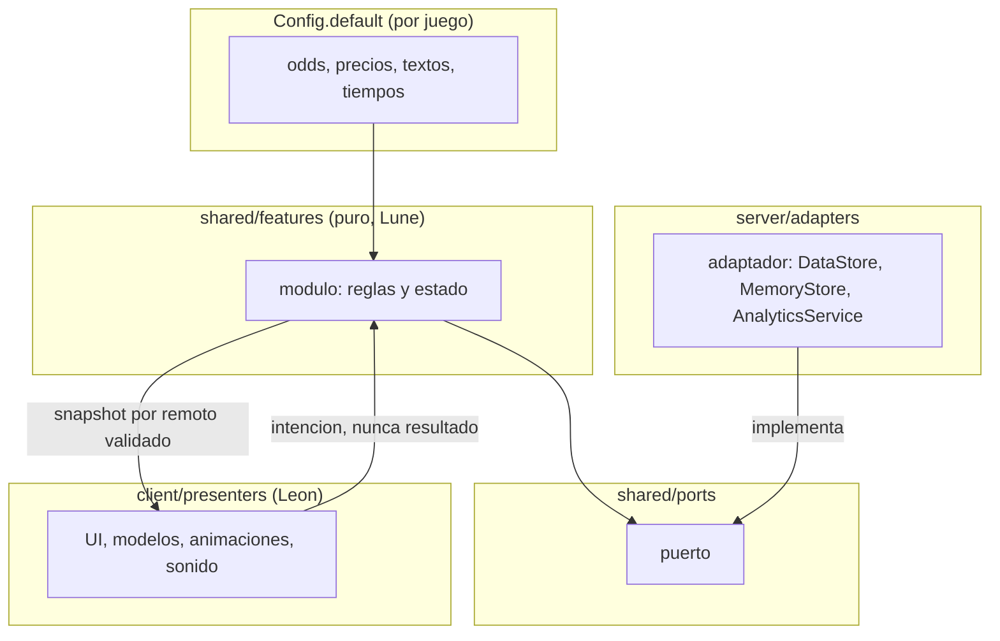
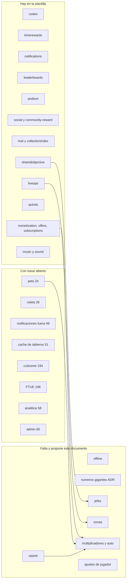

# Sistemas comunes de la plantilla y por género

Issue: Nashei-Studios/studio#112. Épica: #109. Fecha de la investigación: 2026-11-13 y 14. Autor: trabajador de investigación; las decisiones son de Victor y Leon.

## Resumen

1. **Qué era Roblox Essentials.** Un conjunto de 13 productos de un autor externo (`rblx-essentials.itch.io`): 7 de pago (suma 72,93 USD, el bundle completo 34,99 USD) y 6 gratis. Vende menús y HUD ya armados (tienda, ajustes, mascotas, ruleta, códigos, recompensas, tableros, notificaciones, reproductor de música) sobre su propio guardado en un solo DataStore. El estudio decidió no comprarlo y hacer cada sistema propio (decisión 0022 del vault, opción B).
2. **La plantilla ya cubre mucho más de lo que se creía.** En `roblox-game-template` existen los módulos `codes`, `timerewards`, `notifications`, `leaderboards`, `podium` (podio 3D con avatares), `social`, `community-reward`, `hub`, `collectionindex`, `sharedobjective`, `liveops`, `quests`, `offers`, `music`, `sound`, `subscriptions`, `privateserver`, `rewardedads`, `analytics`, `playerdata` (ProfileStore) y otros. La matriz `docs/referent-features-matrix.md` de la plantilla ya lista 50 atracciones de referentes, 30 funciones de Essentials y 14 de presencia social con su estado. Este documento no la rehace: la cruza con lo que hay en `src/`, agrega lo que faltaba en tu lista y corrige estados desactualizados.
3. **Lo que falta de verdad** (sin módulo ni issue abierto): rebirth, ganancias offline, números gigantes para incrementales, zonas que se desbloquean, multiplicadores apilados y funciones automáticas, jefes, ajustes estándar de jugador (hay un issue de experiencia, #45, no de jugador), tienda de cosméticos, rueda de emotes y ayuda de voz. Los demás vacíos ya tienen issue en la plantilla (mascotas #24, ruleta #26, notificaciones fuera del juego #49, caché de tableros #51, menús #53, regalos #54, eventos globales #55, analítica de funnel #58, soft shutdown #59, consola de admin #60, privacidad #61, audio #62, pase de temporada #63, cutscenes #194, onboarding #196).
4. **Hallazgo nuevo que cambia una decisión.** Roblox publicó, en beta, un tablero persistente nativo: las vistas "Friends" y "Global" de la lista de jugadores leen un `OrderedDataStore` que se registra en Creator Hub. Cuesta cero código de UI. No reemplaza el tablero físico del lobby ni el podio, pero sí al menú 2D de tablero: conviene registrar el mismo `OrderedDataStore` que ya escribe `leaderboards` y no dibujar un menú propio salvo que Leon quiera uno de marca.
5. **Casi nada de esto tiene código abierto utilizable.** Las búsquedas en GitHub devuelven repositorios de 0 a 5 estrellas, la mayoría sin licencia o con scripts de exploit. Lo mantenido y con licencia compatible es infraestructura (ProfileStore, Cmdr, zap, RbxUtil, Lyra), no sistemas de juego. Para los sistemas de juego la recomendación es **hacer** en la plantilla, leyendo diseños como referencia, y **adoptar** solo servicios nativos de Roblox y los módulos oficiales (Emote Bar, Event Sequencer) cuando su licencia lo permita.
6. **Ocho tareas nuevas** salen de aquí (sección 8): seis de código para Victor, dos de propuesta visual para Leon. Todas con `needs-triage`.

## 1. Método y límites

- Revisé primero lo que el estudio ya tiene: `roblox-game-template` (`src/`, `docs/referent-features-matrix.md`, `docs/ecosystem-map.md`, ADR 0022 a 0071), `games/drain-for-loot` (`src/`, `docs/game/`) y el vault (`decisions/0022`, `0023`, nota `research/2026-11-05-ecosistema-base-paridad-essentials.md`, notas `gimmicks/`).
- Lo externo se leyó de la documentación oficial (`Roblox/creator-docs` en GitHub) y de la API de GitHub (`gh api repos/...`, medida el 2026-11-13 y 14). Lo que sale solo de una búsqueda web o del DevForum sin abrir el código se marca **sin revisar**.
- Lo que los juegos grandes hacen sale de dos fuentes: la matriz de la plantilla y las notas del vault, que ya midieron referentes por API y con gameplays (2026-11-05 a 08). Esas notas marcan "visto" o "inferido"; aquí se conserva esa marca. No jugué ningún juego ni abrí paquetes de terceros.
- Ningún número de esta página es medido por mí salvo las estrellas, licencias y fechas de push de GitHub. Los límites de servicios vienen de la documentación oficial.
- Los enlaces de GitHub se comprobaron con `gh api repos/<dueño>/<repo>` (existe, con licencia y fecha); los demás, con `curl` (código 200).

## 2. Qué incluía Essentials y dónde cae cada pieza

Fuente: perfil del autor y tienda (ambos 200 al 2026-11-13) y la auditoría del vault.

| Producto de Essentials | Precio | Cae en | Estado en el estudio |
|---|---|---|---|
| General UI Kit (14 menús), Classic UI Kit, Studded Glass UI Kit | 14,99 cada uno | UI | La UI es de Leon (ADR 0071); no se copian temas ajenos (barra de entrega, punto 4) |
| Easy Pet System | 9,99 | Mascotas | Falta; issue #24 |
| Leaderboards System (tableros, podio, formatos) | 5,99 | Tableros | `leaderboards` y `podium` existen |
| Roulette System Kit | 5,99 | Ruleta | Falta; issue #26 |
| Time Rewards System Kit (racha y regalos por tiempo) | 5,99 | Recompensa diaria | `timerewards` existe |
| Datastore & Purchase System | gratis | Datos | ProfileStore y `monetization`, mejores que su guardado único |
| Codes System Kit | gratis | Códigos | `codes` existe |
| Notification System Kit (toasts, banner, chat) | gratis | Notificaciones | Toasts sí; banner y líneas de chat con color no |
| Sound System & Music Player | gratis | Audio | `sound` y `music` existen; falta el reproductor con UI (#62) |
| RBLX Essentials Plugin | gratis | Instalador | Rojo y `new-game.ps1` cumplen ese papel |
| Studded UI: Design Only | gratis | UI | Solo referencia visual |

Licencia de Essentials: uso en cualquier cantidad de juegos propios, sin redistribución ni siquiera modificada (vault, decisión 0022). El estudio no lo compra: cada módulo se escribe detrás de un puerto, con configuración y pruebas.

## 3. Arquitectura común de todos los sistemas

Todos siguen la regla que la plantilla ya fijó (ADR 0009, 0022, 0028): lógica pura y probada con Lune en `src/shared/features/<sistema>/`, puertos en `src/shared/ports/`, adaptadores de motor en `src/server/adapters/`, presentadores de UI en `src/client/presenters/`. Lo que da valor pasa por el servidor y por guardado confirmado (ADR 0016); remotos con validación y límite de frecuencia (ADR 0012).

Reparto fijo: Victor entrega el módulo, el puerto, el adaptador y un presentador mínimo de depuración (`SetCoreToastRenderer` es el ejemplo). Leon decide cómo se ve y suena (ADR 0071; el issue #112 lo repite: "el arte y la UI los decide Leon"). Cada fila de las secciones siguientes separa las dos partes.

## 4. Catálogo de sistemas comunes

Leyenda de la decisión: **Adoptar** (usar lo externo tal cual), **Adaptar** (partir de algo externo y moldearlo), **Hacer** (escribirlo en la plantilla). Estados: **hay** (módulo cubre de punta a punta), **parcial**, **falta**.

| # | Sistema | Estado en la plantilla | Estado en drain-for-loot | Decisión | Issue existente o nuevo |
|---|---|---|---|---|---|
| C1 | Leaderboard 2D (GUI) | hay: `leaderboards`, formatos, ciclos diario y semanal | hereda la plantilla | Adoptar el tablero nativo de Roblox (beta) y hacer solo el menú si Leon lo quiere | #51 (caché), nuevo L1 (visual) |
| C2 | Leaderboard 3D físico y podio | parcial: `podium` hace los 3 primeros con avatares; faltan las filas 4 a N en pared | hereda | Hacer (ya hecho) y completar | #51, nuevo L1 |
| C3 | Notificaciones y toasts en el juego | hay: `notifications`, `ToastController` | hereda | Hacer; sumar banner y chat con color | #49 (fuera del juego) |
| C4 | Notificaciones fuera del juego | falta | falta | Adoptar `ExperienceNotificationService` | #49 |
| C5 | Chat de voz | falta (nativo, solo configuración) | falta | Adoptar el nativo | nota en #45 |
| C6 | Chat con etiquetas | parcial: `Announcer` usa `TextChatService` | hereda | Adoptar `TextChatService` | por el módulo `progress` |
| C7 | Emotes | parcial: `HubEmotes` (lista permitida y enfriamiento) | falta | Adoptar el menú nativo; Emote Bar oficial como referencia | nuevo L2 |
| C8 | Cutscenes | falta | falta | Hacer (molde `CutsceneRunner`) | #194 |
| C9 | Animaciones | n/a (arte) | `animate-roblox-characters` y legacy | Adoptar catálogo y herramientas de Studio | nuevo L2 |
| C10 | Datos | hay: ProfileStore detrás de `ProfileRepository` | hereda | Adoptar (ya hecho) | #34, #74 |
| C11 | Códigos | hay: `codes` | hereda | Hacer (ya hecho) | sin tarea |
| C12 | Recompensa diaria y racha | hay: `timerewards` | hereda | Hacer (ya hecho); decidir racha que pausa o que reinicia | nuevo L2 (visual) |
| C13 | Ajustes del jugador | parcial: `SoundSettings`, `MomentSettings`; sin menú ni persistencia común | parcial (`Config`) | Hacer | #45 ajusta la experiencia, no al jugador |
| C14 | Tutorial con flechas | falta en la plantilla | legacy: `TutorialController` (tarjeta de misión y rastro de flechas con `Beam`) | Adaptar el de drain-for-loot | #196 |
| C15 | Panel de administración y depuración | falta | falta | Adoptar Cmdr (MIT) con lista de permisos | #60 |
| C16 | Analíticas con `AnalyticsService` | parcial: solo `LogCustomEvent` | `AnalyticsService_` legacy | Hacer el catálogo tipado de funnel y economía | #58 |
| C17 | Invitar amigos | hay: `social` + `InvitePrompt` | hereda | Adoptar `SocialService` (ya hecho) | sin tarea |
| C18 | Unirse al grupo | hay: `community-reward`, apagado hasta decisión de Victor | hereda | Hacer (ya hecho) | sin tarea |
| C19 | VIP | parcial: `subscriptions`, `monetization`, `offers` | hereda | Hacer sobre el módulo existente | nuevo L2 (visual) |

### C1 y C2. Leaderboards en GUI y en 3D

**Qué hacen los mejores.** Mantienen una lista global y otra de amigos, y exhiben a los líderes en el lobby: "Cut a Rock lista tableros globales; Spider Arm tiene tablero y exhibe rigs de otros en el lobby" (vault, notas `played-08` y `played-05`, marca "visto en pantalla"). Los tres primeros con su avatar es lo que Essentials vende por 5,99.

**Lo que hay.** `src/shared/features/leaderboards/` (tableros, ciclos, `Format`), adaptador `OrderedDataStoreBoards`, `ReplicatedBoardPublisher`. `src/shared/features/podium/` más `PodiumStage` (escenario con `Players:CreateHumanoidModelFromUserId`, filtro de nombres, caché por intervalo; ADR 0056). La matriz de la plantilla todavía marca E22 como "parcial (#50)": desactualizada, el módulo ya existe.

**Alternativas.**

| Opción | Rendimiento en celular | Costo | Equipo de 3 | Mantenimiento | Qué se pierde |
|---|---|---|---|---|---|
| A. Tablero persistente nativo de Roblox (vistas Friends y Global de la lista de jugadores; beta; un solo tablero activo por experiencia) | El mejor: no dibujamos nada | 0 | Registro en Creator Hub y un `OrderedDataStore` | Lo mantiene Roblox, pero es beta y puede cambiar | Marca propia, tablero por periodo (diario, semanal), más de uno |
| B. Menú 2D propio sobre `leaderboards` (hoy) | Bueno | 0 | Ya escrito | Propio | Más UI de Leon que mantener |
| C. Tablero 3D con avatares en el lobby (`podium`) | Costo de 3 `HumanoidModel`; se refresca por intervalo | 0 | Ya escrito | Propio | Un muñeco de avatar por servidor |
| D. Pagar el pack de Essentials | Desconocido (no medido) | 5,99 | Sin código propio | Del autor | Código propio, licencia sin redistribución |

**Decisión recomendada.** A y C juntos: el tablero nativo para la vista global (Friends y Global gratis) y el podio 3D como pieza de lobby y de clip. B solo si Leon pide un menú de marca. Cambiaría si la beta se retira o si queremos tableros por periodo, que el nativo no tiene. Fuente: [documentación de leaderboards](https://create.roblox.com/docs/players/leaderboards) (200).

**Victor.** Escribir en la plantilla el registro documentado del `OrderedDataStore` (una clave por `UserId`, un puntaje numérico) y completar las filas 4 a N en el mundo si se pide. Seguir #51 (caché `MemoryStoreSortedMap`, el vault calculó que cuesta cerca de 8 % de la cuota con 100 ítems por tablero; es una cuenta del vault, no medida).

**Leon.** Diseño del tablero físico del lobby (pared, pedestal, tipografía), modelos de los 3 escalones, medallas, cómo se ve un avatar vacío. Tarea L1.

### C3, C4 y C6. Notificaciones, banner y chat con etiquetas

**Qué hacen los mejores.** Toast al ganar algo, banner al arriba cuando empieza un evento, línea de chat coloreada al abrir un huevo raro, "amigo entró". Essentials lo vende como 7 plantillas de toast, banner, líneas de chat y anuncios rotativos.

**Lo que hay.** `notifications` (cola, controlador, config con texto, estilo, duración y sonido) y `RemoteNotifier`. `Announcer` publica por `TextChatService`. Faltan banner y anuncios rotativos.

**Opciones externas.** Búsqueda en GitHub: `banan2114/RBX-Libraries` (MIT, 0 estrellas, push 2026-10-31), `spiraljng/roblox-notifications-server` (sin licencia). Nada con mantenimiento real ni licencia clara. Chat: la documentación trae un ejemplo oficial de [etiquetas de grupo en el chat](https://create.roblox.com/docs/chat/examples/group-chat-tags) (200).

**Decisión.** Hacer el banner y los anuncios rotativos sobre `notifications` y `liveops` (ya existe el reloj de rotación). Adoptar `TextChatService` para el chat. Para fuera del juego, adoptar `ExperienceNotificationService`: aviso a usuarios de 13 años o más que aceptaron, y una notificación por usuario por día por experiencia según la documentación oficial leída por el vault ([documentación](https://create.roblox.com/docs/production/promotion/experience-notifications), 200). Diseño en #49; el límite de la API de envío no apareció en la documentación (vault, marcado como hueco).

**Victor.** Banner, anuncios rotativos, adaptador de chat con color; #49. **Leon.** Plantillas visuales del toast y del banner, ícono por tipo (tarea L2).

### C5. Chat de voz

**Qué dice la documentación.** Voz está activa por defecto para usuarios verificados de 13 años o más en experiencias nuevas, solo en lugares de hasta 100 jugadores, y es de proximidad por defecto. Para sin proximidad o por equipo hay scripts de ejemplo con `AudioDeviceInput` y `Wire`. Ver [Voice Chat](https://create.roblox.com/docs/chat/voice-chat) (200). Los juegos con voz "suelen tener" más engagement según el propio texto de Roblox; es afirmación de una sola fuente, sin cifra.

**Decisión.** Adoptar el nativo. No hay nada que escribir: hay que decidir por juego (a) si el lugar admite más de 100 (no sirve voz), (b) si el modo es de proximidad o global, y (c) activar la casilla en Experience Settings. Tarea mínima: sumar esa decisión a la plantilla de ajustes de experiencia (#45) con un comentario, no con código.

**Victor.** Documentar la decisión por juego. **Leon.** Ícono de micrófono y estados en el HUD (el nativo ya trae el suyo; solo se toca si se oculta el de Roblox).

### C7 y C9. Emotes y animaciones

**Qué hacen los mejores.** Rueda de emotes y espacios extra como pase (The Strongest Battlegrounds usa "B, rueda de emotes"; "Extra Emote Slots" cuesta 99 Robux en la matriz, marcado "inferido").

**Lo que hay.** `HubEmotes` valida en servidor que el id esté permitido y que pase el enfriamiento. No hay rueda ni animación.

**Opciones.**

| Opción | Rendimiento | Costo | Mantenimiento | Qué se pierde |
|---|---|---|---|---|
| A. Menú nativo de emotes (hasta 8 equipados con `HumanoidDescription:SetEquippedEmotes`; `GuiService:SetEmotesMenuOpen`) | Mejor | 0 | Roblox | Aspecto propio |
| B. Módulo oficial Emote Bar (Creator Store, paquete de Roblox) | Bueno | 0 | Roblox; licencia no leída | Código ajeno en la plantilla; no entra al gate |
| C. Rueda propia sobre `HubEmotes` | Bueno | Trabajo | Propio | Más trabajo de Leon |

**Decisión.** A por defecto; C solo si el juego vende emotes como cosmético o espacios como pase (F26, F27 de la matriz). B queda como referencia, no se instala (regla del estudio: nada se instala sin leer su código). Fuentes: [Emotes](https://create.roblox.com/docs/characters/emotes) (200) y [Emote Bar](https://create.roblox.com/docs/resources/modules/emote-bar) (200).

**Animaciones.** Las mejores animaciones son contenido, no código. Leon decide el estilo. Opciones: editor de animaciones de Studio, catálogo y el módulo `Social Interactions` de Roblox (orientación del cuerpo y animaciones en el chat, [documentación](https://create.roblox.com/docs/resources/modules/social-interactions), no comprobada por curl). El estudio ya tiene las skills `animate-roblox-characters` y `make-anim`.

### C8. Cutscenes

**Qué hacen los mejores.** Cámara guiada de 3 a 10 segundos al desbloquear una zona o abrir un huevo raro; cortes de jefe. En los juegos pequeños se usa para el momento "clip" (módulo `clipmoment` y `reveal` ya existen).

**Opciones.**

| Opción | Licencia y estado | Qué se pierde |
|---|---|---|
| `timoursfoil/Easy-Roblox-Cutscenes` | MIT, 1 estrella, push 2025-06-04 | Casi sin uso; no se revisó el código |
| Módulos del DevForum (EasyCutscenes, CameraUtil, Cutscene Module V1, CutsceneManager 2.0) | Sin licencia verificada; foros | Licencia incierta |
| `Sleitnick/RbxCameraShaker` | MIT, 128 estrellas, push 2023-07-06 | Sin mantenimiento desde 2023; solo el temblor de cámara |
| Event Sequencer oficial (conciertos, cutscenes sincronizadas entre servidores) | Paquete de Roblox; licencia no leída (la página de licencia de uso limitado existe, no confirmé que aplique a este paquete) | Mucho más grande de lo que necesitamos; no se lee ni se vendoriza sin revisión |
| Molde propio `CutsceneRunner` (lista de pasos con cámara, tween, sonido y bloqueo de input) | Propio | Trabajo de Victor |

**Decisión.** Hacer el `CutsceneRunner` ya pedido en #194, leyendo el diseño de CameraUtil y EasyCutscenes como referencia sin copiar código. Los pasos son datos, el runner es puro y la cámara es un presentador.

**Victor.** #194. **Leon.** Las tomas (puntos de cámara, música, texto) de cada cutscene de cada juego.

### C10. Bases de datos

**Hecho.** ProfileStore detrás de `ProfileRepository` con migraciones puras y guardado confirmado antes de entregar una compra. La skill `roblox-data` pide lo mismo: `UpdateAsync`, sesión exclusiva, `BindToClose`, claves con el `UserId` visible para borrado por privacidad. Pendientes relacionados: #61 (borrado por privacidad) y #74 (cancelar el unirse). Alternativa evaluada: Lyra (MIT, 156 estrellas, push 2026-03-25), que el mapa del ecosistema deja solo como referencia; ProfileStore tuvo su último push el 2025-07-31 y no está archivado, así que se mantiene. Una base externa solo vale con 2 o más juegos con CCU sostenido (cuenta del vault, no medida).

### C11, C12 y C13. Códigos, recompensa diaria y ajustes

**Códigos.** Hecho. Pendiente de Leon: que el jugador tenga una caja de texto visible (el vault lo marcó como hueco en +1 Mining Power).

**Recompensa diaria y racha.** Hecho. Decisión abierta del vault (matriz E28): Essentials pausa la racha con un día perdido, la plantilla la reinicia tras una ventana de gracia. La skill `roblox-player-psychology` dice "streaks with one forgiven day". Recomendación: un día perdonado, y de ahí en adelante pausa en vez de reinicio. Es una decisión de diseño de Victor; se anota para el grill, no se cambia aquí.

**Ajustes del jugador.** `SoundSettings` y `MomentSettings` existen por separado, sin menú común. Mínimo útil: volumen de música y de efectos, activar o no el temblor de cámara, escala de texto, daltonismo (hay `Contrast` en `ui/`), reducir movimiento, y atajo para ocultar el chat de voz. Guardarlo en el perfil (ProfileStore) y no en un store aparte. Es lo que la skill `roblox-gui` pide con "layouts own repeated layout" y el cuidado de móvil primero. **Hacer.**

### C14. Tutorial con flechas

**Qué hacen los mejores.** Primer minuto guiado: 5 a 10 s de acción, 10 a 30 s la primera recompensa, objetivo visible; la skill `roblox-player-psychology` lo resume en una tabla de 60 segundos. La flecha va con `Beam` entre el jugador y el objetivo.

**Lo que hay.** En drain-for-loot, `src/client/legacy/Controllers/TutorialController.luau` (326 líneas): tarjeta de misión arriba a la izquierda y un rastro de flechas con `Beam` y marcador que rebota, sin quitar el control al jugador. Es código heredado de Leon (decisión del grupo sobre legacy pendiente: "sirven como base, el grupo decide"). La plantilla tiene `quests` (cadenas con contadores) pero no la flecha. #196 pide el molde FTUE con máquina de pasos, flecha, saltar y eventos de funnel.

**Decisión.** Adaptar: sacar la flecha y la tarjeta de ese controlador como presentador de la plantilla y hacer que la máquina de pasos viva en `quests`. **Victor** máquina y eventos; **Leon** aspecto de la flecha y la tarjeta.

### C15. Panel de administración y depuración

| Opción | Licencia y estado | Qué se pierde |
|---|---|---|
| `evaera/Cmdr` | MIT, 546 estrellas, push 2026-10-21 | Consola de texto, sin interfaz gráfica de moderación |
| `Epix-Incorporated/Adonis` | MIT, 516 estrellas, push 2026-11-05 | Superficie de ataque grande; el vault lo descartó |
| Panel propio sobre `Players:BanAsync` y Open Cloud `user-restrictions` | Propio | Más trabajo |

**Decisión.** Cmdr vendorizado con lista de permisos desde `Config` y un puerto `Moderation` (ya descrito en #60). Nada de comandos que den moneda en producción. Nota de seguridad: la consola es una superficie de exposición; la lista de permisos va validada en el arranque, no hardcodeada.

### C16. Analíticas con `AnalyticsService`

La documentación oficial separa eventos de **funnel** (onboarding con `LogOnboardingFunnelStepEvent`, recurrentes con `LogFunnelStepEvent`), de **economía** (`LogEconomyEvent`, fuentes y sumideros) y **personalizados**; todos solo desde el servidor y en juegos publicados (no en Studio). Hoy `AnalyticsServiceSink` solo usa `LogCustomEvent`. Falta el catálogo tipado de onboarding, tienda y economía que alimenta los tableros del Creator Hub. #58 ya cubre el funnel; este documento agrega economía y la regla "un evento por fuente y sumidero de cada moneda". Fuentes: [funnel](https://create.roblox.com/docs/production/analytics/funnel-events), [economía](https://create.roblox.com/docs/production/analytics/economy-events), [personalizados](https://create.roblox.com/docs/production/analytics/custom-events) (todas 200).

### C17, C18 y C19. Invitar, grupo y VIP

**Invitar.** `SocialService:PromptGameInvite` y `Player:GetJoinData`; la plantilla ya tiene `social`, `InvitePrompt` y recompensa idempotente. [Documentación](https://create.roblox.com/docs/production/promotion/invite-prompts) (200).

**Unirse al grupo.** `community-reward` (con `CommunityPerk`) y `RobloxGroupMembership`. Está apagado a la espera de una regla de Community Standards (vault). Los referentes ofrecen un beneficio real, no solo monedas (Tower Defense Simulator "+$100 al empezar", Mine a Mountain "+1 Digging Luck").

**VIP.** Es un pase o una suscripción con beneficios; el escalón de precios más común está entre 199 y 375 (matriz F25, de una lectura de API). La skill `roblox-monetization` exige un registro único de pase a beneficio que sirva igual al unirse y al comprar, y recompensa solo desde el servidor. Hacer sobre `subscriptions` y `monetization`. **Leon**: insignia, color de nombre, sala o zona VIP.

## 5. Catálogo por género: incrementales y simuladores

Los referentes medidos por el estudio (Steal An Egg, Tap Simulator REBORN, Crypto Empire, My Small Business, Mine a Mountain, Lift Rock, ver matriz) comparten un esqueleto: ganar una moneda, gastar en mejoras, reiniciar por un multiplicador, coleccionar mascotas con probabilidades, y volver por reloj.

| # | Sistema | Estado en la plantilla | Decisión | Issue |
|---|---|---|---|---|
| G1 | Rebirth y prestigio | falta | Hacer | nuevo V1 |
| G2 | Mascotas | falta | Hacer | #24 |
| G3 | Huevos con probabilidades visibles | falta (con la política de azar de pago) | Hacer | #24 y #26 |
| G4 | Ganancias offline | falta (F06 en la matriz) | Hacer | nuevo V2 |
| G5 | Números gigantes | falta | Adoptar una librería tras comparar | nuevo V3 |
| G6 | Auto-recoger y funciones automáticas | falta | Hacer | nuevo V5 |
| G7 | Multiplicadores apilados | parcial: `social` y `offers` aplican multiplicadores sueltos | Hacer | nuevo V5 |
| G8 | Zonas que se desbloquean | falta | Hacer | nuevo V4 |
| G9 | Jefes | falta en la plantilla; legacy en drain-for-loot | Adaptar | nuevo V6 |
| G10 | Eventos de tiempo | hay: `liveops` (rotación y ventanas); falta el evento global entre servidores | Hacer | #55 |

### G1. Rebirth

**Qué hacen.** Reinicio del progreso a cambio de un multiplicador permanente; es un patrón común del género, con curso de simuladores que lo trata como tema propio (vault, `gimmicks/rebirth-prestige-multiplier.md`, "ningún juego verificado" aún; la nota admite que no hay evidencia jugada).

**Código abierto.** Ninguno útil: la búsqueda `roblox rebirth` en GitHub no devolvió un repositorio con licencia y mantenimiento. **Hacer**: módulo puro `features/rebirth` con curva de costo y multiplicador en `Config`, requisito, qué se conserva (pases, mascotas fijadas, códigos canjeados) y qué se reinicia; todo bajo guardado confirmado. **Victor** módulo. **Leon** pantalla de rebirth y la animación del reinicio.

### G2 y G3. Mascotas y huevos con probabilidades visibles

**Qué hacen.** Huevos con pesos, fusión de 3 iguales, Equip Best, índice con encontradas y ocultas, seguimiento en tres modos, mutaciones y tamaños (matriz F16, F17, E17 a E20).

**Código abierto.** `RealOda/Gacha-System` (MIT, 0 estrellas, push 2026-07-23) y `bilalylkvn1/roblox-gameplay-toolkit` (MIT, 1 estrella, push 2026-11-13) son los que el vault ya midió; el segundo trae seguimiento procedural. Ninguno tiene comunidad. No se adoptan; se leen como referencia de diseño. `adoredpersonn/Roblox-Pet-Simulator-Script` es MIT pero es un script de juego, no un módulo.

**Regla que cambia el diseño.** Cualquier huevo o ruleta que se pague con Robux, directa o indirectamente (por gemas, llaves o tickets), es un "ítem aleatorio de pago": hay que mostrar **todos los resultados con su probabilidad numérica, que sumen exactamente 100 %**, antes de gastar; un botón "Detalles" con la palabra, no solo "(i)"; y un potenciador de suerte debe explicar y actualizar las probabilidades reales mientras esté activo. Además `PolicyService:GetPolicyInfoForPlayerAsync` devuelve `ArePaidRandomItemsRestricted` por jugador. Fuente: [política](https://create.roblox.com/docs/production/monetization/paid-random-items) (200). La skill `roblox-player-psychology` agrega las 5 rarezas típicas (55, 27, 12, 5, 1 %), mostrar el pozo y un contador de piedad.

**Decisión.** Un solo motor de "elección ponderada" compartido por mascotas, ruleta y suerte (la matriz ya lo pide: "diseñarlo una vez, como ADR"). Falta ese ADR; está en #24 y #26. **Victor** el motor, la tabla de probabilidades que la UI consume y el chequeo de política. **Leon** huevos, apertura, modelos de mascotas, índice.

### G4. Ganancias offline

**Qué hacen.** Calculan lo ganado mientras el jugador no estaba: `tasa por segundo × tiempo fuera × multiplicador`, con un tope de horas y a veces una tasa menor; se muestra un estimado al volver (matriz F06, "Crypto Empire" y "My Small Business"; vault: "En el juego (rebirth); offline no auditado").

**Cómo se suele hacer.** Todas las discusiones del DevForum coinciden: guardar la marca de tiempo al salir con el resto del perfil y comparar al entrar ([cómo hacer un sistema offline](https://devforum.roblox.com/t/how-to-make-an-offline-earning-system/3761245), [cómo lo hacen los juegos Steal a...](https://devforum.roblox.com/t/how-do-steal-a-games-calculate-offline-cash/3854950), ambos 200). Son hilos informales y no verifiqué el código. Cuidado: una carga fallida del perfil no puede producir un tiempo fuera gigante.

**Decisión.** Hacer. Función pura `OfflineEarnings.compute(lastSeen, now, rate, cap, factor)` con reloj inyectado, tope y factor en `Config`, una marca `lastSeen` en el perfil guardado en el mismo registro, y un presentador mínimo del resumen. Las pruebas cubren: reloj que retrocede, tope, perfil nuevo y la falla de carga. **Leon** la pantalla de "mientras no estabas".

### G5. Números gigantes

Los incrementales rebasan `1e308` y rompen el `leaderstat` (hilo "After 1e308 leaderstat game breaks"). Opciones del DevForum, todas **sin revisar**:

| Opción | Licencia | Dato | Qué se pierde |
|---|---|---|---|
| EternityNum / EternityNum2 | no verificada | la más usada en simuladores de botones (autor) | Rendimiento |
| GammaNum | no verificada | dice ser "hasta 100 veces más rápida" que EternityNum; una respuesta reporta fallos en `toSuffix` y `tostring` en valores altos; una sola fuente | Madurez |
| Gigantix | MIT, según su autor | números "de tamaño infinito" | Una sola fuente |
| APInt | no verificada | enteros de precisión arbitraria; benchmarks propios | Rendimiento en celular, sin medir |
| BigNum de RoStrap | no verificada | clásica, con precisión exacta | Antigua |
| Mantisa y exponente propios (un `{m, e}` con comparación y formato) | Propio | Los hilos dicen que un incremental rara vez necesita precisión exacta | Escribirlo y probarlo |

Enlaces comprobados: [EternityNum2](https://devforum.roblox.com/t/doing-math-with-arbitrarily-large-numbers-eternitynum2/3081503), [Gigantix](https://devforum.roblox.com/t/gigantix-infinite-size-numbers-module/3307153), [GammaNum](https://devforum.roblox.com/t/gammanum-up-to-100x-faster-than-eternitynum/3906397), [APInt](https://devforum.roblox.com/t/a-pint-unlimited-numbers-library-for-incremental-games-and-simulators/3936725) (todos 200).

**Decisión.** Ninguna con licencia clara y código revisado hoy. Tarea V3: un ADR que mida dos candidatos (por ejemplo, un `{mantisa, exponente}` propio de unas 150 líneas contra Gigantix o EternityNum con licencia comprobada en su repositorio) en un celular de gama baja y que decida; hasta entonces, juegos que no pasen de `1e15` usan `number` y el `Format` existente.

### G6 y G7. Auto-recoger y multiplicadores

**Qué hacen.** Funciones automáticas vendidas como pase (Auto Collect, Auto Sell, Auto Tap; matriz F28), escalera de pases de multiplicador (x2 a x64; F20) y multiplicadores por amigos (`social` hoy). Lo que falta es una sola fórmula para apilar: sumar bonos del mismo tipo y multiplicar entre tipos, para que "x2 de pase", "+50 % de amigos" y "x3 de rebirth" no se pisen ni se vuelvan imposibles de depurar.

**Código abierto.** Ninguno. **Hacer** `features/multipliers` (registro de fuentes con tipo, valor y vencimiento, resultado explicado: la UI puede mostrar de dónde sale cada porcentaje) y `features/autofeatures` (permiso y cadencia en servidor; el cliente solo pide). Esto además es lo que la política de azar exige para la suerte (ver G3). **Leon**: íconos de cada multiplicador y el panel de desglose.

### G8. Zonas desbloqueables

**Qué hacen.** Cada zona exige un costo o un nivel y muestra un precio sobre la puerta; "una zona nueva cada hora" es el patrón de Mine a Mountain (matriz F31, ya cubierto por `liveops` en el reloj). La plantilla trae `hub` (anillos de aparición y estaciones) y `ZonePlus` (de `1ForeverHD`, MIT, push 2024-07-04; sin mantenimiento) queda descartado por el mapa del ecosistema.

**Decisión.** Hacer `features/zones`: lista de zonas en `Config` (requisito, costo, orden), estado por jugador en el perfil, puerta que valida en servidor (ataque típico: teletransportarse dentro de la zona; la comprobación debe estar en el servidor y en el punto de aparición). **Leon** el modelo de la puerta, el efecto al abrir y la cutscene corta (C8).

### G9. Jefes

**Lo que hay.** `drain-for-loot` tiene `src/server/legacy/Services/BossService.luau` (298 líneas) y `BossController` en el cliente. No leí su lógica a fondo; el grupo decidió que los legacy de Leon "sirven como base, el grupo decide". La plantilla no tiene un molde de encuentro. `sharedobjective` ya resuelve "barra de progreso común que abre por reloj y termina en premio o falla" (ADR 0049), que es el esqueleto de un jefe de servidor.

**Decisión.** Adaptar: un molde `features/boss` que reutilice `sharedobjective` para la vida común y deje el comportamiento del jefe como datos y un adaptador por juego. **Leon** modelo, animaciones y la cutscene de entrada.

### G10. Eventos de tiempo

`liveops` ya entrega rotaciones y ventanas de evento con reloj del servidor (README del módulo). Falta el evento global entre servidores (#55, con `MessagingService`). Regla del vault: `MessagingService` solo para eventos de todo el juego y pocos por minuto; "amigo entró" por broadcast se rompería por un factor de 2,5 con 5000 CCU (cuenta del vault, marcada como inferida). La documentación oficial de [eventos de experiencia](https://create.roblox.com/docs/production/promotion/experience-events) (200) agrega un límite de 10 eventos por experiencia (según el vault). **Leon**: banner de cuenta regresiva y arte de temporada.

## 6. Tabla de reparto: Victor y Leon

| Sistema | Victor (código, en la plantilla) | Leon (lo que se ve y suena) |
|---|---|---|
| Tablero 2D y 3D | Registro del store nativo, caché, filas 4 a N | Tablero físico, escalones, medallas, avatares vacíos |
| Notificaciones | Banner, anuncios rotativos, chat con color, envío fuera del juego | Plantillas de toast y banner, íconos |
| Voz | Decisión por juego, documentación | Ícono y estados si se oculta el nativo |
| Emotes y animaciones | Lista permitida, espacios como pase | Rueda o menú, animaciones propias |
| Cutscenes | `CutsceneRunner` | Tomas, música, texto |
| Códigos y recompensa diaria | Hecho; regla de racha | Menú de códigos, calendario de recompensa, insignia de "listo" |
| Ajustes | Módulo y guardado en perfil | Pantalla de ajustes |
| Tutorial | Máquina de pasos | Flecha, tarjeta de misión |
| Administración | Cmdr con lista de permisos | Nada |
| Analíticas | Catálogo de eventos | Nada |
| Invitar, grupo, VIP | Hecho; VIP sobre `subscriptions` | Insignia y pantallas |
| Rebirth | Módulo | Pantalla y animación |
| Mascotas y huevos | Motor ponderado, política de azar | Modelos, apertura, índice |
| Offline | Función pura y perfil | Pantalla de bienvenida |
| Zonas | Módulo y puerta | Puertas, efecto, cutscene |
| Jefes | Molde sobre `sharedobjective` | Modelo, animaciones, entrada |
| Eventos | Calendario y evento global | Banner y arte |

El sistema de diseño de UI lo propone Leon (issue #112, alcance); aquí solo se listan referentes: las tarjetas y las pantallas de este documento deben resolverse con ese sistema, no con tokens copiados de Essentials ni de otro repositorio (barra de entrega, punto 4).

## 7. Qué tiene hoy el estudio y qué falta, en una vista

Correcciones a la matriz de la plantilla, para que Victor las valide en un PR aparte (este documento no toca otro repo): E22 y F15 dicen "parcial (#50)" pero `features/podium` ya existe (ADR 0056); F10 (objetivo compartido) figura como faltante pero `features/sharedobjective` ya existe (ADR 0049).

## 8. Propuestas en orden de valor y esfuerzo

Valor alto y esfuerzo bajo primero. Las tareas se crearon con la etiqueta `from-research,needs-triage`.

| Orden | Tarea | Dueño | Esfuerzo | Por qué en este orden |
|---|---|---|---|---|
| 1 | V2. Ganancias offline | Victor | S a M | Mueve el retorno del incremental y es función pura |
| 2 | V1. Rebirth | Victor | M | Es el segundo bucle del género |
| 3 | V5. Multiplicadores y auto-funciones | Victor | M | Lo necesitan mascotas, rebirth y suerte; evita 3 fórmulas distintas |
| 4 | V3. ADR de números gigantes | Victor | S | Decide antes de que dos juegos escriban su propia versión |
| 5 | V4. Zonas desbloqueables | Victor | M | Estructura de progresión de cada simulador |
| 6 | V6. Jefes sobre `sharedobjective` | Victor | M | Reutiliza un módulo ya probado |
| 7 | L1. Propuesta visual del lobby (tablero 3D, escalones, vitrinas) | Leon | M | Depende de `podium` ya hecho |
| 8 | L2. Propuesta visual del paquete común (ajustes, banner, VIP, racha, rueda de emotes, índice) | Leon | M | Los módulos de Victor ya existen sin cara |

Mascotas (#24) y ruleta (#26) siguen siendo las de mayor valor del género, pero ya están en el tablero con su diseño; dependen del motor ponderado compartido y de la política de azar de la sección 5.

## 9. Lo que no cubre este documento

- No se abrió ni leyó el código de ningún paquete de terceros; las licencias de los candidatos del DevForum quedan "sin revisar" y las de GitHub se tomaron de la API del repositorio.
- No se midió rendimiento en celular de gama baja de ninguna librería; la tarea V3 lo incluye.
- No se jugó ningún referente. Todo "qué hacen los mejores" viene de la matriz de la plantilla y del vault, que marcan "visto" o "inferido" por fila.
- `ExperienceNotificationService`: el límite de la API de envío no apareció en la documentación consultada (hueco anotado por el vault).
- No se revisó el estado de la beta del tablero persistente nativo fuera de la página de documentación; si la plataforma la retira, vale la opción B.

## 10. Fuentes

Documentación oficial de Roblox (todas con código 200):

- [Leaderboards](https://create.roblox.com/docs/players/leaderboards)
- [Voice Chat](https://create.roblox.com/docs/chat/voice-chat)
- [Emotes](https://create.roblox.com/docs/characters/emotes)
- [Emote Bar](https://create.roblox.com/docs/resources/modules/emote-bar)
- [Event Sequencer](https://create.roblox.com/docs/resources/modules/event-sequencer)
- [Limited Use License](https://create.roblox.com/docs/resources/limited-use-license)
- [Experience notifications](https://create.roblox.com/docs/production/promotion/experience-notifications)
- [Invite prompts](https://create.roblox.com/docs/production/promotion/invite-prompts)
- [Experience events](https://create.roblox.com/docs/production/promotion/experience-events)
- [Funnel events](https://create.roblox.com/docs/production/analytics/funnel-events)
- [Economy events](https://create.roblox.com/docs/production/analytics/economy-events)
- [Custom events](https://create.roblox.com/docs/production/analytics/custom-events)
- [Paid random items](https://create.roblox.com/docs/production/monetization/paid-random-items)
- [Group chat tags](https://create.roblox.com/docs/chat/examples/group-chat-tags)
- [MemoryStore SortedMap](https://create.roblox.com/docs/cloud-services/memory-stores/sorted-map)

Essentials: [perfil del autor](https://rblx-essentials.itch.io) (200), [tienda](https://rblxessentials.com/store) (200).

Repositorios, licencia y último push leídos con la API de GitHub el 2026-11-13 (existen; no se abrió su código):

| Repositorio | Licencia | Estrellas | Último push |
|---|---|---|---|
| [MadStudioRoblox/ProfileStore](https://github.com/MadStudioRoblox/ProfileStore) | Apache-2.0 | 354 | 2025-07-31 |
| [paradoxum-games/lyra](https://github.com/paradoxum-games/lyra) | MIT | 156 | 2026-03-25 |
| [evaera/Cmdr](https://github.com/evaera/Cmdr) | MIT | 546 | 2026-10-21 |
| [Epix-Incorporated/Adonis](https://github.com/Epix-Incorporated/Adonis) | MIT | 516 | 2026-11-05 |
| [red-blox/zap](https://github.com/red-blox/zap) | MIT | 190 | 2026-06-23 |
| [Sleitnick/RbxUtil](https://github.com/Sleitnick/RbxUtil) | MIT | 476 | 2026-08-11 |
| [Sleitnick/RbxCameraShaker](https://github.com/Sleitnick/RbxCameraShaker) | MIT | 128 | 2023-07-06 |
| [1ForeverHD/TopbarPlus](https://github.com/1ForeverHD/TopbarPlus) | propia (`NOASSERTION`) | 247 | 2026-11-13 |
| [1ForeverHD/ZonePlus](https://github.com/1ForeverHD/ZonePlus) | MIT | 102 | 2024-07-04 |
| [Quenty/NevermoreEngine](https://github.com/Quenty/NevermoreEngine) | MIT | 634 | 2026-11-12 |
| [timoursfoil/Easy-Roblox-Cutscenes](https://github.com/timoursfoil/Easy-Roblox-Cutscenes) | MIT | 1 | 2025-06-04 |
| [RealOda/Gacha-System](https://github.com/RealOda/Gacha-System) | MIT | 0 | 2026-07-23 |
| [bilalylkvn1/roblox-gameplay-toolkit](https://github.com/bilalylkvn1/roblox-gameplay-toolkit) | MIT | 1 | 2026-11-13 |
| [FarFromLittle/Questline](https://github.com/FarFromLittle/Questline) | MIT | 9 | 2026-10-07 |
| [prooheckcp/RoQuest](https://github.com/prooheckcp/RoQuest) | Apache-2.0 | 20 | 2025-05-22 |
| [Roblox/creator-docs](https://github.com/Roblox/creator-docs) | CC-BY-4.0 | 903 | 2026-11-13 |

DevForum (todas 200; licencia y código sin revisar): [EasyCutscenes](https://devforum.roblox.com/t/open-source-easycutscenes-a-beta-cutscene-maker-module/3157884), [cámara abierta](https://devforum.roblox.com/t/open-source-in-game-camera-rig/1001900), [CameraUtil](https://devforum.roblox.com/t/camerautil-your-new-tool-for-simple-camera-manipulation-open-sourced/1270130), [CutsceneManager 2.0](https://devforum.roblox.com/t/cutscenemanger-20-create-and-manage-cutscenes-in-a-clean-and-organised-way/3635714), y los enlaces de números gigantes y ganancias offline de las secciones 5.

Del estudio (rutas locales): `roblox-game-template/docs/referent-features-matrix.md`, `docs/ecosystem-map.md`, `docs/adr/0022`, `0049`, `0056`, `0071`; `roblox-vault` decisiones `0022` y `0023`, notas `research/2026-11-05-ecosistema-base-paridad-essentials.md` y `gimmicks/`; `games/drain-for-loot/src/client/legacy/Controllers/TutorialController.luau` y `src/server/legacy/Services/BossService.luau`.
