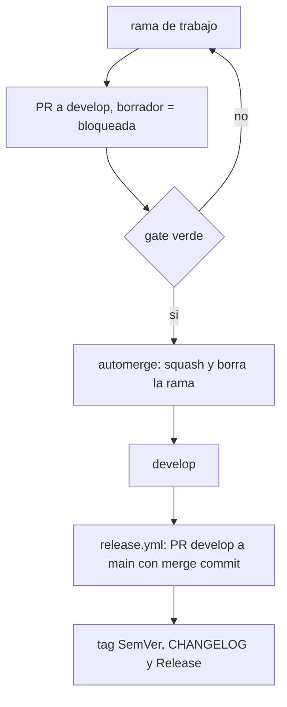

# Plan de CI, visibilidad y control de versiones de la organización

Estado: borrador parcial del 2026-11-16. Las secciones marcadas "pendiente" se completan en commits siguientes. Refs studio#187 y studio#168.

## 1. Qué es y qué no es

Es el plan por etapas para tres cosas: qué repos son públicos o privados, cómo los 2.000 minutos de Actions del plan Free alcanzan todo el mes, y cómo todos los repos heredan el mismo control de versiones. No cambia visibilidades, no archiva repos, no toca secretos ni facturación y no borra ramas: eso queda como paso con su comando en la sección 7.

## 2. Medido el 2026-11-16

Fuente de minutos: `gh api "/organizations/Nashei-Studios/settings/billing/usage?year=2026&month=11"` (la API solo devuelve desde el 11-11, 57 filas agregadas).

| Repo | Visibilidad | Minutos Linux | Descuenta de los 2.000 |
|---|---|---|---|
| drain-for-loot | privado | 762 | sí |
| roblox-vault | privado | 78 | sí |
| plus-one-mining | privado | 24 | sí |
| project-template | privado | 15 | sí |
| claude-toolkit | privado | 11 | sí |
| art | privado | 10 | sí |
| 3 legacy | privados | 6 cada uno, 18 en total | sí |
| **Total privados** | | **918 de 2.000 (46 %)** | |
| studio | público | 673 Linux, 570 Windows, 523 macOS | no |
| roblox-game-template | público | 233 | no |
| .github | público | 43 | no |

Dato: el neto facturado es 0 USD en todas las filas; el descuento lo absorbe el plan.

### Ajustes de merge antes de aplicar (`gh api repos/Nashei-Studios/<repo>`)

| Repo | Visib. | delete_branch_on_merge | squash | merge commit | rebase | Ramas |
|---|---|---|---|---|---|---|
| roblox-game-template | público | true | true | true | true | 11 |
| roblox-vault | privado | false | true | true | true | 10 |
| plus-one-mining | privado | false | true | true | true | 3 |
| studio | público | true | true | true | true | 2 |
| .github | público | true | true | true | true | 2 |
| drain-for-loot | privado | false | true | true | false | 11 (hoy 3, ver sección 6) |
| claude-toolkit | privado | false | true | true | false | 2 |
| legacy-grassgame | privado | false | true | true | false | 2 |
| legacy-bowl-brawl | privado | false | true | true | false | 2 |
| legacy-drain-the-sea | privado | false | true | true | false | 2 |
| project-template | privado | false | true | true | false | 3 |
| art | privado | false | true | true | false | 2 |

Organización: plan `free`, verificación en dos pasos NO exigida (`two_factor_requirement_enabled=false`), pendiente de decidir con Victor.

## 3. Visibilidad repo por repo

Hecho: ninguna visibilidad cambia hoy. Verificado: `gh api repos/Nashei-Studios/drain-for-loot/rulesets` responde 403 "Upgrade to GitHub Pro or make this repository public"; en `studio` los rulesets `develop` y `production` están `active`. Es decir, en Free la protección real de ramas existe solo en públicos.

| Repo | Hoy | Recomendada | Por qué | Qué se pierde |
|---|---|---|---|---|
| .github | público | público | los workflows reutilizables los llama cualquier repo | nada relevante |
| studio | público | público; mover a un repo privado el tablero, decisiones y config con ids | la matriz de install-smoke (1.766 min en 3 sistemas, macOS vale 10 veces) es gratis solo en público | docs/ visibles desde fuera, sin secretos |
| roblox-game-template | público | público | rulesets reales, template-sync sin token; candidato a open source (framework sin la lógica de un juego) | sistemas reutilizables visibles |
| project-template | privado | privado hasta decidir (#187 pregunta 1) | publica la forma de trabajo | no se usa como plantilla sin token |
| drain-for-loot | privado | privado | juego en producción: economía, anti-exploit y diseño | sin rulesets; los minutos descuentan (mitigado con runner propio) |
| roblox-vault | privado | privado | investigación de mercado y decisiones | igual |
| art | privado | privado | arte de Leon sin publicar | igual |
| claude-toolkit | privado | privado | herramientas internas con rutas y configuración | igual |
| plus-one-mining | privado | privado; revisar si sigue vivo (último push 12-11) | juego | igual |
| 3 legacy | privados | archivar (decisión de Victor, #187 pregunta 2) | sin actividad desde el 12-11; archivado no consume minutos | quedan de solo lectura, reversible |

Open source candidato: plantilla de juego (sin código de juego), herramientas de `studio` (`tools/`, `plant.ps1`) y Agent Board. Siguen privados: juego en producción, vault, arte. Todo pasa antes por el agente `ecc:opensource-sanitizer` [POR VERIFICAR: no corrido hoy].

## 4. Presupuesto de minutos y proyección

Fuente: `gh run list --created ">=2026-11-01" --limit 1000` (duración de pared por run, no facturada; cada job se factura entero al minuto, supuesto de la nota de minutos). drain-for-loot toca el tope de 1000 runs, así que su conteo está truncado.

| Repo (privado) | Workflow | Runs en noviembre | Pared (min) | Comentario |
|---|---|---|---|---|
| drain-for-loot | ci [pull_request] | 102 (32 saltados) | 55 | facturó 762 min Linux antes del runner propio; ahora usa `CI_RUNNER` |
| drain-for-loot | notion-mirror | 813 (455 saltados) | 50 | variable `NOTION_DATABASE_ID` quitada, queda saltado |
| roblox-vault | lint [pull_request] y [push] | 245 y 118 | 97 y 31 | 78 min facturados; el push duplica a la PR |
| plus-one-mining | ci | 204 | 64 | 24 min facturados |
| resto de privados | ci, release, stale, audit-push | 7 a 20 por repo | 1 a 5 | 6 a 15 min por repo |

Proyección mensual (estimación, no medición): sin runner propio, 1 juego son unos 1.600 min (80 %); con `victor-pc` el resto de privados suma unos 300; con 2 juegos nuevos por mes, unos 400 a 500 (25 %). Umbral de aviso: 1.500 (75 %). Ahorro pendiente: lint de `roblox-vault` solo en PR y en `develop`, no en cada push de rama (hasta 31 min menos).

Alternativa de pago, solo como dato: Team cuesta 4 USD por usuario al mes y trae 3.000 min en privados frente a 2.000 (https://github.com/pricing, leído el 2026-11-16). Con 3 personas son 12 USD al mes por 1.000 min extra; el runner propio da minutos sin límite a costo cero.

## 5. Qué corre dónde y fallback

| Dónde | Qué | Por qué |
|---|---|---|
| `victor-pc` (online, etiquetas `self-hosted,Windows,X64,nashei,windows-x64`; variable de organización `CI_RUNNER` = `["self-hosted","nashei"]`) | gates y lint de repos privados | no descuenta minutos |
| Runners de GitHub | todo repo público (install-smoke, ci de studio y plantilla, workflows de `.github`) y jobs cortos de plomería | gratis en públicos; no se expone el PC a código de forks |

Riesgo documentado por GitHub: los runners propios "should almost never be used for public repositories" porque cualquiera abre una PR y compromete el runner (guía oficial de uso seguro de Actions, página secure-use, leída el 2026-11-16). Por eso los públicos nunca usan `CI_RUNNER`.

Fallback con el PC apagado: cambiar `CI_RUNNER` a `"ubuntu-latest"` (comando en la etapa 2); descuenta de los 2.000 y se avisa al 75 %. [POR VERIFICAR] que el `ci.yml` de cada repo lea `vars.CI_RUNNER`: el de drain-for-loot declaraba `ubuntu-latest` según `docs/sistema-que-escala.md`.

## 6. Por qué se acumulan ramas y qué lo evita

Causas, contra lo medido:
1. `delete_branch_on_merge` está en `false` en los 9 privados (sección 2) y en `true` en los 3 públicos. En privados está apagado a propósito: sin ruleset, un merge manual `develop` a `main` borraría `develop` (pasó el 2026-11-12).
2. Un merge hecho con `GITHUB_TOKEN` no dispara ese ajuste; depende de que el job `automerge` borre la rama.
3. Ramas de worktrees, borradores y `dependabot/*` que nadie mergea (roblox-vault tiene dos `dependabot/*`; roblox-game-template tiene 5 `feat/*` o `fix/*` y 3 `game/*`).

Estado del 2026-11-16: otra sesión ya podó drain-for-loot (quedan `main`, `develop` y `planning/ola-prueba`) y dos `jarvis/*` de roblox-vault.

Ajustes: (a) públicos: ya activo; (b) privados: se mantiene apagado y lo cubre un job semanal de poda en `victor-pc` que borra solo ramas con PR `MERGED` y mismo SHA; (c) regla de borradores: un borrador sin actividad 14 días se cierra con aviso; (d) `allow_rebase_merge=false` en todos (aplicado hoy).

## 7. Etapas

| Etapa | Qué | Criterio de aceptación | Comando |
|---|---|---|---|
| 1 (hecha hoy) | rebase apagado en los 5 repos donde estaba | `allow_rebase_merge=false` en los 12 | `gh api -X PATCH repos/Nashei-Studios/<repo> -F allow_rebase_merge=false` |
| 2 | fallback del runner | la variable cambia y un gate corre en `ubuntu-latest` | `gh api -X PATCH orgs/Nashei-Studios/actions/variables/CI_RUNNER -f value='"ubuntu-latest"'` (volver: `'["self-hosted","nashei"]'`) |
| 3 | job de poda semanal y aviso al 75 % en `victor-pc` | corre en `workflow_dispatch` y borra 0 ramas sin PR `MERGED` | `scripts/branch-prune.mjs` y `.github/workflows/branch-prune.yml` de este repo; borra de verdad cuando exista el secreto `GH_PRUNE_TOKEN` |
| 4 | decisiones de #187 (visibilidad, archivado) | dos de tres votos | archivar: `gh repo archive Nashei-Studios/legacy-grassgame --yes`; visibilidad: `gh repo edit Nashei-Studios/<repo> --visibility public --accept-visibility-change-consequences` |

Flujo:

## 8. Lo aplicado hoy

| Repo | Antes (rebase / squash / merge commit / delete_branch) | Después |
|---|---|---|
| roblox-game-template, studio, .github | true / true / true / true | rebase false, el resto igual |
| roblox-vault, plus-one-mining | true / true / true / false | rebase false, el resto igual |
| 7 repos restantes | rebase ya false | sin cambio |

Decisión: `allow_merge_commit` queda en true en todos porque el release hace merge commit `develop` a `main`; apagarlo lo rompería. `delete_branch_on_merge` en privados no se activó (sección 6). No se tocó visibilidad, archivado, secretos, facturación ni ramas.

