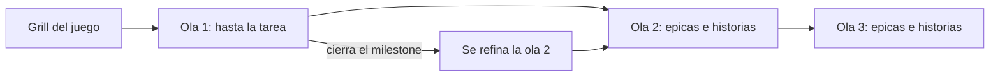

# Planificación del Project de un juego

Cómo se decide qué issues existen antes de programar. Un juego puede llegar a miles de issues, así que no se escriben de golpe ni a espaldas de quien los va a hacer. Decisión y alternativas: [ADR 0004](adr/0004-planificacion-por-olas-con-compuerta-de-preguntas.md). La conduce el agente con la skill `planificar-ola` de `claude-toolkit`; esta guía es lo que tú ves y haces.

## Qué es una ola

Una ola es un tramo del juego con un milestone propio (`Ola 1`, `Ola 2`...). Solo la ola en curso se detalla hasta la tarea. Las siguientes quedan como épicas e historias, sin tareas, y se afinan cuando termina el milestone anterior, con lo que ya se aprendió.

| Nivel | Qué es | Quién lo escribe |
|---|---|---|
| Spec | Una página: problema, alcance, cómo se mide | El agente, con el grupo |
| Épica | Un frente del juego (loop, economía, FTUE, arte, rendimiento) | El agente |
| Historia | Lo que el jugador logra, con criterios Dado, Cuando, Entonces | El agente |
| Tarea | Trabajo de una persona o agente, tamaño M o menos | El agente, con tu aprobación |

Se enlazan con sub-issues de GitHub: la tarea cuelga de la historia, la historia de la épica y la épica del spec.

## Quién responde qué

Está en `personas` de `config/ecosistema.json`: login, rol, áreas y foco de cada uno. Hoy:

| Persona | Cubre |
|---|---|
| Leon | Builder, modelado, mapas, niveles y arte |
| Victor | Scripting, sistemas, rendimiento y tests |
| Nande | Por definir |

- Un ítem se te pregunta si toca un área tuya. Si cruza áreas (un modelo que necesita un script), se pregunta a los dos y hacen falta los dos sí.
- Ningún área se reparte por defecto. Si nadie cubre un área (hoy: ui, economía, audio y crecimiento), la pregunta va a todo el equipo y esos ítems esperan hasta que alguien la tome.
- Nande no recibe preguntas de área hasta que diga qué quiere tomar; cuando lo decida, se cambia `personas` por PR.
- Aunque tu área sea una, siempre ves el juego completo: cada ronda trae una pregunta sobre monetización, retención, FTUE, rendimiento o crecimiento.

## Qué vas a ver, paso a paso

| # | Qué pasa | Dónde | Listo cuando |
|---|---|---|---|
| 1 | El agente publica un borrador del lote | PR con `docs/planning/ola-N.md` en el repo del juego | Puedes leer la tabla de ítems y el impacto por eje |
| 2 | Te llegan de 3 a 7 preguntas | Agent Board del juego, con tu mención | Cada una trae opciones, recomendación y qué se pierde |
| 3 | Respondes con la letra (o "otra: ...") | Comentario en el tablero | Tu respuesta aparece en la sección Respuestas del borrador |
| 4 | El agente crea los issues | Repo y Project del juego | Cada issue enlaza el borrador y la respuesta que lo aprobó |
| 5 | Tú tomas lo tuyo | `ready-for-agent`, `tools/work.ps1` | Solo tiene esa etiqueta lo que aprobaste |

Si no respondes, tu parte espera; no se crea nada por ti. Si no estás de acuerdo con el borrador, dilo en "otra" o comenta la PR: el agente lo incorpora y te lo confirma.

## Campos del Project

| Campo | Para qué | Nota |
|---|---|---|
| Etapa | En qué fase del juego cae (Prototipo, Lanzamiento suave, Escala) | Opciones por confirmar en la primera ola |
| Área | Quién lo ve | En los Project actuales se llama `Carril` |
| Prioridad | P0, P1, P2 | La define quien aprobó |
| Tamaño | S, M, L | Una L se parte antes de crearse |
| Iteración | La semana en que se hace | La pone quien lo toma |
| Responsable | Quién lo hace | Es el asignado de GitHub |

Los nombres exactos viven en `planificacion.campos` del config. Los estados (Backlog a Hecho) siguen como en [flujo-de-trabajo.md](flujo-de-trabajo.md).

## Topes

| Tope | Valor | Por qué |
|---|---|---|
| Issues por lote | 40 | 7 preguntas por persona agrupan unos 6 ítems cada una |
| Tareas detalladas por lote | 25 | Lo que tres personas con un trabajo a la vez consumen en una ola |
| Sub-issues por padre | 15 | Una épica legible; GitHub admite 100 |

Si el lote pasa de ahí, lo que sobra baja a la ola siguiente como épica o historia. Se comprueba con `node scripts/ecosistema.mjs lote <items.json>`. Antes de crear, el agente busca duplicados en abiertos y cerrados.

## Cuando cambia el rumbo

Una sesión de beta testing, una reunión o una métrica bajo el umbral pueden invalidar lo planificado. El agente no toca lo aprobado: escribe la propuesta en la sección Ajustes del borrador y te pregunta en el issue afectado. Cambia solo con tu sí. Lo que ya tiene una PR abierta no se modifica: se pregunta si se cierra o se sigue.

## Probar el flujo

Para ensayar sin ensuciar el tablero real: etiqueta `hold`, título que empieza con `PRUEBA` y preguntas marcadas `[prueba]`. Al terminar, los issues de prueba se cierran como "not planned".

## Qué está prohibido

- Crear un lote sin preguntas respondidas.
- Poner `ready-for-agent` a algo que su responsable no aprobó.
- Editar un issue aprobado sin su sí.
- Escribir nombres, logins o topes en las skills: salen del config.
- Asumir el rol de una persona `por-definir`.
