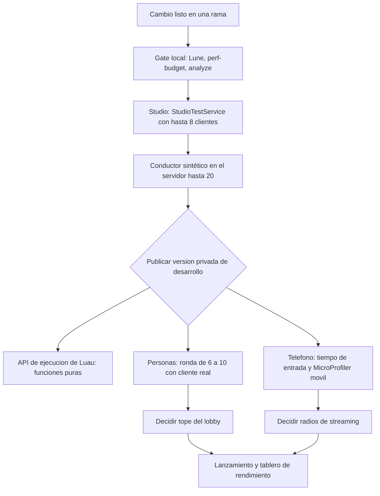

# Cómo se prueba un juego antes de publicarlo: carga, teléfono real y streaming

Investigación del issue [studio#152](https://github.com/Nashei-Studios/studio/issues/152), parte de la épica #109. Fecha: 2026-11-14. Esto es investigación: no decide nada. La decisión es del equipo (Victor, Leon y Nande) y las preguntas cerradas están al final.

## Resumen de una pantalla

1. **"Publicar una versión privada" no es hacerla pública.** Un juego recién publicado desde Studio solo lo juegan el dueño, quienes tienen acceso de edición y los miembros del grupo con rol permitido. Para más gente existen hasta 10 "early testers" y el acceso Playtest por rol del grupo. El modo beta, en cambio, sí es público y queda fuera.
2. **Los tres bloqueos tienen la misma raíz:** hace falta una versión subida a Roblox que el equipo y un teléfono puedan abrir. Studio solo no basta, y esto ya está medido: con la place compartida abierta cabe 1 cliente (`docs/performance.md` de drain-for-loot, PR #137).
3. **Studio tiene un techo duro de 8 clientes simulados** por prueba, tanto en el menú como por script (`StudioTestService`). Con 20 jugadores reales no se llega desde Studio aunque la máquina aguantara.
4. **Roblox no ofrece bots ni clientes headless.** La petición de un `BotService` sigue sin respuesta oficial en el DevForum. Los Términos no traen un permiso para ello; el estudio los trata como prohibidos (sección 1.8).
5. **La API de ejecución de Luau de Open Cloud no sirve para carga de jugadores.** No corre física ni arranca los scripts de servidor o cliente. Sirve para medir lógica pura contra una versión publicada.
6. **Las granjas de dispositivos (AWS Device Farm, Firebase Test Lab, BrowserStack) no encajan.** Están pensadas para probar una app que tú subes. Abrir el cliente de Roblox exigiría iniciar sesión con una cuenta real en un teléfono ajeno, y la propia documentación de AWS pide no hacerlo. Que se pueda instalar el cliente de Roblox ahí: no verificado.
7. **Lo que sí funciona con costo cero:** una versión privada de desarrollo, el teléfono de alguien del equipo, el MicroProfiler móvil por la red local, y un puñado de personas reales. Lo automatizable es el lado servidor y el registro de marcas de tiempo; lo que mide el teléfono lo corre una persona.

Recomendación por bloqueo (detalle en las secciones 3 a 5):

| Bloqueo | Recomendación | Quién |
|---|---|---|
| #87 carga de 20 | Ahora: 8 clientes en Studio con la compartida cerrada más jugadores sintéticos en el servidor (#125). Después: ronda con personas reales sobre la versión privada. Fijar el tope con margen, no con extrapolación sola | Victor mide, Nande junta gente |
| #33 antes y después del streaming | Un teléfono propio, la versión privada con cada valor y el mismo guion de 3 repeticiones | Nande con apoyo de Victor |
| #89 tiempo de entrada | Mismo teléfono: marcas de tiempo del cliente enviadas al servidor y leídas en la consola del servidor | Victor instrumenta, Nande mide |

---

## 1. Roblox: qué ofrece la plataforma

### 1.1 Quién puede jugar una versión sin hacerla pública

Fuentes: [publicar y lanzar](https://create.roblox.com/docs/production/publishing/publish-games-and-places) y [beta testing](https://create.roblox.com/docs/education/developer/beta-testing-experiences), leídas hoy.

| Mecanismo | Quién entra | Límite | Se expone al público |
|---|---|---|---|
| Publicar sin lanzar (estado por defecto) | Dueño, personas con acceso de edición, miembros del grupo con rol y permisos | Los que defina el grupo | No |
| Early testers | Amigos que el creador invita desde `File > Invite early testers` | Hasta 10, de edades compatibles con la del creador; ven una marca de agua de vista previa | No |
| Playtesters (pestaña Playtest de `Manage access`) | Quien tenga acceso de edición o de Playtest, más los early testers | Los que se den de alta | No |
| Rol "Tester" del grupo | Miembros del grupo con ese rol o con el permiso "Playtest all group experiences" | Los miembros del grupo | No (una sola fuente: un mensaje de la persona que anunció los betas en el [DevForum](https://devforum.roblox.com/t/a-new-way-to-test-before-launch-experience-betas/4144485)) |
| Modo beta | Cualquier persona de Roblox; solo se oculta de "Recomendados" | Una activación cada 10 minutos; exige el cuestionario de madurez | **Sí.** Fuera de alcance |
| Acceso de pago | Quien pague Robux | Ver doc | Sí. Fuera de alcance |

Qué se pierde con cada una: los early testers son 10 como máximo y deben ser amigos de edad parecida; los roles del grupo exigen que cada tester esté en el grupo 405835365; ninguna da una carga de 20 jugadores simultáneos sin que 20 personas se conecten a la vez.

Dos avisos de la comunidad, ambos de una sola fuente y no probados aquí: hay reportes de testers que no logran entrar aunque tengan acceso ([DevForum](https://devforum.roblox.com/t/how-can-i-test-my-game-as-close-to-live-as-possible/3347948) sugiere dar Play o Edit y que ambas personas pulsen Play en Studio). Conviene hacer una prueba de acceso con una persona antes de convocar a todos.

### 1.2 Servidores privados

Fuente: [servidores privados](https://create.roblox.com/docs/production/monetization/private-servers). Un servidor privado es una suscripción que un jugador compra o activa en un juego que **ya es público**; para habilitarlos el juego debe estar público. No sirve como mecanismo de prueba previa y no se crean en este trabajo. Queda descartado para los tres bloqueos.

### 1.3 Studio: clientes simulados, Team Test y servicios de prueba

Fuente: [modos de prueba](https://create.roblox.com/docs/studio/testing-modes) y [StudioTestService](https://create.roblox.com/docs/reference/engine/classes/StudioTestService).

| Herramienta | Qué hace | Techo o límite |
|---|---|---|
| Servidor y clientes | Un servidor y de 1 a 8 clientes en la misma máquina | La doc dice "usualmente 1 a 2 alcanzan; hasta 8". En este equipo, 1 con la compartida abierta (medido el 2026-11-13) |
| `StudioTestService` | Lanza ese mismo modo por script desde un plugin: `ExecuteMultiplayerTestAsync`, `AddPlayers`, `EndTest`, desconexiones | "Hasta 8 clientes simulados por sesión"; solo en Studio; una sesión a la vez; se llama desde un plugin |
| Team Test | Otras personas del equipo se unen a una sesión de prueba desde sus propios Studio | Una sesión a la vez; requiere colaboración (Team Create). Dónde corre el servidor y qué ancho de banda real hay: no verificado |
| Simulador de dispositivos | Pantalla, densidad de píxeles y toque, con perfiles de gama de entrada, media y alta | No es exacto en memoria; la doc oficial lo dice ([probar en hardware](https://create.roblox.com/docs/performance-optimization/test-on-hardware)) |
| Simulador de red | Latencia, jitter y pérdida de paquetes | No limita el ancho de banda: medido en este equipo y consistente con la doc, que solo lista esas tres variables ([simulador de red](https://create.roblox.com/docs/studio/network-simulator)) |
| `TestService` | Servicio interno de Roblox para pruebas de motor; "disponible a un grado limitado" | No es un banco de carga ([fuente](https://raw.githubusercontent.com/Roblox/creator-docs/main/content/en-us/reference/engine/classes/TestService.yaml)) |

Consecuencia: el techo de la "carga de 20" en Studio es 8, y en esta máquina hoy es 1 con la compartida abierta. Cuántos clientes caben con la compartida cerrada: no medido (el documento de rendimiento dice que la compartida sola ocupa unos 2 GB).

### 1.4 API de ejecución de Luau de Open Cloud

Fuente: [referencia oficial](https://create.roblox.com/docs/cloud/reference/features/luau-execution), leída hoy.

- Ejecuta un script en un servidor sin cabeza contra una versión concreta de una place publicada. Hasta 5 minutos por tarea y 10 tareas concurrentes por place.
- Límite de creación: 5 por minuto por dueño de la llave (la búsqueda web mostró una cifra distinta de 45; la página oficial leída dice 5 para crear y 45 solo para listar logs).
- "La simulación de física no corre" y los scripts de servidor y cliente no arrancan solos.
- Los cambios al DataModel no persisten. Las APIs de nube sí funcionan.
- **Para la carga:** sirve para medir el costo de una función (por ejemplo, 20 llamadas al cálculo del lobby) en el servidor real de Roblox, sin jugadores ni red. No mide replicación, física ni red. Complementa, no reemplaza.
- Hace falta una llave de Open Cloud, y las llaves no las toca este trabajo. El análisis anterior ya propone una universe de desarrollo separada (ver `docs/investigacion/arquitectura-de-pruebas.md`, 4.2).

### 1.5 Herramientas de medición en el dispositivo

- **MicroProfiler móvil:** en el teléfono, Ajustes, MicroProfiler en Encendido; desde un computador en la misma red se abre la IP y el puerto que muestra el teléfono, y se ven los 30 últimos cuadros ([fuente](https://create.roblox.com/docs/performance-optimization/microprofiler)). La doc lo recomienda: "en general, el cliente móvil es el mejor lugar para perfilar".
- **Estadísticas de rendimiento** (FPS, memoria y ping): se activan en el menú de ajustes del cliente ([probar en hardware](https://create.roblox.com/docs/performance-optimization/test-on-hardware)).
- **Developer Console:** corre también en producción. La vista de servidor solo la ven el dueño o miembros del grupo con permiso de edición ([doc](https://create.roblox.com/docs/studio/developer-console)). Cómo abrirla en un teléfono: no verificado en la doc leída.
- **`Stats`:** `DataSendKbps` y `DataReceiveKbps` leen alrededor de 0 en un servidor local de Studio (medido en este equipo el 2026-11-13). En un servidor publicado deberían reflejar tráfico real: no verificado.
- **Tablero de rendimiento del Creator Dashboard:** gráficos de cliente por plataforma (fotogramas, caídas, memoria, salidas por falta de memoria) y de servidor (CPU, memoria, fotogramas), con filtro por versión del place ([doc](https://create.roblox.com/docs/production/analytics/performance)). **Los gráficos solo aparecen con al menos 100 usuarios activos diarios.** Con una versión privada de 5 personas no sirve; es para después del lanzamiento.

### 1.6 Abrir una versión privada en el teléfono propio

La documentación oficial leída no trae un procedimiento específico para teléfono. Lo que hay son hilos de la comunidad (una sola fuente, no probado aquí): abrir primero el juego en el computador para que aparezca en "jugados recientemente" o ponerlo en favoritos, o entrar al Creator Hub desde la app móvil ([Testing on mobile?](https://devforum.roblox.com/t/testing-on-mobile/3820570)). En ese hilo se aclara que los juegos privados **publicados** se pueden abrir, pero los cambios sin publicar, no. Conclusión práctica: cada medición en el teléfono exige publicar esa versión.

### 1.7 Cómo prueban los estudios chicos de Roblox

Hallazgo honesto: no se encontró una charla ni un hilo con un método completo de carga y rendimiento móvil de un estudio chico. Lo que se encontró:

- **Carga:** el consejo recurrente es levantar un servidor local con 8 clientes, medir y extrapolar a 50 ([hilo de 2019](https://devforum.roblox.com/t/stress-test-with-only-a-few-people/311764), una sola fuente y de hace años). Otro hilo sobre pruebas de estrés sin testers recibió una única respuesta, sobre reducir carga de físicas, y ninguna sobre método ([hilo](https://devforum.roblox.com/t/stress-test-without-game-testers/2825650)).
- **Bots:** la petición de un `BotService` ([hilo](https://devforum.roblox.com/t/botservice-create-and-control-fake-players/3311311)) argumenta que correr muchos clientes en Studio pesa demasiado y pide clientes falsos en servidores de Roblox. No hay respuesta oficial en esa página.
- **Móvil:** la práctica descrita es copiar el juego a una place de prueba aparte y jugarla en el teléfono ([Testing on mobile?](https://devforum.roblox.com/t/testing-on-mobile/3820570)); una guía antigua de benchmarking recomienda cerrar apps en segundo plano y fijar la calidad gráfica en 10 en lugar de Automática para comparar ([hilo](https://devforum.roblox.com/t/improving-game-performance-benchmarking-microprofiler-developer-stats-and-developer-console/1002074)).
- **Dispositivos de referencia:** Roblox propone elegir uno de gama baja y da una lista de ejemplo (Infinix Smart 9, Motorola Moto G05, Oppo A18, Amazon Fire HD 10 de 2023, Samsung Galaxy S22 Ultra) y datos de población: cerca del 65 % de los jugadores de un juego típico están en Android y alrededor del 60 % de ellos tiene entre 2 y 4 GB de RAM ([probar en hardware](https://create.roblox.com/docs/performance-optimization/test-on-hardware)).

### 1.8 Términos de Roblox sobre clientes automatizados

Fuente: Términos de Uso (User Terms), vigentes desde el 2026-11-01, leídos en una copia de Internet Archive porque la página oficial responde 403 a `curl` ([copia](https://web.archive.org/web/2026/https://en.help.roblox.com/hc/en-us/articles/115004647846-Roblox-Terms-of-Use)).

- La sección 9.2 prohíbe "eludir, desactivar o interactuar de forma fraudulenta con cualquier parte del Servicio o intentar acceso no autorizado", y acceder al servicio con robots, crawlers o raspadores para entrenar modelos de IA.
- Otra cláusula (programa Creator Rewards) prohíbe ganar Robux con varias cuentas o "usando bots".
- **No encontré una frase que permita o prohíba de forma explícita bots de prueba de carga.** Los Community Standards no se pudieron leer en la copia (la página depende de JavaScript): no verificado.

Postura que se propone: **tratarlo como prohibido.** No hay API oficial para clientes automatizados, un cliente automatizado necesita iniciar sesión con una cuenta real, y el riesgo es que la cuenta (no el juego) sea sancionada. Qué sanción aplicaría: no verificado. Esto coincide con la regla ya fijada en la ficha: no se usan bots contra Roblox.

---

## 2. La industria fuera de Roblox

### 2.1 Carga de servidores de juego

| Enfoque | Cómo lo hace | Fuente | Aplica a Roblox |
|---|---|---|---|
| Clientes headless o bots que repiten el protocolo real | Unity y Unreal los usan contra servidores dedicados propios. Metaplay documenta un `BotClient` que "debe imitar el comportamiento del jugador razonablemente" | [Metaplay](https://docs.metaplay.io/feature-cookbooks/automated-testing/botclient-testing.html) | No: el servidor no es nuestro y no hay protocolo abierto |
| Varios clientes en una máquina | Unity Multiplayer Play Mode: el editor más 3 jugadores virtuales; la propia doc advierte que consume muchos recursos | [Unity Netcode](https://docs.unity3d.com/Packages/com.unity.netcode@1.4/manual/playmode-tool.html) | Es el equivalente a "Servidor y clientes" de Studio |
| Gauntlet de Unreal | Arranca un servidor y N clientes para pruebas; hay pocos ejemplos oficiales de servidor dedicado con muchos clientes | [Epic](https://dev.epicgames.com/documentation/unreal-engine/gauntlet-automation-framework-overview-in-unreal-engine) | Idea transferible: un script que orquesta servidor y clientes. Roblox ya lo tiene en `StudioTestService` |
| Un proceso con muchos clientes headless | Foro de Unreal: cada robot hace el flujo de inicio de sesión real contra el servidor dedicado | [foro](https://forums.unrealengine.com/t/how-to-use-a-single-process-to-implement-multiple-headless-clients-for-stress-testing-a-ds-server/2843374) | No, por lo mismo que la primera fila |
| k6 y Gatling | Cargan servicios HTTP y similares | [k6](https://grafana.com/docs/k6/latest/), [Gatling](https://docs.gatling.io/) | No: el tráfico de Roblox no es HTTP que se pueda dirigir. Útil solo para un backend propio, y el estudio no tiene uno |

Lección que sí se transfiere: los bots que repiten todos la misma acción subestiman la carga real (una sola fuente, [guía de terceros](https://www.websnp.com/help/dedicated-server-for-multiplayer-game-development-testing)). Un conductor sintético dentro del servidor propio debe variar el ritmo y las acciones.

### 2.2 Granjas de dispositivos reales

| Servicio | Costo y capa gratis (verificado hoy) | ¿Sirve para abrir Roblox? |
|---|---|---|
| [AWS Device Farm](https://aws.amazon.com/device-farm/pricing/) | Prueba única de 1.000 minutos de dispositivo; luego 0,17 USD por minuto; plan sin medición desde 250 USD al mes por ranura | Acceso remoto: permite subir `.apk` o `.ipa`, mostrar la pantalla, ajustar la red y grabar video ([doc](https://docs.aws.amazon.com/devicefarm/latest/developerguide/remote-access.html)). Instalar la app de Roblox desde la tienda: no verificado. La doc pide no ingresar datos de login personales |
| [Firebase Test Lab](https://firebase.google.com/docs/test-lab/usage-quotas-pricing) | Plan Spark: 10 pruebas virtuales y 5 físicas por día; Blaze: 30 minutos físicos al día gratis, luego 5 USD por hora | Está pensado para pruebas automáticas de una app propia: no verificado que sirva para el cliente de Roblox |
| [BrowserStack App Live](https://www.browserstack.com/pricing?product=app-live) | Precios de App Live no verificados (las fuentes de terceros se contradicen). El plan Freelancer de Live trae 100 minutos para una persona | No verificado |

Qué se pierde: cualquiera de las tres exige poner una cuenta de Roblox con sesión iniciada en un teléfono compartido con terceros. Eso choca con el NFR "datos de jugadores seguros" y, si se usa una cuenta de prueba, con las reglas de cuentas de Roblox (no verificado). No se recomienda para ninguno de los tres bloqueos.

### 2.3 Perfiladores en el teléfono

| Herramienta | Qué da | Límite para este caso |
|---|---|---|
| Android GPU Inspector (en transición a Android Performance Analyzer, según su propia página) y Perfetto | Trazas de CPU, GPU, memoria y batería por USB; la traza solo incluye marcas y actividad de GPU de la app si se elige la app a perfilar ([doc](https://developer.android.com/agi/sys-trace/system-profiler)) | Perfilar un cliente de Roblox sin depuración habilitada: no verificado. El documento de Epic dice que un build "profileable" basta para Perfetto, pero el build de Roblox no es nuestro ([Epic](https://dev.epicgames.com/documentation/unreal-engine/profile-android-projects-with-platformnative-tools)) |
| Xcode Instruments | Equivalente en iOS | No verificado (no se encontró una página oficial comprobable) |
| GameBench | Perfilado comercial de juegos móviles | Precio y capa gratis: no verificado ([sitio](https://www.gamebench.net/)) |
| MicroProfiler de Roblox en el teléfono | Tiempo por cuadro y por tarea del motor, sin cable, por la red local | Es el que ya viene con el juego y se probó en la doc oficial. Es la opción por defecto |

### 2.4 Playtests cerrados con personas

La guía de Roblox sobre betas recomienda el acceso cerrado: "es la más segura y aun así da datos suficientes". Pide un juego jugable de punta a punta, buen rendimiento en las plataformas objetivo y recursos para atender comentarios ([beta testing](https://create.roblox.com/docs/education/developer/beta-testing-experiences)). El estudio ya tiene el procedimiento de sesión y las severidades en `docs/game/beta-testing.md` de drain-for-loot y la propuesta de carriles en `docs/investigacion/arquitectura-de-pruebas.md` (sección 7). Aquí solo se agrega que **la ronda de personas es también el banco de carga real** de #87 y, con teléfonos distintos, el banco de #89.

---

## 3. Bloqueo #87: carga con hasta 20 jugadores

Criterios de paso (ya definidos en `docs/performance.md`): Heartbeat de servidor en 60 o dentro de 1; ningún cuadro sobre 16,67 ms; envío de hasta 4 KB/s y recepción de hasta 2 KB/s por jugador; memoria bajo el 50 % de `6,25 GiB + 100 MiB por jugador`.

| Opción | Qué mide | Qué se pierde | Costo | Equipo de 3 | Sin exponer el juego | Datos seguros |
|---|---|---|---|---|---|---|
| A. Studio con 8 clientes (menú o `StudioTestService`) con la compartida cerrada | CPU y memoria del servidor con jugadores reales en ventanas, hasta 8 | Techo de 8; no mide red (la lectura de `Stats` es 0); el servidor comparte máquina con los clientes y puede dar números inflados. Cuántos caben: no medido | 0 | Sí (Victor) | Sí | Sí |
| B. Conductor sintético dentro del servidor (#125) | Costo de CPU y memoria de la lógica propia con 20 o 100 "jugadores" | No ejerce replicación, física ni remotes reales; sirve para forma, no para milisegundos exactos | 0, un módulo | Sí | Sí | Sí |
| C. Versión privada publicada con personas reales (equipo, early testers, rol Tester) | Todo: red real, replicación, memoria y CPU del servidor de Roblox | Máximo 10 early testers más los miembros del grupo; hay que juntar a la gente a la vez | 0 | Sí, pero Nande debe coordinar | Sí, solo acceso por invitación | Sí, cuentas reales de quien acepta |
| D. API de ejecución de Luau sobre la versión publicada | Costo de funciones puras en el servidor real, sin jugadores | No hay física ni red ni replicación; no sustituye a las anteriores | 0; requiere llave | Sí | Sí | Sí |
| E. Bots o clientes automatizados contra Roblox | Sería el más parecido | Prohibido por la ficha; sin permiso explícito en los Términos; riesgo para las cuentas | N/A | N/A | N/A | No |
| F. Granjas de dispositivos con 20 sesiones | Descartada: cuesta y no encaja (sección 2.2) | | | | | |

Observación sobre honestidad de la cifra: 20 jugadores reales a la vez es difícil con un equipo de 3. Lo realista es combinar A, B y D para medir el costo por jugador y fijar un tope con margen, y usar C para confirmarlo con 6 a 10 personas, no con 20.

### Plan por etapas

| Etapa | Qué | Se automatiza | Necesita personas |
|---|---|---|---|
| Ahora | Cerrar todos los Studio menos uno; correr N = 2, 4, 8 con `StudioTestService` y anotar el máximo alcanzado; sumar el conductor sintético (#125) hasta 20 | Lanzar la sesión, sumar clientes, leer `Stats` y registrar la fila de la tabla | Quien mire la máquina y no abra otro Studio |
| Después | Con la versión privada: ronda de 6 a 10 personas con el cliente real; Developer Console del servidor y el sondeo de rendimiento | El registro del sondeo y la tabla | Nande convoca y observa, las personas juegan 10 minutos |
| Cómo escala | Tras el lanzamiento, el tablero de rendimiento (desde 100 usuarios activos diarios) y la alerta de memoria de servidor | El tablero | Revisión semanal |

Si el equipo quiere un número ya: 12 es la mediana de los referentes directos (6 a 12 jugadores por servidor) que citó la investigación de #87. Eso no es una medición.

---

## 4. Bloqueo #33: antes y después del streaming, medido en un teléfono

Contexto: en Studio, con la red simulada, los valores 192 y 64 de `StreamingMinRadius` dieron el mismo tiempo (3,4 s y 3,5 s) porque el simulador no limita el ancho de banda.

| Opción | Qué mide | Qué se pierde | Costo | Equipo de 3 | Sin exponer el juego | Datos seguros |
|---|---|---|---|---|---|---|
| A. Un teléfono propio del equipo con la versión privada, un valor por versión | Tiempo de entrada y memoria reales con la red real del teléfono | Un solo modelo y una sola red; hay que publicar dos versiones (192 y 64) | 0 si ya hay teléfono | Sí | Sí | Sí, cuenta propia |
| B. Roblox Player en PC con el ancho de banda limitado por una herramienta externa (por ejemplo [Clumsy](https://github.com/jagt/clumsy), de código abierto, último cambio 2025-11-25, que degrada paquetes en Windows) | La parte de red de la entrada | No mide memoria ni CPU de un teléfono; si Clumsy limita ancho de banda y no solo retraso o pérdida: no verificado; la licencia figura "NOASSERTION" | 0 | Sí | Sí | Sí |
| C. Granja de dispositivos | Un teléfono distinto | Sección 2.2 | Prueba gratuita limitada | Sí | No recomendada | No |
| D. Tablero de rendimiento tras el lanzamiento | Datos de jugadores reales | No existe hasta tener 100 usuarios activos diarios; llega tarde | 0 | Sí | Ya es público | Sí |

### Plan por etapas

| Etapa | Qué | Se automatiza | Necesita personas |
|---|---|---|---|
| Ahora | Publicar privada la versión A (192) y la B (64). En el teléfono: misma red Wi-Fi, calidad gráfica fija en 10, apps cerradas, tres entradas por versión, con grabación de pantalla. Anotar tiempo hasta el personaje y memoria de las estadísticas de rendimiento | La rotulación de las versiones y la tabla | Quien sostenga el teléfono (Nande) |
| Después | Repetir con datos móviles y con un segundo teléfono de gama baja si el equipo lo tiene; Leon revisa aparición tardía en los bordes de la parcela con el valor 64 (ya lo pedía el issue) | Nada nuevo | Nande y Leon |
| Cómo escala | Tablero de rendimiento filtrado por versión del place una vez lanzado | El tablero | Revisión semanal |

---

## 5. Bloqueo #89: tiempo de entrada en un dispositivo real

Contexto: en Studio el arranque del cliente depende de la hora del primer spawn (4,85 s), porque la UI de StarterGui se copia a `PlayerGui` recién entonces. Hay que repetir la tabla en PC y en celular.

| Opción | Qué mide | Qué se pierde | Costo | Equipo de 3 | Sin exponer el juego | Datos seguros |
|---|---|---|---|---|---|---|
| A. Marcas de tiempo del cliente enviadas al servidor y leídas en la consola del servidor | Las mismas marcas de la sonda de Studio, en el teléfono real | Hay que agregar un remote con esquema y límite de tasa; el servidor solo lo ve el dueño o el grupo con permiso | 0 | Sí (Victor) | Sí | Sí: solo tiempos, sin datos de jugador |
| B. Grabar la pantalla del teléfono y contar cuadros hasta el control del personaje | Lo que ve el jugador | Manual; precisión de 1 cuadro, ruidosa | 0 | Sí | Sí | Sí |
| C. MicroProfiler móvil durante la entrada | Dónde se va el tiempo por tarea | Capturar justo la entrada es difícil (muestra los 30 últimos cuadros por defecto, ampliables) | 0 | Sí | Sí | Sí |
| D. Tablero de rendimiento | Promedio de jugadores reales | Necesita 100 usuarios activos diarios | 0 | Sí | Ya público | Sí |

### Plan por etapas

| Etapa | Qué | Se automatiza | Necesita personas |
|---|---|---|---|
| Ahora | Opción A para la cifra y B como contraprueba; tres entradas en frío por dispositivo | El registro de marcas y el cálculo de la mediana | Quien entra en el teléfono |
| Después | Un segundo dispositivo de gama baja y, si aplica, PC; MicroProfiler (C) solo si A muestra algo raro | Una tabla por dispositivo | Nande |
| Cómo escala | Tablero filtrado por plataforma | El tablero | Revisión semanal |

---

## 6. Qué se puede automatizar y qué necesita personas

| Paso | Automatizable | Persona |
|---|---|---|
| Lanzar N clientes de Studio, leer `Stats`, escribir la fila de resultados | Sí, por plugin con `StudioTestService` | Quien vigile la máquina |
| Conductor sintético | Sí | Quien lo diseñe |
| Pruebas de funciones en el servidor real | Sí, con la API de ejecución de Luau (necesita llave, que da Victor) | Quien cree la llave |
| Publicar una versión privada | Con Open Cloud sería posible; **hoy se hace a mano** por regla del estudio | Victor |
| Juntar 6 a 10 jugadores reales | No | Nande |
| Medir en el teléfono | Parcial: las marcas de tiempo sí; mantener el teléfono, grabar y repetir no | Nande |
| Interpretar cifras y decidir tope y radios | No | El equipo |

---

## 7. Qué tiene hoy el estudio y qué falta

| Ya existe | Dónde |
|---|---|
| Método de carga paso a paso con criterios de paso | `docs/performance.md` de drain-for-loot, ADR 0070 |
| Una fila medida con 1 cliente y la tabla del resto en "no alcanzado" | mismo documento, PR #137 |
| Presupuestos de red y de servidor | `PerfBudget.luau`, ADR 0019 |
| Procedimiento de beta y severidades | `docs/game/beta-testing.md`, y `docs/investigacion/arquitectura-de-pruebas.md` sección 7 |
| Propuesta de conductor sintético | studio#125 |
| Pruebas de motor con la API de ejecución de Luau | studio#126 |

| Falta | Quién |
|---|---|
| Una universe privada de desarrollo, con acceso por invitación | Decisión de Victor (pregunta 1) |
| Un guion escrito para medir en el teléfono, con la misma hoja de registro para quien lo haga | Tarea nueva |
| Un plugin que lance los clientes de Studio y escriba la fila de resultados | Tarea nueva |
| Un teléfono de gama baja de referencia | Decisión del equipo (pregunta 2) |

---

## 8. Explicado sin jerga para Leon y Nande

**El problema.** Queremos saber tres cosas: cuánta gente aguanta el juego a la vez, si el mapa carga más rápido en un teléfono con el cambio que propusimos y cuánto se demora uno en poder jugar después de tocar "Jugar". En el computador de Victor no se puede saber, porque Studio hace trampa: todo corre en la misma máquina y la conexión simulada no tiene límite de velocidad.

**Qué es "publicar una versión privada".** Es subir el juego a Roblox, pero sin que lo vea nadie más que nosotros. Nada de salir en la página de juegos ni en recomendados. Hay que subirlo para poder abrirlo desde un teléfono real. No es lanzarlo.

**Cómo entra la gente.** Por el grupo (con el rol de Tester) o como invitados "early testers", hasta 10. Eso nos da un grupo chico de personas reales, suficiente para probar de verdad con 6 a 10.

**Lo que no se puede hacer.** No usamos "bots" (cuentas falsas que juegan solas). Roblox no los ofrece y, aunque sus reglas no dicen con todas las letras que esté prohibido para pruebas, ponen en riesgo las cuentas que usemos. Tampoco alquilamos teléfonos por internet: habría que iniciar sesión con una cuenta en un aparato ajeno.

**Qué hacemos entonces.**
1. Victor prueba con 8 ventanas de Studio y un programa que simula jugadores dentro del servidor.
2. Con la versión privada, Nande junta a 6 a 10 personas y juegan 10 minutos.
3. Nande usa un teléfono, siempre el mismo, en la misma red, y graba la pantalla mientras entra al juego tres veces con cada versión.
4. Leon mira en la versión con el cambio de streaming si aparece algo tarde en los bordes de la parcela.

**Qué se hace solo y qué no.** Contar tiempos y escribir los números lo hace un programa. Juntar gente, sostener el teléfono y decidir lo hacemos nosotros.

---

## 9. Preguntas cerradas para el equipo

Cada una con la opción recomendada primero.

**1. ¿Se publica una versión privada de desarrollo?**
1. **Sí, en una universe aparte (por ejemplo `drain-for-loot-dev`), acceso solo por el grupo y early testers, nunca pública (recomendada).** Se pierde: hay dos lugares que mantener. Se gana: DataStores y compras separados de los reales y se puede usar la API de ejecución de Luau sin riesgo.
2. Sí, en la experiencia real con acceso Playtest. Se pierde: los datos de prueba y los reales comparten DataStore.
3. No publicar. Los tres bloqueos siguen abiertos y las cifras de #87, #33 y #89 seguirán diciendo "no medido".

**2. ¿Con qué teléfono se mide?**
1. **El del equipo que sea más lento; se anota modelo y RAM, y se usa siempre el mismo (recomendada).** Se pierde: un solo modelo; el rango real de jugadores no queda cubierto.
2. Sumar un Android de gama baja usado. Se pierde: dinero, y el estudio trabaja con costo cero; el precio no se verificó.
3. Una granja de dispositivos. No recomendada (sección 2.2).

**3. ¿Cómo se fija el tope del lobby?**
1. **Medir costo por jugador con 8 clientes y el conductor sintético, fijar el tope con margen y confirmarlo con 6 a 10 personas reales (recomendada).** Se pierde: nunca habrá 20 reales a la vez antes del lanzamiento.
2. Dejar 12, la mediana de los referentes, sin medir. Se pierde: la regla de que el tope lo fija un dato.
3. Esperar a la beta abierta con 20 reales. Se pierde: queda público y los datos llegan tarde.

**4. ¿Quién mantiene la hoja de medición del teléfono?**
1. **Nande, con la ficha escrita por Victor (recomendada).**
2. Victor.
3. Rotativo. Se pierde: comparabilidad entre rondas.

---

## 10. Propuestas en orden de valor y esfuerzo

| Orden | Propuesta | Valor | Esfuerzo | Depende de |
|---|---|---|---|---|
| 1 | Decidir la pregunta 1 y subir la versión privada | Desbloquea las tres mediciones | Bajo | Victor |
| 2 | Hoja de medición en el teléfono (tarea nueva en drain-for-loot) | Cierra #33 y #89 con datos | Bajo | 1 |
| 3 | Plugin con `StudioTestService` (tarea nueva en studio) | Repite la prueba sin clics y respeta el techo de 8 | Medio | #125 |
| 4 | Universe de desarrollo y llave para la API de ejecución de Luau | Funciones puras sobre el servidor real | Medio | 1 y #126 |

## 11. Lo que no se pudo verificar

- Si la app de Roblox se puede instalar y abrir en AWS Device Farm, Firebase Test Lab o BrowserStack.
- Precio de App Live de BrowserStack y de GameBench, y su capa gratis.
- Si Xcode Instruments o AGI pueden perfilar el cliente de Roblox sin depuración.
- Cómo abrir la Developer Console en un teléfono.
- Si `Stats.DataSendKbps` y `DataReceiveKbps` reflejan tráfico real en un servidor publicado.
- Dónde corre el servidor en Team Test y qué ancho de banda tiene.
- Si Clumsy limita ancho de banda y no solo retraso y pérdida.
- Cuántos clientes caben en la máquina de referencia con la compartida cerrada.
- Qué dicen los Community Standards sobre clientes automatizados.
- Qué sanción aplica Roblox a una cuenta que se use como cliente automatizado.
- La política exacta de tareas por minuto de la API de ejecución de Luau: la página oficial leída dice 5 para crear; un resultado de búsqueda decía otra cifra.

## Fuentes

Documentación de Roblox (comprobadas con HTTP 200 el 2026-11-14):
- <https://create.roblox.com/docs/studio/testing-modes>
- <https://create.roblox.com/docs/reference/engine/classes/StudioTestService>
- <https://create.roblox.com/docs/cloud/reference/features/luau-execution>
- <https://create.roblox.com/docs/performance-optimization/test-on-hardware>
- <https://create.roblox.com/docs/performance-optimization/microprofiler>
- <https://create.roblox.com/docs/production/analytics/performance>
- <https://create.roblox.com/docs/production/publishing/publish-games-and-places>
- <https://create.roblox.com/docs/education/developer/beta-testing-experiences>
- <https://create.roblox.com/docs/production/monetization/private-servers>
- <https://create.roblox.com/docs/studio/network-simulator>
- <https://create.roblox.com/docs/studio/device-simulator>
- <https://create.roblox.com/docs/studio/developer-console>
- <https://raw.githubusercontent.com/Roblox/creator-docs/main/content/en-us/reference/engine/classes/TestService.yaml>
- Términos de Uso (copia de Internet Archive): <https://web.archive.org/web/2026/https://en.help.roblox.com/hc/en-us/articles/115004647846-Roblox-Terms-of-Use>

DevForum (una sola fuente cada uno):
- <https://devforum.roblox.com/t/stress-test-with-only-a-few-people/311764>
- <https://devforum.roblox.com/t/stress-test-without-game-testers/2825650>
- <https://devforum.roblox.com/t/botservice-create-and-control-fake-players/3311311>
- <https://devforum.roblox.com/t/testing-on-mobile/3820570>
- <https://devforum.roblox.com/t/how-can-i-test-my-game-as-close-to-live-as-possible/3347948>
- <https://devforum.roblox.com/t/a-new-way-to-test-before-launch-experience-betas/4144485>
- <https://devforum.roblox.com/t/improving-game-performance-benchmarking-microprofiler-developer-stats-and-developer-console/1002074>

Fuera de Roblox:
- <https://aws.amazon.com/device-farm/pricing/>
- <https://docs.aws.amazon.com/devicefarm/latest/developerguide/remote-access.html>
- <https://firebase.google.com/docs/test-lab/usage-quotas-pricing>
- <https://www.browserstack.com/pricing?product=app-live>
- <https://developer.android.com/agi/sys-trace/system-profiler>
- <https://dev.epicgames.com/documentation/unreal-engine/profile-android-projects-with-platformnative-tools>
- <https://dev.epicgames.com/documentation/unreal-engine/gauntlet-automation-framework-overview-in-unreal-engine>
- <https://docs.unity3d.com/Packages/com.unity.netcode@1.4/manual/playmode-tool.html>
- <https://docs.metaplay.io/feature-cookbooks/automated-testing/botclient-testing.html>
- <https://forums.unrealengine.com/t/how-to-use-a-single-process-to-implement-multiple-headless-clients-for-stress-testing-a-ds-server/2843374>
- <https://grafana.com/docs/k6/latest/>
- <https://docs.gatling.io/>
- <https://github.com/jagt/clumsy>
- <https://www.gamebench.net/>
- <https://www.websnp.com/help/dedicated-server-for-multiplayer-game-development-testing>

Material del estudio:
- `D:\Victor\Repositorios\roblox\games\drain-for-loot\docs\performance.md`
- `docs/investigacion/arquitectura-de-pruebas.md` (secciones 4.2, 6 y 7)
- Issues drain-for-loot #87, #33 y #89; studio#125 y #126
